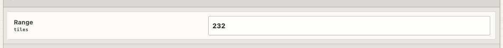
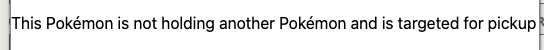

# Agent bug and task tickets

This is the local worklist that you can give to a Codex agent. It does not replace the project's public GitHub issue tracker.

Say “add this as a bug ticket” or “add this as a task ticket.” The agent adds the chat details and any supplied screenshots here. Later, say “fix the open bugs in `TICKETS.md`” or “complete the open tasks in `TICKETS.md`.”

Allowed states are `open`, `in-progress`, `blocked`, and `done`. A ticket is done only when its acceptance checks have evidence. Creating a ticket records work. It does not authorize implementation or publication.

Screenshots are stored in `documentation/ticket-attachments/<ticket-id>/`. Do not add private data, credentials, or ROM-derived files because ticket files can enter Git history.

<!-- tickets:append-below -->

<!-- ticket:TKT-0008:start -->
## TKT-0008 — Stantler always faces north when it stops as a follower

- Type: bug
- Status: done
- Priority: normal
- Created: 2026-09-26T05:03:19Z
- Updated: 2026-10-03T06:37:15Z
- Area: Not provided

### Report

Stantler always looks north when it stops as a follower.

### Expected result

Not provided.

### Actual result

Stantler looks north whenever it stops as a follower.

### Reproduction steps

- Not provided.

### Acceptance checks

- [x] The reported behavior no longer occurs in the stated case, and the relevant checks pass.

### Screenshots

No screenshots supplied.

### Work notes

- 2026-09-26T05:03:19Z — Created from Codex chat.
- 2026-10-01T22:46:28Z — Work started in the existing player-hp worktree. This main-project file is the canonical queue; source work and memory proof stay in that worktree.
- 2026-10-02T01:30:00Z — Fixed the unset Walk output direction that became North. Production-C checks and the retained failing Stantler recording support the change. The permanent current-ROM follower stop test is ready; game acceptance awaits the new build.
- 2026-10-02T09:16:06Z — Current3484 ROM17d4425ffc1f835e7561026435c229cd1fd61a85de0b6f41ade7cf0cf2bf837d passes registered walk.follower.stop-facing with acceptedProof:true, run test-f2fab1c4b6a444eda0b0efc9a420553d,128 observed frames and32 stable idle frames. Source save65c36abc remains unchanged. Shared reader now authenticates the new exact Field Exit wrapper. Final Follower composition and required current-ROM pacing checks remain for the ticket batch.
- 2026-10-03T06:37:15Z — ROM3502 f610408f passes walk.follower.stop-facing with controller acceptedProof:true (test-ee1d0e4268d24cf68fd57c55d94cc636),128 frames. Current-ROM short spawn and unchanged Continue/Mankey zero-stutter gates both pass. The durable copied-data controls and production-C direction proof are retained in the player-hp worktree.
- 2026-10-03T06:37:15Z — ROM3502 f610408f passes walk.follower.stop-facing with controller acceptedProof:true (test-ee1d0e4268d24cf68fd57c55d94cc636),128 frames. Current-ROM short spawn and unchanged Continue/Mankey zero-stutter gates both pass. The durable copied-data controls and production-C direction proof are retained in the player-hp worktree.

### Completion evidence

ROM3502 f610408f passes walk.follower.stop-facing with controller acceptedProof:true (test-ee1d0e4268d24cf68fd57c55d94cc636),128 frames. Current-ROM short spawn and unchanged Continue/Mankey zero-stutter gates both pass. The durable copied-data controls and production-C direction proof are retained in the player-hp worktree.

<!-- ticket:TKT-0008:end -->

<!-- ticket:TKT-0009:start -->
## TKT-0009 — Overworld Pokémon turns every frame when it cannot move

- Type: bug
- Status: done
- Priority: normal
- Created: 2026-09-26T05:05:24Z
- Updated: 2026-10-03T11:56:22Z
- Area: Not provided

### Report

When an overworld Pokémon cannot move, it tends to turn around every frame. One example is Flabébé after it notices the player while it has nowhere to move.

### Expected result

Not provided.

### Actual result

The Pokémon repeatedly turns instead of staying facing one direction while it cannot move.

### Reproduction steps

- Place Flabébé where it has nowhere to move, then let it notice the player. Watch its facing while it remains unable to move.

### Acceptance checks

- [x] The reported behavior no longer occurs in the stated case, and the relevant checks pass.

### Screenshots

No screenshots supplied.

### Work notes

- 2026-09-26T05:05:24Z — Created from Codex chat.
- 2026-10-01T22:46:28Z — Investigating blocked direction selection and retry timing. Root owns live memory reproduction and acceptance.
- 2026-10-02T01:30:00Z — Blocked random Hop now uses the shared wander retry path and keeps facing. Production-C before/after proof passes. Preparing an isolated FlowerBed Flabebe719 fixture to prove real Notice and repeated32-frame blocked retries in the game.
- 2026-10-03T11:43:44Z — ROM3505 native test-ef2a5eb89af24719b8e43807cff69e16 preserves a real FlowerBed Flabebe719 and natural Notice15. Its proof rejects the old Hop direction1 assertion; current Floaty Bounce remains random direction0 because Notice now changes only alert emote/time. The scoped proof, exact metric copies and host controls are aligned to the current authored profile. No product change or native success claimed; fresh96-frame stability acceptance remains.
- 2026-10-03T11:56:22Z — ROM3505 test-4ff599b1e8484976b29640f611d51804 retains103 observed frames, real FlowerBed Flabebe719, natural timed Notice15, and96 consecutive stable native frames with no turn, pose change or movement owner. Fresh host recheck acceptedProof:true passes all13 copied-data controls with the current authored random Hop direction. Original failed source/native evidence is retained; owned session closed.
- 2026-10-03T11:56:22Z — Blocked Flabebe facing is fixed. Current ROM3505 native run test-4ff599b1e8484976b29640f611d51804 passes fresh controller recheck with acceptedProof:true; both current-ROM pacing gates and source save preservation already pass. Evidence: player-hp build/tickets/tkt9-current3505-controls/accepted-recheck-final.json.

### Completion evidence

Blocked Flabebe facing is fixed. Current ROM3505 native run test-4ff599b1e8484976b29640f611d51804 passes fresh controller recheck with acceptedProof:true; both current-ROM pacing gates and source save preservation already pass. Evidence: player-hp build/tickets/tkt9-current3505-controls/accepted-recheck-final.json.

<!-- ticket:TKT-0009:end -->

<!-- ticket:TKT-0010:start -->
## TKT-0010 — Ram should charge at once and continue until it crashes

- Type: bug
- Status: done
- Priority: normal
- Created: 2026-10-01T22:29:14Z
- Updated: 2026-10-03T21:45:46Z
- Area: Overworld behavior profiles / Ram

### Report

Ram stops when it notices the player. It should start ramming at once without losing acceleration. The condition should be seeing the player in a straight line at long range. The user clarified that a whole charge means charging until it crashes, then stopping. The charge must not end after a fixed time. An exact detection range was not provided.

### Expected result

When Ram sees the player in a straight line at long range, it starts charging at once, keeps its current acceleration, and continues until it crashes. It stops at the crash.

### Actual result

Ram stops when it notices the player, and its charge behavior lasts for a fixed time.

### Reproduction steps

- Not provided.

### Acceptance checks

- [x] Ram starts charging as soon as it sees the player in a straight line at long range.
- [x] Entering Ram does not add a pause or reset the current acceleration.
- [x] Seeing the player outside a straight line does not trigger Ram.
- [x] The charge continues until it crashes, then stops.
- [x] A fixed timer cannot end the charge before it crashes.

### Screenshots

No screenshots supplied.

### Work notes

- 2026-10-01T22:29:14Z — Created from Codex chat.
- 2026-10-01T22:46:28Z — Investigating Ram entry, momentum preservation, line detection and crash-controlled end. Will preserve a measured reproduction before edits.
- 2026-10-02T01:30:00Z — Added Until Crash activation, strict forward-line range32, no entry emote pause, heading lock and shared Walk momentum preservation. Real role-adopted Crash delivers the end event. Host controls pass; the registered current-ROM charge/Crash test is ready. The current build is blocked by a measured140-byte Wild code overflow; an unchanged private helper relocation is in progress.
- 2026-10-02T19:55:46Z — Current test3491 native Blue run test-75bdf85c9f814afaa3162494952d6948 exposed a separate Ram entry bug: new Onix faces South toward the player, but zeroed Walk policy direction0/speed0 is treated as a committed North heading. First Ram Walk at772 heads North. Before-edit source and native data are retained in player-hp build/tickets/tkt10-lock-heading. The fix uses a stored heading only with nonzero momentum speed in candidate selection, preview, and shared role requests; existing moving heading and acceleration remain. Actual-C controls and final build are active.
- 2026-10-02T20:13:56Z — Stopped-heading actual-C reproduction now fails40 assertions on the retained old whole source and passes all16 stopped,16 moving and3owner cases on the exact new Wild source310248fd. The one private helper uses the existing Field Walk tail; exact GCC10 compile/link leaves4bytes free in its256-byte slot and4bytes in Wild BSS. Independent placement/lifetime review is green. Fresh Workshop build and the same native Onix trigger remain before closure.
- 2026-10-03T12:44:18Z — Current3505 test-920426ab32204a03a347e5775c100cb3 measures genuine East Ram entry at824 with first16-frame Walk in the same frame, then acceleration, locked heading and off-axis charge beyond96 until real Crash922. A prequeue appearance cache first falsely showed inactive Ram; the completed-frame reader is fixed and independently reviewed. The last checker expected CRASH_PENDING rather than the actual consumed REARM cooldown flags26; corrected against current shared C, with10 host methods green. Final native cooldown16-frame acceptance remains after the next integration build. All owned sessions are closed.
- 2026-10-03T21:45:46Z — ROM3509 6d8f0dc9: controller acceptedProof:true, run test-c09c77c8d062464f8b83b6d9d32889e0. Genuine line entry starts its first Walk in the same frame; 207 completed frames prove acceleration, locked heading, off-axis exclusion, charge beyond96 frames until real Crash,100 cooldown frames and16 exclusion frames. All9 copied faults reject. Retained old native/source momentum failure and actual-C controls are preserved. No accepted movement cancelled.
- 2026-10-03T21:45:46Z — ROM3509 6d8f0dc9: controller acceptedProof:true, run test-c09c77c8d062464f8b83b6d9d32889e0. Genuine line entry starts its first Walk in the same frame; 207 completed frames prove acceleration, locked heading, off-axis exclusion, charge beyond96 frames until real Crash,100 cooldown frames and16 exclusion frames. All9 copied faults reject. Retained old native/source momentum failure and actual-C controls are preserved. No accepted movement cancelled.

### Completion evidence

ROM3509 6d8f0dc9: controller acceptedProof:true, run test-c09c77c8d062464f8b83b6d9d32889e0. Genuine line entry starts its first Walk in the same frame; 207 completed frames prove acceleration, locked heading, off-axis exclusion, charge beyond96 frames until real Crash,100 cooldown frames and16 exclusion frames. All9 copied faults reject. Retained old native/source momentum failure and actual-C controls are preserved. No accepted movement cancelled.

<!-- ticket:TKT-0010:end -->

<!-- ticket:TKT-0011:start -->
## TKT-0011 — Generalize Throw with a shared trigger target and reachable moving cargo

- Type: task
- Status: done
- Priority: normal
- Created: 2026-10-01T22:46:01Z
- Updated: 2026-10-04T05:59:31Z
- Area: Overworld profiles / General Throw / Follower / target queries

### Report

The user wants one general Throw behavior for Pokémon with the right profiles, not a follower-only feature. The condition that starts the reaction captures one shared Trigger target (also described as Aggressor): the identity that caused the reaction. The same pickup, positioning and launch profiles use that identity as their aim, without separate copies for player and Pokémon targets. Cargo is a separate binding and cannot replace Trigger target. Cargo keeps moving and using its own profiles while the thrower chases it; some Pokémon can flee through their own profiles. Cargo selection requires a reachable pickup position under the thrower's resolved movement and terrain rules. Cargo search has no distance limit within the active map scope; actual pickup needs legal reach and height, not an idle dwell. Follower applies before Capability. Follower Mankey is one example: its authored trigger entries select another eligible Pokémon, never the player, and its flight recipient filters protect the player and allied Pokémon. This ticket was first captured as plan only; a separate completion request included it in implementation, as recorded in Work notes. This revision updates requirements only. Implementation plan: [General Throw implementation plan](documentation/overworld-system/follower-throw-implementation-plan.md). The plan separates settled requirements from proposed composition and tuning.

### Expected result

Visible trigger conditions capture the initiating identity as Trigger target. Shared throw profiles pursue separate reachable, free-moving Cargo, pick it up legally, and throw it toward Trigger target. Wild profiles can capture the player; follower profiles capture an eligible Pokémon and protect the player and allies. Ordinary role/Routine behavior resumes when Throw ends.

### Actual result

The user reports that the current follower flow does not let Mankey throw Pokémon. Source inspection in the feature/player-hp task checkout found a late Follower override, rejection of follower carriers, player-only throw-line observation, and cargo reservation handling that pauses selected cargo. The general throw flow needs a persistent trigger identity independent from its cargo-selection target. These are the captured baseline facts, not proof of the current implementation's state.

### Reproduction steps

- Not applicable.

### Acceptance checks

- [x] Follower applies before Capability in shared resolution and the Workshop; active capabilities override it and ordinary follow resumes when they end.
- [x] Wild player-targeted and Follower Pokémon-targeted throws use the same pickup, positioning and launch profile IDs; a changed target does not require a copied throw chain.
- [x] The admitted trigger condition's exact identity is captured once as the shared Trigger target (Aggressor), independently from Cargo, and remains the target through the chain.
- [x] Cargo selection, later observations and targetless stage profiles cannot silently overwrite Trigger target; current target position is used without changing its identity.
- [x] Follower Mankey uses visible profiles to throw distinct Cargo toward a Pokémon Trigger target. Its trigger entries exclude the player; when no valid target/cargo is available it follows normally.
- [x] Wild player-notice trigger entries have explicit Wild subject-role filters; shared throw stages are reusable across roles, and mounted control does not start autonomous Throw.
- [x] Selecting or reserving Cargo does not stop its motion, suppress its profiles, or require an idle dwell before pickup.
- [x] The thrower chases the current Cargo position and performs legal pickup without cancelling accepted movement; include the follower Mankey case.
- [x] Cargo can flee through its own authored profile using the pursuing Pokémon as its target; fleeing is not forced for all cargo.
- [x] The visible reachable-for-pickup filter rejects inaccessible cargo and accepts valid routes under the carrier's resolved Walk/Hop and terrain rules.
- [x] A route lost during pursuit uses the profile's retry response and permits new cargo selection; target search has no hidden distance cutoff.
- [x] Throw positioning and launch use Trigger target for both player and Pokémon identities. Target loss follows the profile's failure response, with no silent player fallback.
- [x] Flight damage uses attacking, speed, damage and an explicit recipient filter. Follower flight filters protect the player and allied Pokémon, including incidental contact; carrying and landing do not retain flight attack settings.
- [x] Target loss, timeouts, failed actions and lifecycle changes leave no stale claim, held orphan or second motion owner; all behavior choices and timing are visible in profiles.
- [x] Focused current-ROM throw/follower regressions and required spawn-work/zero-stutter acceptance pass, with exact evidence recorded.
- [x] The Workshop produces a playable ROM and its verified copy for the user's Open NDS flow.

### Screenshots

No screenshots supplied.

### Work notes

- 2026-10-02T11:17:52Z — Shared Throw now has early Follower resolution, separate full-identity Trigger/Cargo values, visible role/binding/reach/retry controls, Wild-only follower damage recipients, and moving-cargo claim support. Native pursuit consumes the shared route next step through existing Walk/Hop START; pickup waits for completed motion and checks current identities, support, reach and claim. Fixed-code fit and current-ROM acceptance are still open. Per the user, the Mankey check waits until this follower change is linked. Blue tint remains in this batch.

- 2026-10-01T22:46:01Z — Created from Codex chat; plan-only request..
- 2026-10-01T22:51:16Z — Included by the current request to complete tickets, including entries added while work continues. Read-only dependency investigation started; current follower-facing, blocked-facing and Ram bugs come first.
- 2026-10-01T23:01:57Z — User clarified that Throw is general behavior. Updated this ticket and the existing plan to use shared Trigger target/Aggressor plus separate Cargo, reuse the same throw stages across roles, and define follower player/allied exclusions in profiles. This update changes documentation only; status and prior work notes are preserved.
- 2026-10-02T07:35:24Z — Trigger/Cargo identity bindings now have production-C controls. The first bounded route query failed the moving-cargo and open-map controls, so it is being corrected before native integration. A small field-owned relocatable code image is viable in scratch ARM links; native loading, legal movement edges, profiles and game proof remain.
- 2026-10-02T12:02:04Z — Shared Throw code and the loader now fit their fixed homes. Source-C, two-address link, and loader checks pass. The first full Workshop build found a missing Make rule; that rule is fixed and the fresh retry is running. Blue tint, follower Throw and late Ambush still need current-ROM game proof.
- 2026-10-02T12:17:01Z — Third full build exposed two fixed-slot overflows: Wild runtime4 bytes and Task6 helper64 bytes. Exact production object/link reproduction is in progress; no new ROM yet. The public memory-recording command now forwards the bounded Throw interaction option; strict Boolean/default-path checks pass.
- 2026-10-02T12:54:34Z — All35 other current production links pass in an isolated read-only check. The remaining HP overflow is corrected by moving an unchanged private scripted-tile helper into existing HP extension space. HP freeze and its dependent Field wrapper packing/link are being checked before the next full Workshop build. No new ROM or Mankey game check yet.
- 2026-10-02T13:06:00Z — Retry4 passed all37 production links, then the package gate rejected condition callbacks at their old Selector addresses. The callbacks now belong to the authenticated Query addon. Correcting the exact package ownership checks and the related Runtime18 slot4 export before the next V2 retry; no new ROM or Mankey native sample yet.
- 2026-10-02T13:29:56Z — Current package gates and fresh TKT18 HP/Field links now pass. A later completed V2 build reached data packaging and found stale v87 validation. Current blob validation is aligned to recipient bits, actor facts and the appended condition-options table; independent review requires the same fact-mask/overlap rule for all non-terrain conditions before the next build. Blue/Mankey game proof still awaits the first linked ROM.
- 2026-10-02T14:07:13Z — Fresh V2 retry7 passed and published test3486.nds. Worktree and Delta SHA561a10d8f044eb625a8a032346fd48492ea02691d0e57af0eb59c2cf924cf860 match; original Continue save65c36abc remains unchanged. First blue game check was blocked before boot by a stale reader symbol (DoesAllowedTileMatch); exact shared reader repair is in progress. No native Throw or tint success is claimed.
- 2026-10-02T14:35:02Z — Retained current-ROM native boot failure in player-hp build/tickets/tkt11-native-boot-pc.json. The shared ARM query called a borrowed Thumb callback with an even pointer, entering the wrong CPU mode. Eight borrowed route/target callback words are corrected; exact GCC10 data-only link and package controls pass with no code/address/cap shifts. The first valid blue/Mankey field sample still awaits the next Workshop ROM.
- 2026-10-02T15:29:24Z — Fixed the native-slot/compact-observation mask bridge with actual-C RED/GREEN evidence. Wild and Follower Cargo slot holes now return the correct native bit and full Cargo handle; reordered same-frame observations reuse only the exact identity, while stale Cargo/Trigger/wrong-slot masks grant no permission. Fresh game Mankey check remains after the Route29 memory fix; query-only scheduling still needs its native baseline.
- 2026-10-02T19:06:57Z — Fresh Workshop test3491 ROMa1b89fe4 keeps source save65c36abc unchanged and fixes the shared resolver erasing ThrowHeld explicit Trigger-line target while removing carrier locomotion. Whole-production-C oldRED/currentGREEN prove PLAYER/ACTOR targets, both lanes and unchanged normal movement defaults. Native run test-6e450930b11a471eba3e5b27fed723d8 proves movingCargo claim846/commit854/pickup897, Trigger-aimed windup944 and launch965, oldbinding cleanup965, recoveryend1025 and completed normalFollow1044 with commit6/currentcenter/CONTROL_RETURNED. Checker falsely rejects a fresh bind-only GeodudeTrigger captured at1044 while Cargo remains empty and baseFollow remains active. That check is being corrected with the retained native data; no further product change is justified by it. Current-ROM Wild Throw and pacing acceptance remain open.

- 2026-10-03T02:53:57Z — Current test3499 follower run test-63f317822aff40bbae001270a91687ae binds, follows moving Cargo, picks up and enters windup, then aborts at game970 despite all three exact identities remaining current. The retained native call proves an unrelated Geodude preparation clears the shared position cache. The fix refreshes current positions through the existing frame owner before binding reads; identity, expiry and failure checks remain. Final current-ROM Throw proof is open.
- 2026-10-03T04:01:01Z — Current ROM3500 follower Throw passes. Wild Throw still cannot select moving Cargo: retained run test-47cf327b7dfb43f3a62866eef192eff3 and public recording session-c9xbn8kx show Geodude has the exact Player Trigger before Mankey claims a Trigger. Actual-C sparse16 reproduction isolates goal-query quota starvation and repeated route-phase resets; both are fixed, but the current moving-Subject proof control remains Pending and is being fixed before another build. No deadline, distance cutoff, movement owner or acceptance rule was changed.
- 2026-10-03T04:33:20Z — The shared moving-Cargo query fix is now source-ready and independently reviewed. Both near and far moving Cargo and moving Subject cases pass at sparse16 cadence; changed path, stale identity, wrong stamp and own-object controls stay strict. Exact GCC10 package fits24564/24576 bytes with unchanged ABI, one native call and16 work units. Frozen receipt: player-hp build/tickets/tkt11-goal-edge-fairness/freeze.json. Sole Workshop build3501 is running; current-ROM Throw/contact and pacing proof remain.
- 2026-10-03T05:12:35Z — ROM3501 proves the shared Follower pickup, held aim, launch and follow return (test-b5c5732054ed4ba3953f5ac6ed549d98; acceptedProof:true). Both current-ROM Route29 pacing gates pass with the unchanged Continue save. Wild pickup still fails the same500-frame trigger (test-68b552f33121480ab37e4236d07ce7f2); an opt-in native Query receipt will identify its state before another product edit. All owned native jobs closed.
- 2026-10-03T05:35:21Z — ROM3501 same80-frame native diagnostic proves each completed Geodude Walk changes only movementPolicyRevision among CargoQuery compatibility fields: at819 it changes2729586200 to2746363819 and nodeCount falls2 to1. Scope, bounds, request, role, distance, edge list and full identities stay current. The range anchor is now being separated from static search identity while retaining current legal-edge validation. Evidence: player-hp build/tickets/tkt11-final3501-wild-query-seed-diagnostic/geodude-query-fact.json; all owned sessions closed.
- 2026-10-03T06:46:53Z — ROM3502 bounded80-frame native Query diagnostic retains node progress with one constant movement policy120977541, confirming the relative range-anchor fix. Geodude receives only6 search calls and then16-frame gaps while walking (game803,819,835,851); nodes progress1,2,2,3,3. Raw recording ec6aceb2 is retained in the player-hp worktree via build/tickets/tkt11-final3502-wild-query-seed-diagnostic/geodude-query-fact.json. The next fix services the same bounded search during accepted movement without activating profiles or cancelling motion. No Throw success is claimed.
- 2026-10-03T11:42:20Z — ROM3505 test-6490f3cd5cf64bbda37ef35b5d2d2169 retains an exact free Cargo claim and the targeted-Flee condition naming Geodude at game884, but its native resolved lane still targets Player from condition20034. The checker used an unsupported event name; correcting it exposes this real target mismatch. The shared resolver is under investigation; no Flee success claimed. Both private jobs and sessions closed.
- 2026-10-03T12:44:18Z — Current3505 mounted Throw run test-7330b487896f4a829b757daa1ef355df proves mount HP28→14 and restored shared-knockback seat, but also rider100→80 at the original1072 flight despite the separate rider clip missing. Measured cause is reciprocal implicit mount/rider damage forwarding in src/player_health_contact.c. Removed both forwards; actual production StepMotion/Sweep/clip RED→GREEN controls prove mount-only, rider-only and both boxes, and both restored-forward controls reject. Recipient and resident-owner checks pass. Shared same-mask target publication fix is source-reviewed GREEN; exact native fit and one combined Workshop build remain.
- 2026-10-03T20:24:51Z — ROM3509 (6d8f0dc9) passes moving Wild Cargo (test-bc05b8e78a38485ca7ccaf6e5421fd3b), authored Cargo Flee (test-c5ba653142674d1fa4afee65231f3434), Follower Mankey pickup/Throw/follow return (test-e8bd19d8bf3245fc87daae5d6acffc75), and player hit contact (test-3c6b1f02bfcc4c24a680c9944f1dbce7). Finished jobs closed their own sessions. Mounted hit proof still needs exact Trigger/Cargo facts: passive Bellsprout69 fixture did not launch within its unchanged limit. Final spawn pacing and zero-stall checks remain. Original Continue save65c36abc is unchanged.
- 2026-10-04T02:41:40Z — The final source fixes the packed recipient bit overwriting follower Walk speed. Retained native facts also separate a blocked signpost flight and a competing Mankey claim from runtime faults. Strict fixture/claim checks are ready; current final-ROM Throw, contact and pacing acceptance remains.
- 2026-10-04T03:41:41Z — Current ROM3514 accepted Mankey moving-Cargo throw/normal-follow return test-5c924bb93de44183b3c03fedcb390eeb, on-foot damage throw test-e5e9b313f6d0441b95d99ece35370ae5, both real height directions, mount-pose/rebind and both D1 checks (short retry275frames and long2668frames zero late). Mounted raw proves mount-only15 damage/rider100/seat restored; its same-queue return and stale command-order checker are corrected with strict copied controls, fresh acceptance pending. Native Flee shows11 reachable results discarded during accepted Notice Walk before authored Cargo admission; Wildmoving has326 pending/one exhausted and no Cargo claim. Product admission/search fixes are in bounded scratch work; no motion/profile guard or deadline weakened.
- 2026-10-04T04:20:18Z — Current3514 nearer moving-Cargo run test-1554da8c0e5f41c3850ab9e618b6d96b measured13 full current REACHABLE returns, all during accepted Geodude Walk, then no claim; native Flee already shows the same fault. The existing near corridor has loaded metatiles, decoded collision bits clear and no authored surface. The nearer fixture keeps real Cargo Walk, unchanged limits and full identity/claim/launch checks. One shared Cargo-only admission fix is in scratch, with normal movement and profile activation kept at the idle boundary. All owned sessions closed; native final-ROM proof remains.
- 2026-10-04T04:51:19Z — Adopted the guarded shared warm-Cargo fix from build/tickets/tkt11-warm-admission3514. Exact Cargo admission now keeps current reachable results during accepted movement; normal profile activation stays at idle. Two actual-C admission/publication checks, the current moving-branch cadence/loss controls, 14 authenticated Query reader checks, extracted scan-budget checks and population checks pass. Build3515 found the old 880-byte Actor evaluator extent guard; the actual approved function is 876 bytes in the same 880-byte slot, with the fixed frame reader unchanged. That exact package check is being updated before one build retry and current-ROM Throw/D1 acceptance. No ticket closure or game pass is claimed; failed native/build records and source save are retained.
- 2026-10-04T05:06:26Z — ROM3515 4d23951f built and verified in Delta, with the unchanged source save. Current Wild Flee passes acceptedProof:true (test-d3a480bb40a64a58b1775ce74de509ea,121 observations). The nearer moving case test-8eecee45541d48f1bc216cddfc8eef17 now captures full current Cargo during Walk, applies Pickup and chases it with211 REACHABLE queries; only launch remains missing. Exact native events at1095 show Cargo COMMIT/FINISH/CONTROL then new own START before its carrier is checked. There are16 samples with idle adjacent carrier and moving Cargo. This is a completed-move handoff issue; the existing atomic pickup must run before the target starts another step, without cancelling its accepted move. One bounded dispatch-order fix is in scratch. Both owned sessions stopped; final current-ROM Throw and D1 checks remain.
- 2026-10-04T05:41:13Z — Adopted the sealed carrier-first idle dispatch from build/tickets/tkt11-atomic-handoff3515. The existing current-query, role, motion and atomic pickup checks stay in place; PENDING or DEFERRED pickup still permits Cargo to start its own next move. The exact production-C composition fails before the edit and passes after it for both slot orders. Three focused host checks, fixed Wild/Field package bounds, lifetime review, current population checks and extracted scan-budget checks pass. One V2 build3516 is running. Current-ROM moving-Cargo, Throw contact/follower and both D1 checks remain; no ticket closure or game pass claimed.
- 2026-10-04T05:59:31Z — All16 acceptance checks are supported by the shared profile/binding/route/recipient and abort-composition controls plus current ROM3516 Throw/contact/follower/height and both D1 game records. The fresh public controller rechecks accept all nine retained records. Exact identities, results and stopped-session proof: build/tickets/tkt20-final/build3516-final-ticket-acceptance.json.
- 2026-10-04T05:59:31Z — Completed on ROM3516 (SHA256 38e92c4e5b48e9cc3c7205713fdf7052c96074ea1f92de379fcf2e3172fc58d5), with a matching Delta test3516.nds and unchanged source Continue save65c36abc. Geodude captures moving Cargo, keeps its exact Player Trigger, follows the current route, legally picks up completed Cargo and launches it. Cargo keeps its profiles and accepted movement while pursued; a PENDING or DEFERRED pickup lets it start its next normal move. Mankey uses the shared chain toward a Pokémon Trigger and returns to Follow. Current Flee, foot/mounted hit and both height directions pass. The short spawn-work run275 observations and untouched-Continue/Mankey long run2680 observations pass; the long run has zero late loops. All owned sessions are stopped.  [Final current-ROM acceptance and nine current public rechecks](build/tickets/tkt20-final/build3516-final-ticket-acceptance.json) records exact manifests, ROM/save and stopped cleanup. [Handoff fix and production-C RED/GREEN proof](build/tickets/tkt11-atomic-handoff3515/freeze.json) retains the measured old terminal/start order and the fixed shared dispatch. [Checker-only repair](build/tickets/tkt11-moving-acceptance3516/freeze.json) selects the exact bound carrier instead of carriers[0]; all10 copied faults reject. The original failed checker manifest and raw342-frame game record remain unchanged; its public current-input recheck grants acceptance without another boot. Unchanged abort/claim/loss/retry and separate hitbox dependencies remain scoped in build/tickets/tkt11-abort-composition/adopted-freeze.json and build/tickets/tkt11-separate-hitboxes/host-result.json. Full V2 build/package checks, host controls and current game acceptance pass. No commit, push or merge was made.

### Completion evidence

Completed on ROM3516 (SHA256 38e92c4e5b48e9cc3c7205713fdf7052c96074ea1f92de379fcf2e3172fc58d5), with a matching Delta test3516.nds and unchanged source Continue save65c36abc. Geodude captures moving Cargo, keeps its exact Player Trigger, follows the current route, legally picks up completed Cargo and launches it. Cargo keeps its profiles and accepted movement while pursued; a PENDING or DEFERRED pickup lets it start its next normal move. Mankey uses the shared chain toward a Pokémon Trigger and returns to Follow. Current Flee, foot/mounted hit and both height directions pass. The short spawn-work run275 observations and untouched-Continue/Mankey long run2680 observations pass; the long run has zero late loops. All owned sessions are stopped.

[Final current-ROM acceptance and nine current public rechecks](build/tickets/tkt20-final/build3516-final-ticket-acceptance.json) records exact manifests, ROM/save and stopped cleanup. [Handoff fix and production-C RED/GREEN proof](build/tickets/tkt11-atomic-handoff3515/freeze.json) retains the measured old terminal/start order and the fixed shared dispatch. [Checker-only repair](build/tickets/tkt11-moving-acceptance3516/freeze.json) selects the exact bound carrier instead of carriers[0]; all10 copied faults reject. The original failed checker manifest and raw342-frame game record remain unchanged; its public current-input recheck grants acceptance without another boot. Unchanged abort/claim/loss/retry and separate hitbox dependencies remain scoped in build/tickets/tkt11-abort-composition/adopted-freeze.json and build/tickets/tkt11-separate-hitboxes/host-result.json. Full V2 build/package checks, host controls and current game acceptance pass. No commit, push or merge was made.

<!-- ticket:TKT-0011:end -->

<!-- ticket:TKT-0012:start -->
## TKT-0012 — Pokémon can lose surface height during a map transition

- Type: bug
- Status: done
- Priority: normal
- Created: 2026-10-01T23:03:42Z
- Updated: 2026-10-03T08:26:52Z
- Area: Overworld map transitions / surface height

### Report

During a map transition, Pokémon may lose their current surface height. A Pokémon on a roof can become unelevated and appear inside the building. A Pokémon on a signpost can end up at the base of the signpost. The exact maps, species, transition method, frequency and cause were not provided. This request records the bug only.

### Expected result

Pokémon retained through a map transition remain at the correct height for their roof or signpost surface.

### Actual result

After a map transition, an elevated Pokémon may lose its height and appear inside a building or at the base of a signpost.

### Reproduction steps

- Observe a Pokémon on a roof or signpost, perform a map transition, then check whether the Pokémon still appears at the correct surface height. Exact maps and transition steps were not provided.

### Acceptance checks

- [x] A Pokémon retained on a roof through a map transition keeps the correct roof height and does not appear inside the building.
- [x] A Pokémon retained on a signpost through a map transition keeps the correct signpost height and does not appear at its base.

### Screenshots

No screenshots supplied.

### Work notes

- 2026-10-01T23:03:42Z — Created from Codex chat.
- 2026-10-01T23:37:54Z — Read-only investigation found a retained-object rebind path that preserves native ground Y rather than the authored support height. A measured map-transition reproduction is still required.
- 2026-10-02T00:15:54Z — Measured canceled Fly In roof failure in melonDS: same Hoothoot163 encounter returned to its roof target566403 with nativeY202112, while the loaded ROOFTOP9303 supports261456. Retained recording22dafe94f86e2b7ec7ecbbec5dbd190267806200cf20b6879fdb7153d35ae497 plus live surface receipt are in the player-hp worktree. Private Wild REBIND now restores absolute support after NORMALIZE; relative canopy is unchanged. Extracted production-C height and identity controls pass. Current-ROM roof and sign acceptance remains.
- 2026-10-03T08:26:52Z — Roof and signpost retention passed on ROM3503 (SHA256 861941608a9ab16c9818178921db8a2bd6e7422e9cdbdc0b74c60c36e2339bad). Controller accepted world.transition.wild-roof-height run test-ac7022b1e7ae476987bc19005442321b and world.transition.wild-signpost-height run test-1971ec345789461b961ca1c45b6a732c. Both owned sessions closed. Surface-height product source is unchanged by the later Cargo query fix.
- 2026-10-03T08:26:52Z — Retained roof and signpost actors keep their supported height through the measured map transition. Native support, full actor identity and terminal rebind checks passed; manifest paths are in the player-hp worktree build/overworld-devtools under the two recorded run IDs.

### Completion evidence

Retained roof and signpost actors keep their supported height through the measured map transition. Native support, full actor identity and terminal rebind checks passed; manifest paths are in the player-hp worktree build/overworld-devtools under the two recorded run IDs.

<!-- ticket:TKT-0012:end -->

<!-- ticket:TKT-0013:start -->
## TKT-0013 — Give Ambush a longer duration and short varied pauses between hops

- Type: task
- Status: done
- Priority: normal
- Created: 2026-10-01T23:04:33Z
- Updated: 2026-10-03T06:37:15Z
- Area: Overworld behavior profiles / Ambush / Hop timing

### Report

Ambush needs to last longer and have subtle pauses between each hop, with some timing variance. It should still feel fast, but should not feel as instant as it does now. Exact duration, pause length and variance values were not provided. Keep the timing choices in profile parameters, in line with the existing behavior design. This request records the task only.

### Expected result

Ambush lasts longer overall. Short pauses with timing variance separate its hops, while the attack still feels fast.

### Actual result

The user reports that the current Ambush feels too instant.

### Reproduction steps

- Not applicable.

### Acceptance checks

- [x] Ambush lasts longer than its current baseline.
- [x] Successive Ambush hops have subtle pauses with timing variance, controlled by profile parameters.
- [x] The user playtest confirms that Ambush still feels fast and no longer feels instant.

### Screenshots

No screenshots supplied.

### Work notes

- 2026-10-01T23:04:33Z — Created from Codex chat.
- 2026-10-01T23:37:55Z — Preparing profile tuning using the existing shared Movement Chain pause and variance; no second Hop timing engine.
- 2026-10-01T23:43:33Z — Implemented profile tuning in feature/player-hp: duration 36 to 90 frames; shared passive Movement Chain pause after each Hop, six-frame base plus four-frame variance. Generator and extracted passive-chain checks pass. Current-ROM timing and user feel checks remain.
- 2026-10-02T00:15:54Z — The shared reducer converts the pause clock to half its authored value. Tuning is now chain base12/variance8 so the native pause is6..10 frames; duration90 and Hop time6 remain. Game timing and user feel checks remain.
- 2026-10-03T00:13:38Z — User playtest confirms that the longer Ambush feels right. The playtest check is complete. Final shared ROM memory proof will reuse the moving-heal run for active duration90 and varied passive pauses6..10.
- 2026-10-03T06:37:15Z — ROM3502 accepted moving-heal run test-349528e540004f09a86c80bcbb60f952 proves the same current Weepinbell Ambush:90 Actor frames, profile pauses6..10 with observed7,10,7,10,9,10,6. Retained reuse receipt build/tickets/tkt13-17-final3502.json has no proof gaps. User confirms the longer Ambush feels right. Same-ROM pacing gates pass.
- 2026-10-03T06:37:15Z — ROM3502 accepted moving-heal run test-349528e540004f09a86c80bcbb60f952 proves the same current Weepinbell Ambush:90 Actor frames, profile pauses6..10 with observed7,10,7,10,9,10,6. Retained reuse receipt build/tickets/tkt13-17-final3502.json has no proof gaps. User confirms the longer Ambush feels right. Same-ROM pacing gates pass.

- 2026-10-03T07:24:27Z — User reconfirms the current longer Ambush: “it feels right.” Keep duration and pause timing unchanged.

### Completion evidence

ROM3502 accepted moving-heal run test-349528e540004f09a86c80bcbb60f952 proves the same current Weepinbell Ambush:90 Actor frames, profile pauses6..10 with observed7,10,7,10,9,10,6. Retained reuse receipt build/tickets/tkt13-17-final3502.json has no proof gaps. User confirms the longer Ambush feels right. Same-ROM pacing gates pass.

<!-- ticket:TKT-0013:end -->

<!-- ticket:TKT-0014:start -->
## TKT-0014 — Add Lurk Routine from Idle and move Idle Pokémon assignments

- Type: task
- Status: done
- Priority: normal
- Created: 2026-10-01T23:06:50Z
- Updated: 2026-10-03T03:23:28Z
- Area: Overworld behavior profiles / Routine / Idle / Lurk

### Report

Add a new Routine profile named Lurk as a duplicate of Idle. Its only settings difference from Idle must be Behavior set to Chase; preserve all other settings. Move the Pokémon currently assigned to Idle to Lurk, retaining Idle as a separate profile. Use the current Idle settings and assignments when implementation starts. This request records the task only; it does not change profiles now.

### Expected result

Lurk is a Routine profile with the same settings as Idle except Behavior = Chase. All Pokémon previously assigned to Idle are assigned to Lurk instead. Idle remains available with its existing settings.

### Actual result

Not applicable.

### Reproduction steps

- Not applicable.

### Acceptance checks

- [x] A new profile named Lurk exists and is classified as Routine.
- [x] Lurk duplicates the current Idle settings; its only settings difference is Behavior = Chase.
- [x] All Pokémon assigned to Idle before the change are moved to Lurk, with no Pokémon assignments left on Idle and no unrelated assignments changed.
- [x] Idle remains a separate profile with its existing settings.

### Screenshots

No screenshots supplied.

### Work notes

- 2026-10-01T23:06:50Z — Created from Codex chat.
- 2026-10-01T23:37:55Z — Preparing Lurk from the current Idle profile and preserving application identity and unrelated assignments.
- 2026-10-01T23:43:34Z — Implemented Lurk as an exact Idle copy with only Behavior=Chase. Idle is unchanged. Existing apply-idle keeps its ID, index, target and three members but now applies Lurk. Portable C before/after resolution changes only Behavior in both lanes for Weepinbell, Victreebel and Carnivine; Stantler, Geodude and Pidgey resolve unchanged. Receipt: player-hp worktree build/tickets/tkt13-14-authoring-proof.json. Required current-ROM pacing remains.
- 2026-10-03T03:23:28Z — Authoring receipt tkt14-current3491-authoring.json exactly matches current catalog SHA5334931a. Lurk is Routine and differs from unchanged Idle only in Chase; all three former Idle members moved, unrelated assignments unchanged. Current ROM3500 required D1 short test-e26a19d2603b4669918bb7702ebf58c7 and long test-1251857360554e29abb8a70ad459bd57 are controller-accepted passes.
- 2026-10-03T03:23:28Z — Lurk delivered. Exact authored/portable-C before-and-after proofs retained in player-hp build/tickets/tkt13-14-authoring-proof.json and tkt14-current3491-authoring.json. Same-catalog ROM3500 pacing gates pass; no extra game case is required for this catalog-only change.

### Completion evidence

Lurk delivered. Exact authored/portable-C before-and-after proofs retained in player-hp build/tickets/tkt13-14-authoring-proof.json and tkt14-current3491-authoring.json. Same-catalog ROM3500 pacing gates pass; no extra game case is required for this catalog-only change.

<!-- ticket:TKT-0014:end -->

<!-- ticket:TKT-0015:start -->
## TKT-0015 — Tint damaged Pokémon red, with stronger tint at lower HP

- Type: task
- Status: done
- Priority: normal
- Created: 2026-10-01T23:07:29Z
- Updated: 2026-10-03T08:44:52Z
- Area: Overworld Pokémon / HP / appearance

### Report

Pokémon that have taken damage should be tinted red. The tint should get stronger as they are more hurt, interpreted as having less remaining HP. Exact tint strength, thresholds and colour values were not provided. This request records the task only.

### Expected result

Damaged overworld Pokémon have a red tint that becomes stronger as their HP falls. The tint reflects their current health.

### Actual result

Not applicable.

### Reproduction steps

- Not applicable.

### Acceptance checks

- [x] An overworld Pokémon with missing HP has a visible red tint.
- [x] Greater injury produces a stronger red tint; exact strength and thresholds are tuned during implementation.
- [x] The tint updates when HP changes and is removed when the Pokémon returns to full HP.

### Screenshots

No screenshots supplied.

### Work notes

- 2026-10-01T23:07:29Z — Created from Codex chat.
- 2026-10-01T23:16:44Z — The user identified the HeartGold decompilation as the key reference for implementing the tint. Start with the [local reference guide](.codex-reference/README.local.md), then inspect the named C/assembly source in `.codex-reference/pokeheartgold/` for tint and palette handling. Keep the reference read-only. This is an implementation lead, not a verified tint solution.
- 2026-10-01T23:43:34Z — Started read-only HeartGold decomp investigation for a safe per-actor material tint that does not alter shared palettes.
- 2026-10-02T00:15:54Z — Prepared one shared, unlinked appearance module using a private stock 3D palette per actor. Production-C palette, material callback and generation tests pass. Code placement, field/lifecycle hooks and current-ROM palette proof remain; no visual success claimed.
- 2026-10-02T01:30:00Z — The shared private-palette tint code is packaged in retired stock Field1 graphics-table space. It remains inactive: no render or teardown hooks yet. Safe update, removal and Field Exit guard points are identified from the decomp. Native tint proof remains.
- 2026-10-02T08:18:19Z — Connected the shared private-palette module at the field frame, slot deletion and stock Field Exit. Native guards keep the resident Actor identity and current map; mounted uses the Pokemon body. Production-C controls prove HP tint strength/full-HP removal and recall-safe unload. The tint is now active in source; exact packaged fit and current-ROM palette/upload/material proof remain.
- 2026-10-03T08:44:52Z — Accepted ROM3504 native palette proof: pokemon-appearance.damage-palette run test-49225a60b5864e6f96e59040600c676a, 1007 observed frames. Real hit HP, per-owner SDK upload/MAT palette use, injury strength, fully-off/on pulse, stock Nurse healing and full-HP tint removal pass. All 11 copied bad-data controls reject. Owned session-v4t6cq52 closed. ROM/Delta SHA2339ef4bf7c33e49d1dcac8d47723e0bad29ff092eb14a03b8c076d6023341c7; source save unchanged.
- 2026-10-03T08:44:52Z — Damaged overworld Pokemon use a private red palette that tracks HP. The palette returns to normal at full HP. Accepted manifest is in player-hp worktree build/overworld-devtools/test-49225a60b5864e6f96e59040600c676a/manifest.json.

### Completion evidence

Damaged overworld Pokemon use a private red palette that tracks HP. The palette returns to normal at full HP. Accepted manifest is in player-hp worktree build/overworld-devtools/test-49225a60b5864e6f96e59040600c676a/manifest.json.

<!-- ticket:TKT-0015:end -->

<!-- ticket:TKT-0016:start -->
## TKT-0016 — Show optional blue rest tint while conditional profiles are blocked by cooldown

- Type: task
- Status: done
- Priority: normal
- Created: 2026-10-01T23:15:34Z
- Updated: 2026-10-03T12:27:15Z
- Area: Overworld conditional profiles / cooldown / appearance

### Report

Resting Pokémon should have a slight blue tint. Resting means no conditional profile is active and all applicable conditional profiles are blocked by cooldown, so the Pokémon cannot enter any of them. Each conditional profile must have a Show rest tint during cooldown on/off option. Blue additionally requires at least one of the blocked profiles to have that option on. Pokémon with no applicable conditional profiles, or with no tint-enabled conditional profiles, must not turn blue. Use existing profile activity and cooldowns; do not add a separate recovery state/timer or special rules for Ambush or Ram. Normal Routine movement can continue while resting. Exact blue strength, the option's default, and interaction with the red damage tint in TKT-0015 were not decided. This request records the task only.

### Expected result

A slight blue tint shows temporary inability to enter conditional behavior because of cooldowns, only when an applicable conditional profile enables the tint. No qualifying profiles means no blue.

### Actual result

Not applicable.

### Reproduction steps

- Not applicable.

### Acceptance checks

- [x] Each conditional profile exposes a Show rest tint during cooldown on/off option.
- [x] A slight blue tint appears only when no conditional profile is active, all applicable conditional profiles are blocked by cooldown, and at least one blocked profile has the tint option on.
- [x] A Pokémon with no applicable conditional profiles never turns blue under this rule; an empty profile set is not a resting state.
- [x] A Pokémon whose applicable conditional profiles all have the tint option off does not get the blue rest tint.
- [x] The blue rest tint is removed when a conditional profile becomes available again or a conditional profile becomes active.
- [x] Rest tint is derived from profile activity and existing cooldowns, without a separate recovery timer or special Ambush/Ram rule.
- [x] The tint does not force a pause or change movement; the normal resolved Routine remains in control while conditional profiles are inactive.

### Screenshots

No screenshots supplied.

### Work notes

- 2026-10-01T23:15:34Z — Created from Codex chat.
- 2026-10-01T23:16:44Z — The user identified the HeartGold decompilation as the key reference for implementing the tint. Start with the [local reference guide](.codex-reference/README.local.md), then inspect the named C/assembly source in `.codex-reference/pokeheartgold/` for tint and palette handling. Keep the reference read-only. This is an implementation lead, not a verified tint solution.
- 2026-10-01T23:43:34Z — Started shared conditional cooldown and native tint investigation; rest uses existing activity/cooldown state, with no extra rest clock or movement owner.
- 2026-10-02T00:15:54Z — Prepared an unlinked shared policy view of existing condition flags and cooldowns. Production-C checks cover empty/disabled sets, an active profile, one available profile, cooldown expiry and frame wrap. No recovery clock or movement change. Authoring option, integration and current-ROM proof remain.
- 2026-10-02T08:00:37Z — Added a strict conditional-profile Show rest tint during cooldown toggle, default off and not inherited. Catalog mask is appended after the existing blob tables; all old offsets stay fixed. Enabled the option on Ram and Ambush for playtest. Shared native tint hooks now read HP and current condition cooldowns without changing movement. Current-ROM color/material and removal proof remains.
- 2026-10-02T12:17:01Z — Read-only review found that prepared entries are filtered by species/context, while role/binding-inapplicable entries are cleared to zero. The rest-tint check still counts those entries and can reject a valid rest state. Current-ROM baseline and shared applicability correction remain. Wild Onix has only applicable Notice/Ram entries, so its natural cooldown overlap must be measured separately.
- 2026-10-02T12:28:55Z — Refined the applicability review against the written contract: wrong-role entries and bindOnly entries do not apply a profile and must be skipped. A missing usesBinding prerequisite still blocks blue because it is not a cooldown block. Plan: share the existing role check and pass the current Actor role directly; no cached applicability flag or extra timer. Onix Notice lasts960 frames and its cooldown ends970, so its natural overlap must be measured.
- 2026-10-02T15:04:06Z — Corrected the shared rest policy to skip wrong-role and bind-only entries and use the current Actor role. Missing binding/state and real cooldown checks still veto blue. Before-edit actual-C failures and passing native role wiring controls are retained in player-hp build/tickets/tkt16-rest-applicability and tkt16-native-role-host.log. Exact Field link and game blue proof remain; Route29 stock heap failure is being fixed first.
- 2026-10-02T19:55:46Z — Final current-ROM Blue run test-75bdf85c9f814afaa3162494952d6948 correctly stops before Notice: freshly bound South-facing Onix charges North due to the zero-speed heading bug recorded in TKT-0010, so it never enters its3-tile Notice range. The full Notice/Ram cooldown requirement remains unchanged. Correct the product heading, then repeat this same fixture before altering tint or timing.
- 2026-10-03T12:27:15Z — Shared policy/source/UI controls cover toggle off, empty/wrong-role/bind-only sets, active/available conditions, exact cooldown expiry and routine ownership. CurrentROM3505 healthy Weepinbell test-40740909ea08442c9410d45d25d9de9a acceptedProof:true proves970 native frames, both real Notice960/CD970 and Ambush90/CD126 inactive cooldown overlap, exact stock Field VBlank SDK blue bytes and matching MAT command, then natural stock clear. No profile/timer/RNG/HP writes during observation; normal20-frame retreat and12-frame approach receipts. Original Onix fixture failures retained, with no UntilCrash claim from this timed variant.
- 2026-10-03T12:27:15Z — Optional blue cooldown tint is implemented and accepted on current test3505. Healthy Weepinbell native timed-case test-40740909ea08442c9410d45d25d9de9a passed and closed its private session. Entire applicable conditional set, current identity/fullHP, actual palette upload/material use and natural removal are proved; shared policy uses existing cooldown clocks and leaves routine movement unchanged.

### Completion evidence

Optional blue cooldown tint is implemented and accepted on current test3505. Healthy Weepinbell native timed-case test-40740909ea08442c9410d45d25d9de9a passed and closed its private session. Entire applicable conditional set, current identity/fullHP, actual palette upload/material use and natural removal are proved; shared policy uses existing cooldown clocks and leaves routine movement unchanged.

<!-- ticket:TKT-0016:end -->

<!-- ticket:TKT-0017:start -->
## TKT-0017 — Conditional profiles can trigger very late even without cooldown

- Type: bug
- Status: done
- Priority: normal
- Created: 2026-10-02T10:49:16Z
- Updated: 2026-10-03T06:37:15Z
- Area: Overworld conditional profiles / activation timing / Ambush

### Report

A condition can take a very long time to apply even when it is not on cooldown. The user reports that an Ambush Pokémon can see the player but waits a long time before triggering. Exact delay, Pokémon species, map, profile settings and cause were not provided. This request records the bug only.

### Expected result

When its condition is satisfied and not on cooldown, the conditional profile applies at the next legal intent boundary without an unexplained long wait. Existing accepted motion still completes normally.

### Actual result

An Ambush Pokémon reportedly sees the player and is not on cooldown, but can wait a long time before the condition triggers.

### Reproduction steps

- With an Ambush Pokémon not on cooldown, bring the player into its Vision and observe the time before Ambush activates. Exact species, map and timing were not provided.

### Acceptance checks

- [x] The reported Ambush case no longer has an unexplained long delay once its condition is satisfied and cooldown is clear.
- [x] Eligible conditional profiles apply at the next legal intent boundary; activation does not cancel accepted motion or bypass an actual cooldown.

### Screenshots

No screenshots supplied.

### Work notes

- 2026-10-02T10:49:16Z — Created from Codex chat.
- 2026-10-02T11:33:52Z — Started tracing the Ambush condition and normal pause gates. Current-ROM timing proof will follow the linked Follower change; existing accepted motion must finish before a new condition intent.
- 2026-10-02T17:48:12Z — Current3489 native RED retained in player-hp build/tickets/tkt17-native-red-window.json. At game1069 the player is adjacent to current Weepinbell70, Actor is IDLE, no emote or condition cooldown is active, yet its ordinary movement pause delays activation until1081. The source fix checks conditions before that pause and keeps accepted motion/alert gates. Exact per-frame checked mask and fixed-code fit are being finished; no game success claimed.
- 2026-10-02T19:28:24Z — Current test3491 native before/after window is retained in the player-hp worktree build/tickets/tkt17-current3491-window.json. Weepinbell is idle with 52 frames of ordinary pause left when the player first enters Vision at game826; Ambush resolves in that same frame. The authored 10-frame alert finishes at836 and the first Hop starts837. The old unexplained pause is gone; existing accepted motion and alert timing remain. Registered final acceptance is still open.
- 2026-10-03T06:37:15Z — ROM3502 accepted run test-349528e540004f09a86c80bcbb60f952 proves Vision and Ambush resolution in game832 despite52 ordinary pause frames. The authored10-frame alert ends842; Hop starts843. Accepted Hop at914 finishes925 through the scheduled922 expiry before new resolution. Retained build/tickets/tkt13-17-final3502.json has no proof gaps; the old3489 delay and actual-C controls remain preserved.
- 2026-10-03T06:37:15Z — ROM3502 accepted run test-349528e540004f09a86c80bcbb60f952 proves Vision and Ambush resolution in game832 despite52 ordinary pause frames. The authored10-frame alert ends842; Hop starts843. Accepted Hop at914 finishes925 through the scheduled922 expiry before new resolution. Retained build/tickets/tkt13-17-final3502.json has no proof gaps; the old3489 delay and actual-C controls remain preserved.

### Completion evidence

ROM3502 accepted run test-349528e540004f09a86c80bcbb60f952 proves Vision and Ambush resolution in game832 despite52 ordinary pause frames. The authored10-frame alert ends842; Hop starts843. Accepted Hop at914 finishes925 through the scheduled922 expiry before new resolution. Retained build/tickets/tkt13-17-final3502.json has no proof gaps; the old3489 delay and actual-C controls remain preserved.

<!-- ticket:TKT-0017:end -->

<!-- ticket:TKT-0018:start -->
## TKT-0018 — Allow player HP healing while moving

- Type: task
- Status: done
- Priority: normal
- Created: 2026-10-02T12:46:15Z
- Updated: 2026-10-03T06:37:15Z
- Area: Player HP / healing

### Report

Remove the requirement for the player to stand still to heal HP. The player should be able to recover HP while moving, rather than having to stop to recover. Movement alone must not prevent healing from starting, reset healing eligibility, or stop ongoing healing. This is player healing, not Pokémon healing. Changes to healing rate, any delay after taking damage, or menu/battle pause rules were not requested. The original request was capture only; the user later explicitly included this ticket in the active implementation batch.

### Expected result

Player HP can heal while the player moves as well as while standing still, subject to the other existing healing rules.

### Actual result

The standing-still requirement blocks player HP recovery while moving.

### Reproduction steps

- Not applicable.

### Acceptance checks

- [x] Player HP healing can start while the player is moving once the other healing requirements are met.
- [x] Movement alone does not reset healing eligibility or stop ongoing healing, on foot or while mounted.
- [x] Healing rate, damage-related delay and menu/battle pause rules remain unchanged unless a separate requirement calls for a change.

### Screenshots

No screenshots supplied.

### Work notes

- 2026-10-02T12:46:15Z — Created from Codex chat.
- 2026-10-02T13:03:16Z — The user explicitly included this ticket in the active implementation batch. Remove only the movement/stillness healing gate; retain rate, damage delay and menu/battle rules. Source and current-ROM proof will use the player-hp worktree.
- 2026-10-02T13:17:40Z — Implemented the shared HP model change: movement preserves the existing damage-free wait and healing remainder; hits still reset both. Existing production-C model and save controls pass, with before-edit movement failure retained in player-hp build/tickets/tkt18-moving-heal. Signature, state layout, rate and paused-frame behavior stay fixed. Fresh HP/Field link and current-ROM on-foot/mounted game proof remain.
- 2026-10-02T19:28:24Z — Current test3491 real-hit walking run proves HP100 to80, then HP80 at300 eligible frames, remainder50 at305, HP81 at306 and HP90 at360 while moving. Single hit, same Field and source save; native recording retained via build/tickets/tkt18-moving-heal/manual-foot2-export.json in the player-hp worktree. Mounted run also heals on a measured safe road with one hit and current Cyndaquil anchor; exact registered on-foot and mounted acceptance is being finished. No ticket closed.
- 2026-10-03T05:16:45Z — ROM3501 foot healing passes384 measured frames (test-ba44cfa5c74a4bf485acc193616bae58; acceptedProof:true). Mounted test stops at an unbounded native random action-set picker after a long real sequence of RNG draws (test-33f140b12fd64a248e3f2eb3b4a3a667). The fix selects an allowed rank with one draw; it keeps the chance and choices. Exact old-C RED18draws and new-C GREEN are retained; fixed-slot fit and the same mounted game trigger remain.
- 2026-10-03T06:37:15Z — ROM3502 passes both registered moving-heal cases with acceptedProof:true: on foot test-349528e540004f09a86c80bcbb60f952 (384 frames), mounted test-d7b8ff6a18674a2a821c91ce15e3959d (387 frames). Both private sessions closed and source save65c36abc unchanged. Existing actual-C model controls prove movement alone keeps heal eligibility/remainder while rate, damage delay and paused-frame behavior stay unchanged. The bounded random picker also passes its retained old-C negative and exact-slot checks. Same-ROM pacing gates pass.
- 2026-10-03T06:37:15Z — ROM3502 passes both registered moving-heal cases with acceptedProof:true: on foot test-349528e540004f09a86c80bcbb60f952 (384 frames), mounted test-d7b8ff6a18674a2a821c91ce15e3959d (387 frames). Both private sessions closed and source save65c36abc unchanged. Existing actual-C model controls prove movement alone keeps heal eligibility/remainder while rate, damage delay and paused-frame behavior stay unchanged. The bounded random picker also passes its retained old-C negative and exact-slot checks. Same-ROM pacing gates pass.

### Completion evidence

ROM3502 passes both registered moving-heal cases with acceptedProof:true: on foot test-349528e540004f09a86c80bcbb60f952 (384 frames), mounted test-d7b8ff6a18674a2a821c91ce15e3959d (387 frames). Both private sessions closed and source save65c36abc unchanged. Existing actual-C model controls prove movement alone keeps heal eligibility/remainder while rate, damage delay and paused-frame behavior stay unchanged. The bounded random picker also passes its retained old-C negative and exact-slot checks. Same-ROM pacing gates pass.

<!-- ticket:TKT-0018:end -->

<!-- ticket:TKT-0019:start -->
## TKT-0019 — Soften the red damage tint and make it pulse

- Type: task
- Status: done
- Priority: normal
- Created: 2026-10-02T13:05:39Z
- Updated: 2026-10-03T11:02:48Z
- Area: Overworld Pokémon / damage tint / appearance

### Report

The current red damage tint is visually too strong. Reduce its strength and make the damage tint pulse. This is a follow-up to TKT-0015, which defines the Pokémon damage tint. Keep the existing relationship between injury and tint strength while reducing the overall effect. The user clarified that the pulse must run from fully off to on. Greater injury must make it pulse faster, and slight injury must make it pulse slower. Exact timing thresholds were not provided.

### Expected result

Damaged Pokémon have a softer red tint that pulses over time, while greater injury still gives a stronger damage indication.

### Actual result

The user reports that the current red damage tint is visually too strong.

### Reproduction steps

- Not applicable.

### Acceptance checks

- [x] The red damage tint is weaker than the current version and the user playtest confirms the softer appearance.
- [x] The red damage tint visibly pulses over time.
- [x] Each damage pulse reaches fully off and then on, without a blue flash during its off phase.
- [x] Greater injury makes the pulse faster; slight injury makes it slower.
- [x] The pulsing tint still reflects injury severity and is removed at full HP, as required by TKT-0015.

### Screenshots

No screenshots supplied.

### Work notes

- 2026-10-03T09:13:13Z — The user reports that the tint never visibly turns off at the pulse valley. Reopened the off-phase check. ROM3504 palette data proved zero strength, but that does not close the visible report; inspect draw use and give the valley a clear fully-off interval.

- 2026-10-03T08:45:07Z — ROM3504 native damage-palette proof accepted (test-49225a60b5864e6f96e59040600c676a):1007 measured frames, fully off/on pulse, no blue off-phase, injury-driven period128/64/32, injury strength and normal Nurse/full-HP removal. All11 copied controls reject. The user appearance reply is still pending; its first acceptance check remains open.

- 2026-10-02T13:05:39Z — Created from Codex chat.
- 2026-10-02T13:06:42Z — Included by the active request to complete tickets added during this batch. Use a softer injury-dependent red tint with a shared existing frame clock for its pulse; keep full-HP removal and blue precedence rules. Native palette proof and user feel check remain.
- 2026-10-02T14:32:03Z — Implemented softer64-Actor-frame red pulse using the existing palette and clock. Peak is at most6/16 instead of12/16; injury ordering/full-HP clear stay intact. Exact GCC10 Field link passes in existing space; all public pins/layouts are fixed. Actual-C native glue and palette replay controls pass, including rising/falling at unchanged HP and rejection of pulse changes as a second hit. Game palette proof and user appearance check remain.
- 2026-10-03T00:13:38Z — User rejects the pulse trough: it must go fully off to on, with faster pulses at greater injury and slower pulses at slight injury. Shared palette implementation and exact existing meter are being updated together; no second tint engine or clock. Ambush user check separately passed.
- 2026-10-03T10:14:35Z — User reports that the pulse never becomes fully clear. Current source now has a half-cycle zero-strength valley and MAT retains the stock palette address there. Actual-C controls pass; current-ROM appearance proof and user-visible result remain open.
- 2026-10-03T10:45:22Z — ROM3505 is built. The retained native damage run test-09334f84f9274b12a84a618f95bbae69 proves injured Mounted Cyndaquil and Wild Snorlax use exact stock palette bytes and the original MAT word during RED0, and tinted bytes/private MAT words during ON. Ten paired SDK uploads completed in Field VBlank. Full-HP healing proof stopped because the next-frame knockback was active; add a settled wait before the nurse warp. User appearance check remains open.
- 2026-10-03T10:56:59Z — ROM3505 registered damage-palette run test-bbc5eda7c7a541d7aed111f5c661b426 passed with controller acceptedProof:true and closed owned session.992 observed frames prove two real mounted hits, Wild injury, original palette and unchanged MAT word during RED0, rising/falling tint ON, no blue off-phase, completed stock Field VBlank uploads, normal Nurse healing of the same party member and full-HP stock draw restore. The soft appearance/user-visible check remains open; test3505.nds is ready through Open NDS.
- 2026-10-03T11:02:48Z — ROM3505 registered damage-palette test-bbc5eda7c7a541d7aed111f5c661b426 accepted992 measured frames with exact original OFF palette/MAT, tint ON, VBlank-completed uploads and normal full-HP healing. User now confirms through Open NDS3505 that the pulse fully clears and reports no black blink.
- 2026-10-03T11:02:48Z — Delivered soft injury-based red pulse with a half-cycle fully clear valley. Native palette/full-HP proof passes and the user confirms the currentROM appearance.

### Completion evidence

Delivered soft injury-based red pulse with a half-cycle fully clear valley. Native palette/full-HP proof passes and the user confirms the currentROM appearance.

<!-- ticket:TKT-0019:end -->

<!-- ticket:TKT-0020:start -->
## TKT-0020 — Game freezes when entering Route 29

- Type: bug
- Status: done
- Priority: normal
- Created: 2026-10-02T14:54:40Z
- Updated: 2026-10-03T03:23:28Z
- Area: Field transition / memory

### Report

The user reports that the game freezes when going into Route 29 from the current player-hp worktree ROM.

### Expected result

The player can enter Route 29 and keep playing.

### Actual result

The game freezes on entering Route 29.

### Reproduction steps

- Use the worktree UI Open NDS button, choose Continue, and walk into Route 29.

### Acceptance checks

- [x] Repeat the same normal walk into Route 29 on the current ROM without a freeze.
- [x] Keep the source save unchanged and retain memory-backed before and after proof.

### Screenshots

No screenshots supplied.

### Work notes

- 2026-10-02T14:54:40Z — Created from Current Codex chat.
- 2026-10-02T14:54:40Z — Reproduced on test3487 with unchanged Continue save and normal keys only. Native data abort at Route29 seam, game frame792/player576398. Stock map load receives a null allocation. Before-edit data is in player-hp build/tickets/route29-freeze-step-east-seam.json. Field heap ownership/headroom fix is active; no ticket is closed.
- 2026-10-02T15:04:06Z — Independent source checks confirm native LR0203FD24 is InitScriptContext writing to a null context from stock CreateScriptContext heap11 allocation. Current Wild fixed allocations use74152 bytes of stock heap11 capacity114688 before stock map data; the optional shared Cargo work buffer adds28544. No duplicate query or cleanup leak found. Actual parent/field heap free-block data is the bounded next check for the allocation-owner fix.
- 2026-10-02T15:29:24Z — Measured current stock heaps with an authenticated read-only diagnostic: heap3free0, heap11free16/largest12, heap4free171016/largest117780. Moved Query code and one work buffer to existing heap4 with32KiB reserve. Added early parent-Field drain and fixed cleanup-before-Selector release order. Actual-C Field lifecycle checks and exact fixed-slot Field link pass; final Wild fit and current-ROM same-walk proof remain.
- 2026-10-02T15:50:03Z — Fresh Workshop build test3488 passes the exact normal Continue walk that aborted test3487. Same source save SHA65c36abc remains unchanged. Entry completes at game828/map33/player585398, followed by normal movement and120 further frames to964 without a freeze. Heap11 now has23428 free bytes instead of16. Before/after receipts are player-hp build/tickets/tkt20-route-freeze-red.json and tkt20-route-freeze-green.json. Short current-ROM spawn acceptance remains; optional Throw reader rejected a valid transition at799 and is being checked separately.
- 2026-10-02T16:14:23Z — The new ROM passes normal Continue route entry without a freeze, but required short spawn run test-1bf513469c5042ba96bc0a224c788702 correctly rejects missing Mankey recovery at the map seam. Normal unchanged-save proof confirms same Mankey live before the seam and all actors absent afterward. Source identifies retained Query owner2/2 rejecting current Actor context3/3, plus condition preparation before Query rebinding. No D1 rule was weakened; precise owner observation and bounded lifecycle fix are active.
- 2026-10-02T16:59:59Z — Exact live owner read confirms Query remained at2/2 while Actor context became3/3 at the same Route29 seam. Fixed same-Field exact paired-next rebind and pre-condition admission; invalid/stale/zero transition controls stay closed. Independent review, actual-C controls and fixed ARM links pass with unchanged public pins and28 Wild bytes spare. Current product/proof inputs are frozen in player-hp build/tickets/tkt20-query-rebind/freeze.json; the fresh sole Workshop build is running before the same normal Continue walk.
- 2026-10-02T17:07:52Z — Fresh Workshop test3489 ROM98df8edd with unchanged save65c36abc passes the same normal Continue walk into Route29 at828 and continues to965. The same saved Mankey PID2920357538 and3 Wild actors stay live/verified; retained Query image owner now updates2/2 to3/3. Memory receipts are player-hp build/tickets/tkt20-route-owner-green.json and tkt20-paired-route-*.json. Registered short run test-282a4622739443d79fb84324891ccc19 also passes the former missing-follower seam, then rejects a separate resumed spawn-finalizer guest-work budget at959. That product cost is being traced; the pacing rule stays unchanged and closure waits for final-ROM acceptance.
- 2026-10-02T18:38:05Z — Fresh Workshop test3490 (ROM80f835ad, save65c36abc unchanged) passes the exact normal Continue walk into Route29 at828 and normal movement to965, with the same saved Mankey and three current Wild actors. The short registered run test-a208d2a7c75c4af8ad21fb9dd8650281 also stays live; it stops at971 because the now-early Ram knocks the player one tile south before the global step-count route ends. Entry to city is575399 rather than reviewed575398, so the unchanged strict route check correctly rejects it. Normal key navigation is being anchored to its original completed tile endpoints; all scan, preparation, guest-work and zero-late-loop rules stay unchanged. Current-ROM acceptance remains open.
- 2026-10-02T20:31:11Z — Current Workshop test3492 (ROM463cb3b3, same source save65c36abc) completes the normal Continue entry path in registered run test-0714eb70530a4e7fb0e9e026d93446f4 with the original saved Mankey. The pacing check stops at982 on one3,332,506-tick/3-cycle main loop after the return seam. No explicit spawn attempt ran there; Mankey starts a6-tile diagonal Hop at981. Product cause is open. One existing baseline-only read-only Hop-start timing tap will split that cost in a bounded unchanged-save route prefix; root owns live control, review at first retained span, then return to the exact Hop path. No budget or acceptance rule changes.
- 2026-10-02T21:13:47Z — The current-ROM Hop timing replay measures rejected Wild attempts up to418725 ARM9 ticks and accepted saved-Mankey hops up to198343. Product now rejects impossible ordinary vectors before terrain reads while preserving valid Hop, flat Walk and chain landing/abort receipts. Old actual-C controls fail; final controls pass. Independent review and exact GCC10 link pass with4 Wild text bytes spare and unchanged pins/state. Frozen source96926707 and296 product/save inputs are in player-hp build/tickets/hop-vector-preflight and tkt20-final. Fresh sole Workshop build3493 is running; current-ROM same-walk and strict pacing checks remain open.
- 2026-10-02T21:46:09Z — Fresh test3493 repeats normal Continue entry into Route 29 with the unchanged save and Mankey. The measured prefix has zero late loops after the Hop-vector fix. Registered run test-5541cb4ab7a9445cb09cf4ff324eb9e2 stops at frame984: one resumed surface-only spawn scan costs460014 ARM9 ticks, above the unchanged50000 cap. The shared terrain seam now receives the wanted mask so complete authored surface misses can skip irrelevant ground reads. Exact package admission, source reads and matching landing checks stay strict; current-ROM acceptance remains open.
- 2026-10-02T22:30:04Z — Current test3494 still enters Route29 without a freeze, with source save65c36abc unchanged. Its strict spawn check remains red at984 (490894 resumed-finalizer ticks). One bounded unchanged-save normal diagnostic test-5e08fe52012b4227a25fc6c4dfa90f62 reaches the same batch:489389 candidate ticks,409313 in twelve Query admission calls,14309 in the shared surface lookup, and zero Land calls. The private unbound classifier is being changed to reject complete authored surface negatives before repeated Query admission, while matching surfaces retain full landing checks. Existing cap12 and50000-tick gate are unchanged. Host control and exact fixed-slot fit precede the next ROM; acceptance is open.
- 2026-10-03T00:01:37Z — test3495 (ROM135435f2, unchanged save65c36abc) again completes the normal Continue Route29 entry with the saved Mankey. The same strict run test-40bb27937e354348b2af933a31ed8756 rejects resumed spawn cost67980 ARM9 ticks at984, down from490894; prefix has zero late loops. The next scoped product change uses the stock MAIN-region loaded-overlay table for the known Field parent check in ConditionService_Get, keeping parent-unload, direct-load and version gates. No speed cap or proof rule changes.
- 2026-10-03T01:21:15Z — Current test3497 (ROMbbbbc636, unchanged Continue save65c36abc and saved Mankey) again enters Route29 without a freeze. Registered run test-84ea44447d6d45d09922c695ea1a3487 stops at the same valid-roof spawn batch980: scan50571/finalizer50705 ticks versus unchanged50000 cap, down from107399/107533 in3496. Stock loaded-table admission and single Landing setup are linked and packaged. The remaining84-byte exact header comparison is being reduced to21 aligned word comparisons with every-byte rejection controls; no cache, skipped guard, budget change or new test leaf. Failed memory proof is retained in player-hp build/tickets/tkt20-final/final3497-failed980.json. Final shared ROM acceptance remains open.

- 2026-10-03T02:07:38Z — test3498 passes the strict short spawn test test-f26f67f1c5124331aee2a0bc75dbcc39 on the unchanged Continue save and saved Mankey; the former resumed batch costs42913 ticks under50000. The long normal walk remains red at2465. A bounded retained memory trace measures three unnecessary no-item archive reads (228659 ticks) in stock walking friendship, while movement/Hop cost stays normal. The ITEM_NONE path now returns a fresh caller-owned zero record; RNG, friendship rules and other items stay unchanged. Host controls pass. Package checks caught a shifted fixed core callback before publishing3499; one private item helper will use existing core filler to retain all old addresses. Current-ROM long walk and final ticket acceptance remain open.

- 2026-10-03T02:53:57Z — Current test3499 passes both registered pacing gates on the unchanged Continue save65c36abc and existing Mankey: short test-cbb4825b94424e0183c5178258d5b7b2 has one preparation, max12 queries and max44457 resumed ticks; long test-ab813da8eeeb4d5babad555e2814a294 has2652 loops,1935 moving frames and zero late loops. Both repeat normal Route29 entry at787 with the same Mankey and unchanged save. The former friendship hitch now costs two cycles. Raw receipt is player-hp build/tickets/tkt20-final/final3499-route-acceptance.json. Final shared ROM acceptance follows the separate Throw cache fix.
- 2026-10-03T03:23:28Z — Current ROM3500 normal Continue runs repeat Route29 entry at787 with the same full-current Mankey PID2920357538 and unchanged save65c36abc. Both registered runs are controller-accepted and closed. Long1935 moving frames have zero late/stall loops; former2464/2465 hitch is normal two cycles. Raw before and after evidence retained; current receipt player-hp build/tickets/tkt20-final/final3500-route-acceptance.json.
- 2026-10-03T03:23:28Z — Route29 entry freeze fixed through Field heap ownership/headroom and exact paired context rebind; walking/spawn costs fixed without changing rules/budgets. Current ROMfe65b0c9 and unchanged Continue save65c36abc pass short test-e26a19d2603b4669918bb7702ebf58c7 and long test-1251857360554e29abb8a70ad459bd57. Old RED retained; final raw receipt SHA74d35240 in player-hp build/tickets/tkt20-final/final3500-route-acceptance.json.

### Completion evidence

Route29 entry freeze fixed through Field heap ownership/headroom and exact paired context rebind; walking/spawn costs fixed without changing rules/budgets. Current ROMfe65b0c9 and unchanged Continue save65c36abc pass short test-e26a19d2603b4669918bb7702ebf58c7 and long test-1251857360554e29abb8a70ad459bd57. Old RED retained; final raw receipt SHA74d35240 in player-hp build/tickets/tkt20-final/final3500-route-acceptance.json.

<!-- ticket:TKT-0020:end -->

<!-- ticket:TKT-0021:start -->
## TKT-0021 — Linear speed does not reduce variation after reaching max speed

- Type: bug
- Status: done
- Priority: normal
- Created: 2026-10-03T09:10:16Z
- Updated: 2026-10-03T23:45:30Z
- Area: Overworld Walk / Linear speed acceleration / Mounted Stantler

### Report

With Linear speed acceleration, continued movement after reaching max speed never reduces ("eats away at") the speed/travel-time variation. The user observed this while mounted on Stantler. Whether the same issue occurs unmounted is unknown. Exact profile settings, ROM version and variation-reduction rate were not provided. This request records the bug only.

### Expected result

After reaching max speed, continued eligible Walk movement progressively reduces the remaining speed/travel-time variation toward zero.

### Actual result

While mounted on Stantler with Linear speed acceleration, variation remains instead of shrinking after max speed is reached.

### Reproduction steps

- Mount Stantler with Linear speed acceleration and nonzero movement variation. Continue moving after reaching max speed and observe whether the variation shrinks. Exact settings were not provided.

### Acceptance checks

- [x] On mounted Stantler with Linear speed acceleration, continued eligible Walk movement after max speed progressively reduces remaining variation toward zero.
- [x] Unmounted behavior is checked and its result recorded; the ticket does not assume that the reported mounted failure also occurs unmounted.

### Screenshots

No screenshots supplied.

### Work notes

- 2026-10-03T09:10:16Z — Created from Codex chat.
- 2026-10-03T10:00:58Z — Included in the active all-tickets batch. Production-C Linear timing passes for Mounted and Wild actors. The next native check will read cap-time counters on continuous same-heading Walk commits; no speculative product patch was made.
- 2026-10-03T10:45:22Z — Actual current C passes48 Wild/Mounted Linear timing combinations, including blocked proposals, mounted transport and duplicate commits; the missing-cap-advance control fails. Retained native3504 Mounted Stantler with ramp12 and variance2 reaches cap12 then completes ten constant2-frame Walks. Production movement sources are unchanged in3505. The authored ramp120 native case and unmounted native sample remain unproved; no source defect found or speculative product patch made.
- 2026-10-03T20:24:51Z — Current ROM3509 Mounted Stantler Linear proof passes: test-a32756ce80f84120bccbee0436b32df3, acceptedProof:true, owned session closed. It completes13 normal Walks, reaches its cap and reduces variation to zero. Current Wild Rattata uses Scavenger, not Linear. Its valid five-frame Walk was rejected by a test that assumed the first Walk must be four frames; a strict checked prelude repair is ready. Shared actual-C Wild/Mounted Linear controls remain green. No speculative movement change was made for this ticket.
- 2026-10-03T23:45:30Z — ROM3511: mount.stantler-linear-variance test-e79e2bdd0a924369b24fb4b47b35f5bd passes with acceptedProof:true and owned cleanup. Thirteen normal Walks reach the cap and variance falls2 to1 to0, then remains at the fastest2 frames. Actual-C Wild/Mounted Linear controls in build/tickets/tkt21-linear-fade-proof/host-result.json remain byte-current; the removed-cap-timer control rejects. Unmounted result is recorded in build/tickets/tkt20-final/tkt21-unmounted3510-observed-result.json: current Rattata uses Scavenger, not Linear, and completes seven measured Walks before normal Notice changes its owner. This is not an accepted exact-four-frame control or an unmounted Linear bug. No speculative product change.
- 2026-10-03T23:45:30Z — ROM3511: mount.stantler-linear-variance test-e79e2bdd0a924369b24fb4b47b35f5bd passes with acceptedProof:true and owned cleanup. Thirteen normal Walks reach the cap and variance falls2 to1 to0, then remains at the fastest2 frames. Actual-C Wild/Mounted Linear controls in build/tickets/tkt21-linear-fade-proof/host-result.json remain byte-current; the removed-cap-timer control rejects. Unmounted result is recorded in build/tickets/tkt20-final/tkt21-unmounted3510-observed-result.json: current Rattata uses Scavenger, not Linear, and completes seven measured Walks before normal Notice changes its owner. This is not an accepted exact-four-frame control or an unmounted Linear bug. No speculative product change.

### Completion evidence

ROM3511: mount.stantler-linear-variance test-e79e2bdd0a924369b24fb4b47b35f5bd passes with acceptedProof:true and owned cleanup. Thirteen normal Walks reach the cap and variance falls2 to1 to0, then remains at the fastest2 frames. Actual-C Wild/Mounted Linear controls in build/tickets/tkt21-linear-fade-proof/host-result.json remain byte-current; the removed-cap-timer control rejects. Unmounted result is recorded in build/tickets/tkt20-final/tkt21-unmounted3510-observed-result.json: current Rattata uses Scavenger, not Linear, and completes seven measured Walks before normal Notice changes its owner. This is not an accepted exact-four-frame control or an unmounted Linear bug. No speculative product change.

<!-- ticket:TKT-0021:end -->

<!-- ticket:TKT-0022:start -->
## TKT-0022 — Screen sometimes blinks black

- Type: bug
- Status: done
- Priority: normal
- Created: 2026-10-03T09:13:13Z
- Updated: 2026-10-03T12:23:52Z
- Area: Overworld / visual effects

### Report

The user reports that the screen sometimes blinks black while testing the current player-hp worktree. The trigger, exact ROM and whether this occurs on a hit, a pulse or during movement were not provided.

### Expected result

The game view remains visible during normal play and hit effects.

### Actual result

The screen sometimes blinks black.

### Reproduction steps

- Not provided.

### Acceptance checks

- [x] On the current Open NDS ROM, normal play and hit/pulse effects keep the game view visible. Retain the before/after native palette-transfer evidence and the user-visible check.

### Screenshots

No screenshots supplied.

### Work notes

- 2026-10-03T09:13:13Z — Created from Current Codex chat.
- 2026-10-03T09:13:13Z — Included in the active ticket batch. Inspect the existing pulse, hit overlay and stock renderer before a scoped fix. No trigger is assumed.
- 2026-10-03T10:14:35Z — The retained ROM3504 SDK recording shows palette uploads inside Actor refresh. The fix uses the existing stock Field VBlank VRAM queue and retains source buffers until the queue is empty. Delayed-queue controls and fixed Field fit pass in scratch; final packaging and current-ROM proof remain open. Byte-based VCOUNT/DISPSTAT readings were invalid and are excluded.
- 2026-10-03T10:45:22Z — ROM3505 packages the shared Field VBlank palette queue and delayed source/key release. Ten real uploads in test-09334f84f9274b12a84a618f95bbae69 completed through stock callback021E5900 and reached the current draw code. Both current-ROM spawn pacing gates passed: test-426c0f99b908440c86a8344e4bf3a481 and test-4ca7c4535dae488f905619f95923b2b5, with unchanged Continue save and existing Mankey. This proves safe dispatch, not the reported visible black-blink cause; trigger and user-visible repeat remain open.
- 2026-10-03T11:02:48Z — User now confirms Pulse clears; no black blink after clicking Open NDS for test3505.nds. Current-ROM safe VBlank SDK/MAT dispatch and source lifetime are proved. This confirms the current user-visible result; the earlier blink exact trigger was never captured, so no precise visual causal claim is made.
- 2026-10-03T12:23:51Z — User confirms no black blink on Open NDS test3505.nds. Retained3504 unsafe refresh-time transfer and3505 stock Field VBlank SDK/MAT dispatch plus delayed-source-release controls prove the scoped transfer fix. The former exact-trigger checklist is replaced with the reported outcome check because no exact trigger was supplied or captured; no precise cause for the earlier visible blink is claimed.
- 2026-10-03T12:23:52Z — Current test3505 keeps the view visible in the user test. Palette work now uses stock Field VBlank and retains source/key until transfer completion. Native damage-palette run test-bbc5eda7c7a541d7aed111f5c661b426 acceptedProof:true; user says Pulse clears; no black blink. The earlier visible blink exact cause remains unknown; the reported current result is resolved.

### Completion evidence

Current test3505 keeps the view visible in the user test. Palette work now uses stock Field VBlank and retains source/key until transfer completion. Native damage-palette run test-bbc5eda7c7a541d7aed111f5c661b426 acceptedProof:true; user says Pulse clears; no black blink. The earlier visible blink exact cause remains unknown; the reported current result is resolved.

<!-- ticket:TKT-0022:end -->

<!-- ticket:TKT-0023:start -->
## TKT-0023 — Ambush Pokémon can remain on the player tile after landing

- Type: bug
- Status: done
- Priority: normal
- Created: 2026-10-03T13:23:04Z
- Updated: 2026-10-03T23:45:30Z
- Area: Overworld Ambush / movement permissions / shared overlap recovery

### Report

The user observed an Ambush Pokémon remaining on the tile occupied by the player. Source inspection in the feature/player-hp checkout suggested a conflict: Ambush permits only the player tile, while the shared overlap resolver uses the active profile's movement permissions to try nearby exit tiles. Those exits can therefore be rejected. The exact in-game case and cause have not been measured. The user accepted the proposed fix: allow normal Land plus the Player tile in Ambush, keep Chase toward Player as its target, and let the shared overlap resolver move it to a clear legal nearby tile after its accepted Hop finishes. Overlap detection must account for physical surface/height, so a roof Pokémon does not count as overlapping an actor below. Keep this general and governed by profile movement rules. This request records the ticket only.

### Expected result

After Ambush lands on the player tile and its accepted motion completes, shared overlap recovery can move it to a clear legal nearby tile when one is available, then return control to its profiles.

### Actual result

An Ambush Pokémon can remain on the player's occupied tile.

### Reproduction steps

- Let an Ambush Pokémon land on the player's tile, then observe whether it leaves the shared tile. Exact species, map and ROM version were not provided.

### Acceptance checks

- [x] Ambush allows normal Land and the Player tile while retaining Chase toward Player as its target; targeting the player does not forbid legal exit tiles.
- [x] The reported Ambush overlap is cleared through shared recovery once the accepted Hop finishes and a clear legal nearby tile is available.
- [x] Overlap recovery respects terrain, occupancy and physical surface/height; actors at different heights on the same map tile are not falsely displaced.
- [x] Recovery does not cancel accepted motion, add an Ambush-only movement controller, or bypass profile movement permissions; normal profile control resumes afterward.

### Screenshots

No screenshots supplied.

### Work notes

- 2026-10-03T13:23:04Z — Created from Codex chat.
- 2026-10-03T14:00:32Z — Included in the active all-tickets batch. Root owns current-ROM before/after proof; a bounded helper is preparing the shared profile and overlap change in scratch.
- 2026-10-03T23:45:30Z — ROM3511: profile.ambush.player-tile-landing test-f4a7d61226b54a1a84e2a033f6ce937c passes with acceptedProof:true and owned cleanup. The accepted Hop lands, stable same-height Player overlap clears through one shared legal native exit, and the same full actor resumes its next normal profile Hop. Land+Player permission and Chase target, physical-height separation, blocked/permission and accepted-motion guards are covered by build/tickets/tkt23-overlap-recovery/freeze.json. Terrain/occupancy admission in host controls uses its existing seam; the registered native exit supplies game proof. The retained BEFORE3506 also cleared its measured overlap; no persistent BEFORE freeze is claimed.
- 2026-10-03T23:45:30Z — ROM3511: profile.ambush.player-tile-landing test-f4a7d61226b54a1a84e2a033f6ce937c passes with acceptedProof:true and owned cleanup. The accepted Hop lands, stable same-height Player overlap clears through one shared legal native exit, and the same full actor resumes its next normal profile Hop. Land+Player permission and Chase target, physical-height separation, blocked/permission and accepted-motion guards are covered by build/tickets/tkt23-overlap-recovery/freeze.json. Terrain/occupancy admission in host controls uses its existing seam; the registered native exit supplies game proof. The retained BEFORE3506 also cleared its measured overlap; no persistent BEFORE freeze is claimed.

### Completion evidence

ROM3511: profile.ambush.player-tile-landing test-f4a7d61226b54a1a84e2a033f6ce937c passes with acceptedProof:true and owned cleanup. The accepted Hop lands, stable same-height Player overlap clears through one shared legal native exit, and the same full actor resumes its next normal profile Hop. Land+Player permission and Chase target, physical-height separation, blocked/permission and accepted-motion guards are covered by build/tickets/tkt23-overlap-recovery/freeze.json. Terrain/occupancy admission in host controls uses its existing seam; the registered native exit supplies game proof. The retained BEFORE3506 also cleared its measured overlap; no persistent BEFORE freeze is claimed.

<!-- ticket:TKT-0023:end -->

<!-- ticket:TKT-0024:start -->
## TKT-0024 — Cargo claims block distance despawn for unrelated Pokémon

- Type: bug
- Status: done
- Priority: normal
- Created: 2026-10-03T13:37:13Z
- Updated: 2026-10-04T03:21:42Z
- Area: Overworld population / distance despawn / Throw

### Report

Wild Pokémon appear never to despawn while walking around Cherrygrove and Route 29, even beyond the despawn threshold. Source diagnosis found that OverworldWildSpawns_DespawnFarMons in src/overworld_wild_spawns_overlay/overworld_wild_spawns_overlay.c sets hardProtectedMask to 0xFFFF whenever throwState.targetMask is nonzero. One cargo claim therefore protects all actors and clears their distance samples. The claim starts when cargo is selected, before pickup, so a long or stuck pursuit can block distance despawn across the population. An extracted production-C wrapper probe confirmed the gate: an unrelated actor 20 tiles away requested removal after two checks without a claim; with an unrelated cargo claim it requested no removal and retained zero far samples after 20 checks; clearing the claim restored the removal request. This proves source-level gating, not native game deletion or the cause of the exact user playtest. Existing three distance-despawn tests passed but omit this outer wrapper case. Spawn preparation can also delay maintenance; permanent scheduling starvation was not proved. Proposed fix: remove blanket population protection, retain protection only for the carrier, its cargo, the follower and existing valid protected actors, and clear claims when the Throw chain ends, fails or loses its target. Keep this lifecycle within the profile-driven Throw chain. Distance checks for unrelated actors must continue. A far actor must finish its accepted movement before removal; do not cancel movement or skid to force despawn. No product changes or ROM build were made during diagnosis.

### Expected result

Unrelated wild Pokémon beyond the distance threshold despawn even while a carrier pursues or holds cargo. Valid protected actors remain protected, and accepted movement or skid is not cancelled.

### Actual result

Wild Pokémon remain while the player walks beyond the reported despawn threshold in Cherrygrove and Route 29.

### Reproduction steps

- Walk around Cherrygrove and Route 29 and move beyond the despawn threshold from a wild Pokémon. The user reports that it remains. Whether a cargo claim was active during that playtest is not yet measured.

### Acceptance checks

- [x] Reproduce and measure the reported failure in the current ROM before editing; record the actor distance, active cargo claims and whether distance maintenance runs.
- [x] With a valid cargo chase active, an unrelated ordinary wild Pokémon more than 16 tiles away on either map axis reaches two scheduled far samples and despawns after its accepted movement completes; the carrier and cargo remain protected.
- [x] Throw completion, failure and target loss clear the relevant cargo claim without breaking the shared profile chain or allowing claims for invalid actor identities to persist.
- [x] Follower, shiny and other existing valid protection rules remain intact; return within the threshold clears pending distance removal.
- [x] No movement or skid is cancelled to obtain a pass. Add durable coverage for the outer cargo-mask wrapper and repeat the same current-ROM reproduction after the fix, including the reported Cherrygrove and Route 29 cases.

### Screenshots

No screenshots supplied.

### Work notes

- 2026-10-03T13:37:13Z — Created from Codex chat.
- 2026-10-03T14:00:32Z — Included in the active all-tickets batch. Existing outer-wrapper C diagnosis retained. Current3506 native distance/claim/maintenance reproduction will run before applying a scoped protection fix.
- 2026-10-04T00:14:05Z — ROM3511 exact Route firstfar959 then pickup961 retained the same valid full Cargo/Player bindings and masks; the old meter wrongly treated that pickup as claim loss. City player step989 settled992 with exact free claim through1157 but no second distance call. Actual source PATH_ADVANCE changed center without requesting maintenance. The shared model now requests the existing bounded pass only on a changed current native Player center. Duplicate/stale/COMMIT and DIRTY phase controls pass; exact GCC10 Actor fits at its unchanged A0BC cap with zero spare. First far still requires a free chase; later valid pickup/windup stays protected by exact bindings and masks. Watched product/proof patch adopted; current deletion and D1 proof await the final ROM.
- 2026-10-04T00:52:11Z — ROM3512 Route run test-ba231342c95a4daf87542204b819d878 now schedules two far checks and issues exact distance deletion after the unrelated actor reaches IDLE. Frame963 has its current native object; frame964 has pointer0 and an exact DELETE receipt. The failure is a meter KeyError while reading the removed presentation. Correcting that narrow check before fresh Route/City acceptance.
- 2026-10-04T00:55:02Z — The retained ROM3512 native DELETE at964 also leaves distanceDespawnPendingMask bit4 set while farSamples[2] is reset to0. The meter keeps its pending-clear rejection. A scoped clear of that slot bit in the existing ResetSlotState owner is being linked and checked; no movement, claim or protection rule changes.
- 2026-10-04T02:41:40Z — The current source clears only the deleted slot pending bit. Retained Route29/City native DELETE streams now pass the exact-owner meter and generic retirement bridge; all12 named copied faults reject. Fresh final-ROM acceptance remains.
- 2026-10-04T03:21:42Z — ROM3514 5241a5a6: accepted native Route29 test-7b6435338d12400298c53aaf6f9f902c and Cherrygrove test-33b33b4de1724d1c804969ecadfd172e. Both reach two exact-owner far samples, complete movement, DELETE only the unrelated actor, preserve carrier/Cargo and close private sessions. Current distance host24 methods and all12 retained copied faults pass/reject as required; outer claim/protection/return controls retained. No accepted movement cancelled.
- 2026-10-04T03:21:42Z — Completed on current ROM3514. Exact native Route29/Cherrygrove manifests, durable guard controls and package fit are recorded; source save unchanged. Shared spawn acceptance remains part of the other open tickets.

### Completion evidence

Completed on current ROM3514. Exact native Route29/Cherrygrove manifests, durable guard controls and package fit are recorded; source save unchanged. Shared spawn acceptance remains part of the other open tickets.

<!-- ticket:TKT-0024:end -->

<!-- ticket:TKT-0025:start -->
## TKT-0025 — Set movement range to unlimited (-1) for all profiles

- Type: task
- Status: done
- Priority: normal
- Created: 2026-10-03T14:40:23Z
- Updated: 2026-10-04T03:39:15Z
- Area: Overworld profiles / movement range / Workshop

### Report

Set movement Range to unlimited (-1) for all profiles and remove the finite movement leash discussed in chat. The supplied screenshot shows the Stats Range field at 232 tiles. This is schema key range, not visionRange, throwMaxRange or despawn distance. Current default Range is 232; Scavenger, Erratic Flutter and Teleport set 32. Range is copied to native X/Y movement limits during initial setup, existing-object restoration and replacement creation. HeartGold already supports signed -1 as unlimited; zero permits only the anchor coordinate and 255 remains finite. The current profile field is u8, so entering -1 or allowing it to wrap to 255 is not a valid implementation. Give every profile the same documented unlimited movement rule and set both native axis limits to true -1 in every setup/restore/recreation path. Retire Range as an editable stat as proposed; preserve its existing storage byte as reserved initially to avoid shifting other fields. Remove old finite catalog overrides rather than leave hidden active limits. Keep terrain, walls, height, collision, movement-style Grid bounds, authored Hop distance, sight range, throw range and despawn rules intact. Unlimited movement range does not grant infinite sight or allow travel into unavailable terrain. Diagnosis was source inspection only; no product edits or game verification were performed.

### Expected result

Every profile-controlled overworld Pokémon has native X and Y movement range -1, including after map transitions and presentation recreation. No profile applies a finite Stats Range.

### Actual result

The catalog supplies finite values 232 and 32 through a u8 Range field; the native movement limits use those values.

### Reproduction steps

- Not applicable.

### Acceptance checks

- [x] All profiles resolve to the documented unlimited movement rule; old finite Range assignments are retired, and the Workshop no longer offers a finite Stats Range setting.
- [x] Initial spawn, follower/role setup, existing-object restoration and replacement recreation produce signed native X/Y limits of -1; no u8 conversion produces finite 255.
- [x] Keep the old profile storage byte reserved initially, with generated schema/catalog and validation updated consistently and all other field positions preserved.
- [x] On the current ROM, measure native limits and legal Walk/Chase/pickup-route movement, then repeat after map transition or object restoration; no movement fails solely because of the old anchor range.
- [x] Terrain, height, collision, Grid style bounds, Hop distance, sight, throw range and despawn rules retain their existing behavior; complete the required scoped regression checks.

### Screenshots

### Work notes

- 2026-10-03T14:40:23Z — Created from Codex chat.
- 2026-10-03T14:58:02Z — Included in the authorized all-ticket batch. Source and native range setup investigation started.
- 2026-10-04T02:41:40Z — Native -1 range, reserved-byte layout, terrain/style guards and rebind receipts are retained. The final recipient-mask fix preserves unauthored movement speed. Final-ROM movement/rebind and scoped pacing checks remain.
- 2026-10-04T03:39:15Z — ROM3514 5241a5a6: accepted follower-rebind test-886ddf7492df4e2c83f3682282d45418 retains75 exact-owner native X/Y=-1 readings across two map generations (build3514-native-range.json); current native legal pickup/Walk/flight and higher/lower target cases pass. Schema/golden/import/body controls retain reserved storage and all other positions, no finite UI Range remains. Short spawn test-8c398153f37247a5b58690738436db06 passed275frames with exact automatic preparation/scan/finalizer/real entry commit and zero late loops; unchanged Continue/Mankey long test-1a57bf817c5b4d6e93b687bd4e93bad5 passed2668frames zero late. Scoped terrain/Grid/Hop/Vision/Throw/outer distance controls and initial/restore/recreate receipts are retained. All profile, package and signed native range checks pass; no finite255 conversion.
- 2026-10-04T03:39:15Z — Unlimited movement limits are implemented and measured before/after current-ROM map rebind. Current3514 short and long pacing pass, source save unchanged. Remaining General Throw search work is tracked separately in TKT-0011.

### Completion evidence

Unlimited movement limits are implemented and measured before/after current-ROM map rebind. Current3514 short and long pacing pass, source save unchanged. Remaining General Throw search work is tracked separately in TKT-0011.

<!-- ticket:TKT-0025:end -->

<!-- ticket:TKT-0026:start -->
## TKT-0026 — Allow Vision and Throw targets at different heights

- Type: task
- Status: done
- Priority: normal
- Created: 2026-10-03T14:42:51Z
- Updated: 2026-10-04T03:24:21Z
- Area: Overworld Vision / Throw / elevation

### Report

Vision should ignore the height difference between Pokémon: a Pokémon must be able to see another Pokémon at a different elevation. Throw should also allow a Pokémon to throw cargo at a Pokémon on a different elevation, above or below the carrier. The user thinks cross-elevation throwing may already be possible; inspect and verify the current behavior first, and implement that part only if support is missing. No current runtime failure or reproduction was supplied. Height difference alone must not reject a Vision or Throw target. Sight range, sight cone and other normal visibility rules still apply. Throw must use the real target elevation for its aim, flight and contact rather than flatten the target to the carrier height. Keep the existing reachable-cargo pickup rules; this request is about seeing and throwing at targets on different elevations.

### Expected result

Pokémon can see and throw at Pokémon on higher or lower surfaces when the other normal Vision and Throw conditions are met.

### Actual result

Current cross-height Vision and Throw support has not been verified. The user believes Throw may already support this.

### Reproduction steps

- Not applicable.

### Acceptance checks

- [x] Vision admits otherwise visible Pokémon both above and below the subject; height difference alone does not block notice conditions, including follower Throw target notice.
- [x] Inspect and verify existing cross-elevation Throw support before making a Throw change; retain working support if already present and implement missing support only where required.
- [x] On the current ROM, prove throws toward targets above and below the carrier using their real elevation through launch, flight and contact; a height difference alone does not prevent targeting or launch.
- [x] Normal sight range, cone, visibility rules, throw range and reachable-cargo pickup rules remain intact. Record separate evidence for Vision and Throw.

### Screenshots

No screenshots supplied.

### Work notes

- 2026-10-03T14:42:51Z — Created from Codex chat.
- 2026-10-03T14:58:02Z — Included in the authorized all-ticket batch. Inspecting existing cross-height Vision and Throw before changing product code.
- 2026-10-04T00:14:05Z — ROM3511 measured Above target failure is a blocked sight ray at550397, not a height launch fault. Current East fixture uses actual clear551..555398 ray toward the same elevated Pot550398. Below picked up on the roof but its moving Bellsprout never supplied a current cardinal line within8, and its only Trigger capture had equal height. Source/identity/height rules stay strict; a bounded normal-mount/dismount roof geometry check is selecting a fresh lower-target fixture before final proof.
- 2026-10-04T02:41:40Z — ROM3513 Above throw has accepted native Vision, elevated launch/flight/contact proof. Below now reads fresh support at the same bind boundary. Fresh final-ROM Above/Below checks remain.
- 2026-10-04T03:24:21Z — ROM3514 5241a5a6: Above test-cb4959aa4bc44729b72aa1f866f65ea0 (90 frames) and Below test-d414c06125b944579328cd68ec137844 (97 frames) both passed with acceptedProof and closed sessions. Native Vision, exact Trigger/Cargo identities, real higher/lower elevation, launch/flight/contact and damage are measured; all named copied guards reject. Existing cross-height Throw support is retained, fresh Below bind uses the same completed support boundary. Stock sight/pickup/terrain and ThrowAim source controls remain strict.
- 2026-10-04T03:24:21Z — Both current-ROM height directions are accepted. Source/actual-C Vision and ThrowAim controls, named negative proof and above/below native manifests are retained; no height, sight or pickup guard was removed.

### Completion evidence

Both current-ROM height directions are accepted. Source/actual-C Vision and ThrowAim controls, named negative proof and above/below native manifests are retained; no height, sight or pickup guard was removed.

<!-- ticket:TKT-0026:end -->

<!-- ticket:TKT-0027:start -->
## TKT-0027 — Remove the time limit for finding a throw position after pickup

- Type: task
- Status: done
- Priority: normal
- Created: 2026-10-03T14:45:22Z
- Updated: 2026-10-03T23:45:30Z
- Area: Overworld Throw / Find Throw Position profile

### Report

Once a Pokémon has picked up cargo, finding a throw position must have no finite time limit. It should keep holding the cargo and searching for a valid position from which to throw at its saved Trigger target. Elapsed time alone must not make it drop cargo, clear the Throw chain, enter recovery or return to its normal behavior. No specific timeout value or current cause has been identified in this request; inspect whether profile duration, stamina or an internal timer can end this stage. Express the stage through the profile system: Find Throw Position stays applicable while cargo is held and the Trigger identity is valid, and a valid throw line permits the release profile. Existing cleanup for lost or invalid actor identities still applies. This change concerns the position search after pickup; keep the separately authored throw windup and recovery timing.

### Expected result

After pickup, the carrier retains its cargo and continues to seek a throw position for as long as its held cargo and saved Trigger remain valid. Time alone never ends that search.

### Actual result

Not applicable.

### Reproduction steps

- Not applicable.

### Acceptance checks

- [x] Identify and remove any finite time gate that ends Find Throw Position while cargo and Trigger remain valid, including any applicable profile duration, stamina expiry or internal timeout.
- [x] Keep this lifetime visible in the profile conditions; the carrier remains in Find Throw Position until a valid line admits Throw Held Actor or an existing identity/lifecycle cleanup condition occurs.
- [x] Prove on the current ROM that a carrier can remain in the search beyond the previous time limit without dropping cargo or entering recovery, then finds a valid line and throws when a position becomes available.
- [x] Lost or invalid cargo/Trigger identities still clean up correctly, and throw windup and recovery retain their separately authored timing.

### Screenshots

No screenshots supplied.

### Work notes

- 2026-10-03T14:45:22Z — Created from Codex chat.
- 2026-10-03T14:58:02Z — Included in the authorized all-ticket batch. Investigating held-cargo position-search lifetime and cleanup guards.
- 2026-10-03T23:45:30Z — ROM3511: wild.throw-held-search test-8f640c2adcb8460ca8bd9af92c6c78a3 passes with acceptedProof:true and owned cleanup. Same current Cargo and Player Trigger remain held through201 continuous Find Position frames without a line; normal input opens a line, native windup20 completes and the exact Cargo starts its authentic Throw with recovery60 and flight protection. Actual-C build/tickets/tkt27-held-search/freeze.json covers2001 valid held frames plus lost Trigger/Cargo cleanup; the finite-expiry fault rejects. Profiles expose HELD+TRIGGER_VALID WHILE_TRUE, zero duration/cooldown and until-clear bindings. No previous finite held-search gate was found, so no invented old limit is claimed removed.
- 2026-10-03T23:45:30Z — ROM3511: wild.throw-held-search test-8f640c2adcb8460ca8bd9af92c6c78a3 passes with acceptedProof:true and owned cleanup. Same current Cargo and Player Trigger remain held through201 continuous Find Position frames without a line; normal input opens a line, native windup20 completes and the exact Cargo starts its authentic Throw with recovery60 and flight protection. Actual-C build/tickets/tkt27-held-search/freeze.json covers2001 valid held frames plus lost Trigger/Cargo cleanup; the finite-expiry fault rejects. Profiles expose HELD+TRIGGER_VALID WHILE_TRUE, zero duration/cooldown and until-clear bindings. No previous finite held-search gate was found, so no invented old limit is claimed removed.

### Completion evidence

ROM3511: wild.throw-held-search test-8f640c2adcb8460ca8bd9af92c6c78a3 passes with acceptedProof:true and owned cleanup. Same current Cargo and Player Trigger remain held through201 continuous Find Position frames without a line; normal input opens a line, native windup20 completes and the exact Cargo starts its authentic Throw with recovery60 and flight protection. Actual-C build/tickets/tkt27-held-search/freeze.json covers2001 valid held frames plus lost Trigger/Cargo cleanup; the finite-expiry fault rejects. Profiles expose HELD+TRIGGER_VALID WHILE_TRUE, zero duration/cooldown and until-clear bindings. No previous finite held-search gate was found, so no invented old limit is claimed removed.

<!-- ticket:TKT-0027:end -->

<!-- ticket:TKT-0028:start -->
## TKT-0028 — Ram stops when hopping a ledge

- Type: bug
- Status: done
- Priority: normal
- Created: 2026-10-03T14:48:57Z
- Updated: 2026-10-03T21:45:46Z
- Area: Overworld Ram / ledge Hop / movement continuity

### Report

Ram should not stop when a Pokémon hops a ledge. A legal ledge Hop during a charge must preserve the active Ram and resume the charge after landing. Treat this as part of the existing TKT-0010 rule that Ram continues until it crashes: a successful ledge Hop is not a Crash or a reason to end the charge. Preserve the charge heading and accumulated acceleration across the Hop rather than adding a stop or resetting the charge on landing. No species, location, mounted status or exact reproduction was supplied; the current cause has not been investigated.

### Expected result

A charging Pokémon completes a legal ledge Hop and continues the same Ram charge after landing, until an actual Crash ends it.

### Actual result

The user reports that Ram stops when hopping a ledge.

### Reproduction steps

- Not provided.

### Acceptance checks

- [x] Reproduce and measure Ram crossing a legal ledge before editing; retain evidence of when the charge stops.
- [x] Ram remains active across ledge Hop start, flight and landing, then continues in its locked charge heading without an added stop or acceleration reset.
- [x] A successful ledge Hop does not emit or consume a Crash/end-of-charge event; an actual blocked movement or Crash still follows the existing TKT-0010 rules.
- [x] Repeat the same ledge reproduction on the current ROM after the fix and confirm the accepted Hop completes normally; do not cancel movement to obtain continuity.

### Screenshots

No screenshots supplied.

### Work notes

- 2026-10-03T14:48:57Z — Created from Codex chat.
- 2026-10-03T14:58:02Z — Included in the authorized all-ticket batch. Investigating Ram ledge continuity; native BEFORE measurement remains required.
- 2026-10-03T20:24:51Z — Current3508 ledge test-f8e2916aee244f7c86869228727aa547 passes all six copied faults and acceptedProof:true: real South Hop590395 to590397 preserves Ram heading/acceleration, then starts South Walk590397 to590398 within one completed frame. Before3506 momentum-reset failure is retained. Current3509 equivalent is queued after final scoped regressions; no accepted movement is cancelled.
- 2026-10-03T21:45:46Z — ROM3509 6d8f0dc9: controller acceptedProof:true, run test-28835c307c40434ea6918e803cfc0ff7. The same retained ledge trigger now completes a real South Hop590395 to590397, keeps Ram heading/acceleration, then starts South Walk590397 to590398 within one completed frame; all6 copied faults reject. Old3506 native momentum reset/reverse Hop/Crash data and actual-C guard matrix remain. No movement cancelled.
- 2026-10-03T21:45:46Z — ROM3509 6d8f0dc9: controller acceptedProof:true, run test-28835c307c40434ea6918e803cfc0ff7. The same retained ledge trigger now completes a real South Hop590395 to590397, keeps Ram heading/acceleration, then starts South Walk590397 to590398 within one completed frame; all6 copied faults reject. Old3506 native momentum reset/reverse Hop/Crash data and actual-C guard matrix remain. No movement cancelled.

### Completion evidence

ROM3509 6d8f0dc9: controller acceptedProof:true, run test-28835c307c40434ea6918e803cfc0ff7. The same retained ledge trigger now completes a real South Hop590395 to590397, keeps Ram heading/acceleration, then starts South Walk590397 to590398 within one completed frame; all6 copied faults reject. Old3506 native momentum reset/reverse Hop/Crash data and actual-C guard matrix remain. No movement cancelled.

<!-- ticket:TKT-0028:end -->

<!-- ticket:TKT-0029:start -->
## TKT-0029 — Spawn is missing spawning intervals

- Type: bug
- Status: done
- Priority: normal
- Created: 2026-10-04T02:25:41Z
- Updated: 2026-10-04T03:30:47Z
- Area: Not provided

### Report

User reports that spawning intervals are missing from the spawn system. The affected setting, interval length, and reproduction steps were not provided.

### Expected result

The spawn system provides spawning intervals.

### Actual result

Spawning intervals are missing.

### Reproduction steps

- Not provided.

### Acceptance checks

- [x] The reported behavior no longer occurs in the stated case, and the relevant checks pass.

### Screenshots

No screenshots supplied.

### Work notes

- 2026-10-04T02:25:41Z — Created from User report in Codex chat..
- 2026-10-04T02:27:46Z — Included while the current all-ticket batch is active. Inspecting the existing spawn interval controls before choosing the smallest fix.
- 2026-10-04T02:53:48Z — Current UI already has Base refill interval60. Retained normal ROM3513 automatic spawn receipts have same-context gaps as short as5 frames; no manual spawn/prepare was used. Source diagnosis finds movement-requested maintenance bypasses the armed refill wait. The scoped fix gates only a new ordinary batch with the existing timer; follower, scan/finalizer, distance work and map-carried countdown remain active. Exact source/fit and current-ROM interval proof remain.
- 2026-10-04T03:30:47Z — ROM3514 5241a5a6: unchanged Continue/existingMankey normal walk test-1a57bf817c5b4d6e93b687bd4e93bad5 passed acceptedProof with clean stopped session. Eleven authenticated post-success ordinary batch intervals have minimum120 Actorframes (base60), versus retained old25; copied short-gap and stale-owner controls reject. All2668 measured frames have zero late loops/render stalls, max2251297ticks/cycles2, resumed scan span21. Actual-C timer/continuation/follower/rebind and four mutants pass/reject; existing UI interval reused, no new timer. The separate short D1 entry-commit test timing retry remains in the active batch.
- 2026-10-04T03:30:47Z — Existing Base refill interval now gates new ordinary batches. Current-ROM registered interval/zero-stutter proof and exact old/new timer controls are retained. No source save, public ABI, UI setting or prepared/direct-spawn path changed.

### Completion evidence

Existing Base refill interval now gates new ordinary batches. Current-ROM registered interval/zero-stutter proof and exact old/new timer controls are retained. No source save, public ABI, UI setting or prepared/direct-spawn path changed.

<!-- ticket:TKT-0029:end -->

<!-- ticket:TKT-0030:start -->
## TKT-0030 — Make turn and stop skid speed thresholds editable in profiles

- Type: task
- Status: done
- Priority: normal
- Created: 2026-10-04T11:09:20Z
- Updated: 2026-10-05T01:34:19Z
- Area: Overworld movement profiles

### Report

Add profile parameters that let the user set the movement speeds at which turn skids occur, including the speeds for one skid and two skids during a turn. Also let the user set the speeds at which stop skids occur. These speed thresholds must be editable in the profile rather than hidden values. The user did not specify default thresholds or speed units.

### Expected result

Profiles expose editable speed thresholds for one turn skid, two turn skids, and stop skids.

### Actual result

Not applicable.

### Reproduction steps

- Not applicable.

### Acceptance checks

- [x] The profile editor exposes separate speed thresholds for one turn skid and two turn skids.
- [x] The profile editor exposes the speed threshold for stop skids.
- [x] Turn skid count and stop skid activation follow the configured profile speed thresholds.

### Screenshots

No screenshots supplied.

### Work notes

- 2026-10-04T11:09:20Z — Created from Codex chat.
- 2026-10-04T15:15:34Z — Started in the current main checkout. This batch owns product fixes and required memory proof; no worktree or Git publication.
- 2026-10-05T01:34:19Z — Built and verified in ROM3529. The Workshop exposes separate turnSkidOneTime, turnSkidTwoTime and stopSkidTime fields. Six scoped host checks prove editor groups, packed roundtrip, limits, independent resolver slices and actual production-C threshold choices. Current user settings5/3/4 remain intact. Native mount.stantler-turn-skid-facing test-9930558aa8594cac823227d70b215a26 passed58 frames with controller acceptedProof:true: Walk3 selects two complete six-frame east skid tiles, exact native lifecycle, authenticated gait/seat and Down recovery. All18 bad-data controls reject. The current owner-reader control remains accepted. Ten gait-aware proof host checks also pass.
- 2026-10-05T01:34:19Z — Complete on current local main and test3529.nds. All three skid thresholds are editable and follow configured profile values. Accepted native proof: test-9930558aa8594cac823227d70b215a26; host UI, packing, production-C threshold and proof-negative checks pass. No profile settings were changed for acceptance.

### Completion evidence

Complete on current local main and test3529.nds. All three skid thresholds are editable and follow configured profile values. Accepted native proof: test-9930558aa8594cac823227d70b215a26; host UI, packing, production-C threshold and proof-negative checks pass. No profile settings were changed for acceptance.

<!-- ticket:TKT-0030:end -->

<!-- ticket:TKT-0031:start -->
## TKT-0031 — Let Ram trigger without facing the player

- Type: task
- Status: done
- Priority: normal
- Created: 2026-10-04T13:59:17Z
- Updated: 2026-10-05T01:03:38Z
- Area: Overworld Ram profiles

### Report

Ram should not require the Pokémon to face toward the player before it can trigger. Remove facing direction as a requirement for Ram activation. The user did not request changes to other trigger conditions or to turning during the charge.

### Expected result

Ram can trigger when the Pokémon is not facing the player, provided its other trigger conditions are met.

### Actual result

Not applicable.

### Reproduction steps

- Not applicable.

### Acceptance checks

- [x] Ram can trigger with the player beside or behind the Pokémon when all other trigger conditions are met.

### Screenshots

No screenshots supplied.

### Work notes

- 2026-10-04T13:59:17Z — Created from Codex chat.
- 2026-10-04T15:15:34Z — Started in the current main checkout. This batch owns product fixes and required memory proof; no worktree or Git publication.
- 2026-10-05T01:03:38Z — Ram notice uses the reusable cardinal-lines Vision option instead of the facing cone. Its range, chance, adjacency and other profile facts still apply, and charge heading stays locked after admission. Production-C Vision3 lowering/predicate controls pass. CurrentROM3529 profile.ram.behind-entry test-e87f5822c82949ec9890c6c7e1ba04f0 passes148frames with acceptedProof true: player behind the Onix triggers normal Notice and Ram, with complete movement/crash/cooldown and no battle.
- 2026-10-05T01:03:38Z — Ram can start with the player behind or beside the Pokémon on a cardinal line. CurrentROM3529 behind-entry game proof accepted; range and charge rules remain profile-driven.

### Completion evidence

Ram can start with the player behind or beside the Pokémon on a cardinal line. CurrentROM3529 behind-entry game proof accepted; range and charge rules remain profile-driven.

<!-- ticket:TKT-0031:end -->

<!-- ticket:TKT-0032:start -->
## TKT-0032 — Remove the clicking sound during the Throw flow

- Type: bug
- Status: done
- Priority: normal
- Created: 2026-10-04T14:07:35Z
- Updated: 2026-10-05T00:58:20Z
- Area: Overworld Throw audio

### Report

The user hears a weird clicking sound during the Pokémon Throw flow and wants it removed. The user thinks it occurs during throwing, but the exact phase is not confirmed. Source inspection found that Throw alert bubbles use the stock bubble effect, whose initializer plays the menu confirmation sound SEQ_SE_DP_DECIDE (1501). Throw shows a bubble at profile entry and at windup. This is a likely cause, not a confirmed match to the sound heard. No game changes or live reproduction were made.

### Expected result

The Throw flow does not play the unwanted clicking sound.

### Actual result

An unwanted clicking sound can be heard during the Throw flow.

### Reproduction steps

- Not provided.

### Acceptance checks

- [x] Identify the sound that causes the reported click during Throw and remove it.

### Screenshots

No screenshots supplied.

### Work notes

- 2026-10-04T14:07:35Z — Created from Codex chat.
- 2026-10-04T15:15:34Z — Started in the current main checkout. This batch owns product fixes and required memory proof; no worktree or Git publication.
- 2026-10-05T00:58:20Z — test3529.nds: wild.throw-moving-candidate test-2a39a0eb6b564b9ab14e9c083ffe7fb0 passed with acceptedProof true. Native stock bubble PlaySE1501 is followed by the authenticated quiet Stop in the same game update; all16 copied controls reject bad sound/claim/motion data. The bubble initializer caused the click. The visual bubble and authored pause remain.
- 2026-10-05T00:58:20Z — Removed the stock bubble confirmation click in the shared Throw flow. CurrentROM3529 native sound and full moving-Cargo pursuit/launch proof accepted; build and Delta copy passed.

### Completion evidence

Removed the stock bubble confirmation click in the shared Throw flow. CurrentROM3529 native sound and full moving-Cargo pursuit/launch proof accepted; build and Delta copy passed.

<!-- ticket:TKT-0032:end -->

<!-- ticket:TKT-0033:start -->
## TKT-0033 — Geodude sometimes stands still after noticing the player

- Type: bug
- Status: done
- Priority: normal
- Created: 2026-10-04T14:09:31Z
- Updated: 2026-10-05T00:58:20Z
- Area: Overworld Geodude behavior

### Report

Geodude sometimes just stands still when it notices the player. Find and fix the underlying cause. The exact location, duration, and Throw stage were not provided. Do not assume this is the same cause as earlier Throw issues.

### Expected result

After noticing the player, Geodude continues its profile-driven behavior after any configured pause. Fix the cause of the unexpected standstill.

### Actual result

Geodude sometimes stands still after it notices the player.

### Reproduction steps

- Not provided.

### Acceptance checks

- [x] Reproduce and identify the cause of Geodude standing still after noticing the player.
- [x] Fix the underlying cause and verify that Geodude continues its profile-driven behavior after any configured pause.

### Screenshots

No screenshots supplied.

### Work notes

- 2026-10-04T14:09:31Z — Created from Codex chat.
- 2026-10-04T15:15:34Z — Started in the current main checkout. This batch owns product fixes and required memory proof; no worktree or Git publication.
- 2026-10-05T00:58:20Z — The shared Cargo query key used changing movement/anchor data to reset an unlimited-range search. Retain its graph through normal motion and prepare query work during the authored pause. test3529 native wild.throw-moving-candidate test-2a39a0eb6b564b9ab14e9c083ffe7fb0 acceptedProof true: exact20-frameNotice; bounded search resumes at its end; first reachable route admits an8-frameWalk within1frame and keeps owner/policy/storage/nodes through commit and return; same moving Cargo launches. Actual-C key/route controls and retained failures remain in build/tickets/tkt41.
- 2026-10-05T00:58:20Z — Geodude now keeps its Cargo route and continues after the configured Notice pause. CurrentROM3529 full moving-Cargo pursuit and throw accepted.

### Completion evidence

Geodude now keeps its Cargo route and continues after the configured Notice pause. CurrentROM3529 full moving-Cargo pursuit and throw accepted.

<!-- ticket:TKT-0033:end -->

<!-- ticket:TKT-0034:start -->
## TKT-0034 — Follower Mankey pauses too long between jumps after noticing a Pokémon

- Type: bug
- Status: done
- Priority: normal
- Created: 2026-10-04T14:10:27Z
- Updated: 2026-10-05T01:02:05Z
- Area: Overworld follower Hop timing

### Report

When Mankey is a follower and notices another Pokémon, it takes a long time between jumps. It should use its normal profile-defined jump interval. Find and fix the underlying cause. The exact location, delay length, and active profile were not provided.

### Expected result

Follower Mankey uses its normal profile-defined jump interval after noticing another Pokémon.

### Actual result

Follower Mankey waits too long between jumps after noticing another Pokémon.

### Reproduction steps

- Not provided.

### Acceptance checks

- [x] Reproduce the long gaps between follower Mankey jumps after it notices another Pokémon, and identify the underlying cause.
- [x] Fix the cause and verify that the jump interval follows the normal profile setting.

### Screenshots

No screenshots supplied.

### Work notes

- 2026-10-04T14:10:27Z — Created from Codex chat.
- 2026-10-04T15:15:34Z — Started in the current main checkout. This batch owns product fixes and required memory proof; no worktree or Git publication.
- 2026-10-04T21:42:23Z — Latest user direction: keep authored pauses for character; do not extend them. Native ROM3526 Sight run test-d8415ddec67243208c1fee5a79c0f5cf measured the intended Hop settle at5 frames, but extra route waits46/25/72 frames and repeated20-frame alert resets. Fix only the extra waits. Full pickup/away-throw/follow flow passed its measurements; controller proof is still open.
- 2026-10-05T01:02:05Z — Preserved before-ROM3526 native gaps46/25/72frames and repeated20-framealerts in test-d8415ddec67243208c1fee5a79c0f5cf. The unlimited query key reset on changing anchor/Hop data and did not prepare useful route work while moving. Keep the current exact-Cargo graph, prepare bounded work during accepted motion and its5-frame settle, and suppress only a duplicate Notice for the same profile/fullInterest. CurrentROM3529 follower.throw-moving-cargo test-9e5c81f6eb5a4a53908a1fcac904444a passes238frames with acceptedProof true; exact authored Notice/Hop/settle/query/launch/normalFollow timing remains. Damage counterpart test-3091ccce4cf646529fba0e1dc1738ef6 also accepted224frames. No authored pause was removed or lengthened.
- 2026-10-05T01:02:05Z — Removed the added Cargo route stalls and duplicate Notice waits. Kept normal profile pauses. Both currentROM3529 Mankey throw flows pass accepted native proof.

### Completion evidence

Removed the added Cargo route stalls and duplicate Notice waits. Kept normal profile pauses. Both currentROM3529 Mankey throw flows pass accepted native proof.

<!-- ticket:TKT-0034:end -->

<!-- ticket:TKT-0035:start -->
## TKT-0035 — Player can remain in the running animation after knockback ends

- Type: bug
- Status: done
- Priority: normal
- Created: 2026-10-04T14:12:52Z
- Updated: 2026-10-05T00:59:28Z
- Area: Player hit and knockback animation

### Report

When the player runs around and is hit by a Pokémon, such as Weepinbell, the player can remain stuck in the running animation longer than the knockback effect lasts. Find and fix the underlying cause. The exact location and extra animation duration were not provided.

### Expected result

When knockback ends, the player animation returns to the correct state for the current input and movement.

### Actual result

The player can remain stuck in the running animation after the knockback effect has ended.

### Reproduction steps

- Not provided.

### Acceptance checks

- [x] Reproduce a Pokémon hit while the player is running and identify why the running animation can outlast knockback.
- [x] Fix the underlying cause and verify that the player animation matches the current input and movement after knockback ends.

### Screenshots

No screenshots supplied.

### Work notes

- 2026-10-04T14:12:52Z — Created from Codex chat.
- 2026-10-04T15:15:34Z — Started in the current main checkout. This batch owns product fixes and required memory proof; no worktree or Git publication.
- 2026-10-05T00:59:28Z — Measured running-hit failure retained before the fix. Knockback cancellation restored movement state but did not publish the idle sprite in its terminal queue. It now invokes the same stock registered player sprite callback after command/reset/forced-move cleanup. CurrentROM3529 player-hp.running-hit test-7108c60987ea4217a80bb20ee030bde9 passed44frames with acceptedProof true: accepted hit, full jump knockback, correct final pose/height/control and normal movement return. Actual cancellation-C host proof is build/tickets/tkt41/hp-idle-host-check.log; current build and Delta copy match.
- 2026-10-05T00:59:28Z — Player sprite now publishes idle in the same completed game queue that ends knockback. CurrentROM3529 running-hit game proof accepted.

### Completion evidence

Player sprite now publishes idle in the same completed game queue that ends knockback. CurrentROM3529 running-hit game proof accepted.

<!-- ticket:TKT-0035:end -->

<!-- ticket:TKT-0036:start -->
## TKT-0036 — Rename Throw aggressor to object of interest

- Type: task
- Status: done
- Priority: normal
- Created: 2026-10-04T15:45:42Z
- Updated: 2026-10-04T21:48:20Z
- Area: Overworld Throw target naming

### Report

Rename the variable called aggressor, used by Throw for a noticed Pokémon, to object of interest. This is a naming change; the user did not request a change to target selection or Throw behavior.

### Expected result

The Throw target currently called aggressor is named object of interest.

### Actual result

Not applicable.

### Reproduction steps

- Not applicable.

### Acceptance checks

- [x] Rename the relevant variable and its associated labels and references to object of interest.
- [x] Preserve the existing target identity, target selection, and Throw behavior.

### Screenshots

No screenshots supplied.

### Work notes

- 2026-10-04T15:45:42Z — Created from Codex chat.
- 2026-10-04T15:51:35Z — Included in the current ticket batch; naming only, preserve Throw behavior.
- 2026-10-04T21:48:20Z — Runtime binding slot0 is now OVERWORLD_TARGET_BINDING_OBJECT_OF_INTEREST. Workshop labels and references say Object of interest; the stored trigger key and binary slot remain compatible. Current Workshop authoring25 tests and binding/Throw16 focused host tests pass. Sight and damage target selection changes belong separately to TKT-0041.
- 2026-10-04T21:48:20Z — Renamed the target in code, labels and current docs. Preserved stored trigger spelling and binary slot0. Host authoring and target-binding checks pass; no name-only game run was needed.

### Completion evidence

Renamed the target in code, labels and current docs. Preserved stored trigger spelling and binary slot0. Host authoring and target-binding checks pass; no name-only game run was needed.

<!-- ticket:TKT-0036:end -->

<!-- ticket:TKT-0037:start -->
## TKT-0037 — Follower Mankey fails to trigger Throw for a nearby or visible Pokémon

- Type: bug
- Status: done
- Priority: normal
- Created: 2026-10-04T15:46:53Z
- Updated: 2026-10-05T04:58:34Z
- Area: Overworld follower Throw activation

### Report

When Mankey is a follower, it does not trigger the Throw flow even when another Pokémon is clearly within its vision range or next to it. The exact location and target species were not provided. Record this separately from the long jump pauses reported in TKT-0034; whether the causes are related is not known.

### Expected result

Follower Mankey starts the profile-driven Throw flow when a Pokémon is within its configured vision and the other Throw conditions are met.

### Actual result

Follower Mankey does not start the Throw flow when another Pokémon is visibly within vision range or adjacent to it.

### Reproduction steps

- Not provided.

### Acceptance checks

- [x] Reproduce the missed Throw trigger with follower Mankey and a Pokémon within vision range, including an adjacent target, and identify the underlying cause.
- [x] Fix the cause and verify that the Throw flow starts when its profile conditions are met.

### Screenshots

No screenshots supplied.

### Work notes

- 2026-10-04T15:46:53Z — Created from Codex chat.
- 2026-10-04T15:51:35Z — Included in the current ticket batch; diagnose the missed follower Throw trigger separately from jump pauses.
- 2026-10-04T16:36:15Z — User confirms two or more nearby Pokemon. Old-ROM control with an adjacent Bellsprout and separate Oddish binds both identities and starts pickup; the unchanged Continue Mankey also starts Throw after normal Y-menu confirmation and a Route 29 map rebind. These controls do not reproduce the reported missed activation. Asking for nearby species while the independent ticket fixes continue.
- 2026-10-04T17:10:56Z — New measured approach run has no Y or party edit. During a normal follower Hop, four anchor-only key changes erase the same cargo route search while Bellsprout is still. This is the TKT-0034 unlimited-range reset cause before Find Cargo starts. The shared fix is in place; exact approach and full Throw proof remain for the new ROM. Receipt: build/throw-gap-diagnosis/t37-approach-before-measured.json.
- 2026-10-05T01:02:05Z — Before reproduction without Y/party changes retained in build/throw-gap-diagnosis/t37-approach-before-measured.json: four anchor-only resets erased the same Cargo query during followerHop before FindCargo could begin. The shared unlimited-query key/graph/warmup fix and zero-step reachable pickup fix are covered by production-C regressions. CurrentROM3529 follower.throw-moving-cargo test-9e5c81f6eb5a4a53908a1fcac904444a acceptedProof true: normal Sight captures the exact Interest, Cargo is that same Pokémon, the normal pickup/awayThrow starts and full Follow returns. Player-damage trigger remains separate and also accepted in test-3091ccce4cf646529fba0e1dc1738ef6.
- 2026-10-05T01:02:05Z — Mankey now keeps and starts its Cargo search during normal follower motion. Sight and player-damage triggers each use the shared pickup/away-throw path and pass currentROM3529 native proof.
- 2026-10-05T02:01:00Z — New user playtest report on 2026-10-05: follower Mankey sometimes stands still after noticing another Pokémon. This result remains unresolved despite the earlier accepted control cases. The tested ROM, map, target species, delay duration, and exact Throw stage were not provided. The cause may overlap TKT-0034, but this is not established. Reopened for the intermittent failure; preserve the prior proof as evidence for its tested cases, not as proof of this new report.
- 2026-10-05T02:04:27Z — Reopened playtest report is the active outcome. I will trace the stop after Notice and preserve a measured missed Throw before changing the product. Prior passing prepared cases remain evidence only for their tested triggers; keep the authored pauses.
- 2026-10-05T02:40:30Z — Preserved a measured old-ROM stop: session-feq9p9bk, ROM3529, Mankey sees a clear North Geodude and retains exact Notice/Interest, but receives 102 PENDING query returns over the post-pause window while an unrelated unbound Wild Geodude owns the one workspace. Baseline build/tickets/tkt41/t37-measured-prefixed-stall-baseline.json. Fix shared query admission, preserve authored pauses and existing reserved/held ownership.
- 2026-10-05T03:31:47Z — The shared query now admits current Follower Interest ahead of an idle, unclaimed Wild search. Actual-C identity, claim and same-frame query-budget checks pass. Authored pauses remain. The exact old-ROM stop is retained; current-ROM follower.throw-query-priority acceptance is next.
- 2026-10-05T04:58:34Z — Measured ROM3529 failure: 102 Pending returns after Notice while an idle unclaimed Wild Geodude owned the shared query. ROM3530 fixes admission for exact current Follower Interest while preserving existing claims, identity guards, one-query frame budget, Notice20 and Hop pause5. The identical original setup passes twice: follower.throw-query-priority test-c2cdcdefa9094a048ce7f414f68f3443 and test-7febd2071ec4474cbbf085e69dc42e05, 882 observed frames each. Notice1499, handoff1519, Cargo1521, pickup1529, launch1572, landed1601, full normal Follow1645. Both have acceptedProof true and current independent recheck with all negative controls. Exact manifests, unchanged save identity and all failed setup layers: build/tickets/tkt41/rom3530-final-ticket-evidence.json.
- 2026-10-05T04:58:34Z — Mankey takes the shared search after its authored Notice pause, picks up the clear target and completes Throw and normal Follow. Two current registered native runs and independent saved-proof rechecks pass. ROM3530 and Delta match; Continue save unchanged.

### Completion evidence

Mankey takes the shared search after its authored Notice pause, picks up the clear target and completes Throw and normal Follow. Two current registered native runs and independent saved-proof rechecks pass. ROM3530 and Delta match; Continue save unchanged.

<!-- ticket:TKT-0037:end -->

<!-- ticket:TKT-0038:start -->
## TKT-0038 — Disable Movement Chain through the Mounted profile settings

- Type: task
- Status: done
- Priority: normal
- Created: 2026-10-04T16:36:39Z
- Updated: 2026-10-04T23:20:56Z
- Area: Overworld Mounted profile

### Report

Mounted Pokémon should have Movement Chain turned off. This must be set in the Mounted profile settings, not implemented as a hidden rule for mounted Pokémon.

### Expected result

The Mounted profile explicitly disables Movement Chain through its settings.

### Actual result

Not applicable.

### Reproduction steps

- Not applicable.

### Acceptance checks

- [x] The Mounted profile settings explicitly disable Movement Chain.
- [x] The resolved mounted behavior has Movement Chain disabled, including when the normal Pokémon profile enables it.
- [x] Do not add a hidden runtime rule that disables Movement Chain based on the mounted role.

### Screenshots

No screenshots supplied.

### Work notes

- 2026-10-04T16:36:39Z — Created from Codex chat.
- 2026-10-04T16:46:17Z — Included in this ticket batch. Set the visible Mounted profile fields and prove normal-versus-mounted resolution; no role-specific runtime change.
- 2026-10-04T23:20:56Z — Mounted profile explicitly disables Movement Chain. Actual portable C role/profile matrix and rejected-data controls pass on current catalog (tools/overworld/test_mounted_rooftop_profiles.py; build/tickets/tkt41/current-mounted-rooftop-check.log). Native ROM3527 spawn-work and unchanged-Continue zero-stutter gates passed (test-d559b4be0aae4f46ac310e74e0566a46 and test-60c2837450594941808d4e2330607a61). No mounted-role runtime shortcut was added.
- 2026-10-04T23:20:56Z — Complete: explicit Mounted settings override normal chain-enabled profiles through the shared resolver. Host role/profile proof and current-ROM spawn pacing passed. No hidden role rule.

### Completion evidence

Complete: explicit Mounted settings override normal chain-enabled profiles through the shared resolver. Host role/profile proof and current-ROM spawn pacing passed. No hidden role rule.

<!-- ticket:TKT-0038:end -->

<!-- ticket:TKT-0039:start -->
## TKT-0039 — Add a Rooftop Access profile and assign the Mankey line

- Type: task
- Status: done
- Priority: normal
- Created: 2026-10-04T16:41:41Z
- Updated: 2026-10-04T23:20:56Z
- Area: Overworld placement profiles

### Report

Create a Rooftop Access profile and assign the Mankey evolutionary line to it. The user did not specify further profile settings or which species the current game includes in that line.

### Expected result

A Rooftop Access profile exists and applies to the Mankey evolutionary line.

### Actual result

Not applicable.

### Reproduction steps

- Not applicable.

### Acceptance checks

- [x] Create the Rooftop Access profile with rooftop access defined through its profile settings.
- [x] Assign the Mankey evolutionary line supported by the game to the profile.
- [x] Verify that the resolved profiles grant rooftop access to the assigned Pokémon.

### Screenshots

No screenshots supplied.

### Work notes

- 2026-10-04T16:41:41Z — Created from Codex chat.
- 2026-10-04T16:46:17Z — Included in this ticket batch. Add a reusable Rooftop Access profile, assign the locally supported Mankey line, and prove the resolved rooftop permission.
- 2026-10-04T23:20:56Z — Reusable Rooftop Access grants the authored rooftop surface. Mankey56, Primeape57 and supported Annihilape1029 are assigned. Actual portable C resolver matrix proves their allowed masks on land/roof contexts and preserves nonmembers; wrong profile fingerprints reject (tools/overworld/test_mounted_rooftop_profiles.py; build/tickets/tkt41/current-mounted-rooftop-check.log). Current ROM3527 spawn-budget and unchanged-Continue zero-stutter gates passed: test-d559b4be0aae4f46ac310e74e0566a46 / test-60c2837450594941808d4e2330607a61.
- 2026-10-04T23:20:56Z — Complete: Rooftop Access is visible and assigned to the supported Mankey line. The actual shared C resolver proves the resulting permissions. No species-specific terrain shortcut.

### Completion evidence

Complete: Rooftop Access is visible and assigned to the supported Mankey line. The actual shared C resolver proves the resulting permissions. No species-specific terrain shortcut.

<!-- ticket:TKT-0039:end -->

<!-- ticket:TKT-0040:start -->
## TKT-0040 — Remove the Notice Player profile

- Type: task
- Status: done
- Priority: normal
- Created: 2026-10-04T19:17:45Z
- Updated: 2026-10-05T01:03:38Z
- Area: Overworld conditional profiles

### Report

Remove the conditional profile named Notice Player and its application. This is the general wild Pokémon notice reaction discussed in chat, which shows an exclamation bubble and a short pause and can cause a cry through shared alert code. The user changed the request to ticket capture only; no profile edits were made.

### Expected result

The Notice Player profile and its application are removed.

### Actual result

Not applicable.

### Reproduction steps

- Not applicable.

### Acceptance checks

- [x] Remove Notice Player and its application, and clean up references to that profile.
- [x] Other profiles retain their own notice conditions and alert settings.

### Screenshots

No screenshots supplied.

### Work notes

- 2026-10-04T19:17:45Z — Created from Codex chat.
- 2026-10-04T19:24:06Z — Included in the active unfinished-ticket batch. Remove only the general Notice Player profile and application; keep each other profile notice and cooldown behavior.
- 2026-10-05T01:03:38Z — Removed only general notice-player/apply-notice-player and generated/catalog/editor references. Currentcatalog/source search has no such profile/application; per-profile notice conditions remain. Resolver/authoring/packed composition host checks pass. CurrentROM3529 accepted Wild Throw proof test-2a39a0eb6b564b9ab14e9c083ffe7fb0 retains exact20-frameNotice; Mankey Sight and Damage test-9e5c81f6eb5a4a53908a1fcac904444a/test-3091ccce4cf646529fba0e1dc1738ef6 and Ram behind-entry test-e87f5822c82949ec9890c6c7e1ba04f0 retain their own profile conditions/alerts.
- 2026-10-05T01:03:38Z — General Notice Player is removed. Throw and Ram keep their own notice behavior; currentROM3529 native proofs and host catalog checks pass.

### Completion evidence

General Notice Player is removed. Throw and Ram keep their own notice behavior; currentROM3529 native proofs and host catalog checks pass.

<!-- ticket:TKT-0040:end -->

<!-- ticket:TKT-0041:start -->
## TKT-0041 — Let Throw-capable followers throw away Pokémon that hit the player

- Type: task
- Status: done
- Priority: normal
- Created: 2026-10-04T19:29:22Z
- Updated: 2026-10-05T01:02:31Z
- Area: Overworld follower Protect Player profiles

### Report

Add a profile-driven Protect Player reaction: when the player takes damage from a Pokémon, a Throw-capable follower pursues that exact Pokémon, picks it up, and throws it away from the player. Use separate Pickup, Find Position, and Throw Away profiles over normal Follower behavior, with shared pickup, carry, and throw mechanics. The object of interest and Cargo are the same Pokémon: the one that hit the player. A thrown hit uses the Pokémon that physically hit the player as Cargo. Add reusable profile support for the accepted player-damage event, its source actor, Cargo selection from object of interest, and safe throw aiming away from the player. Trigger, target, throw distance, and failure choices must be visible in profiles, not hidden follower-specific rules.

### Expected result

A Throw-capable follower responds to an accepted Pokémon hit on the player by picking up the hitting Pokémon and throwing it to a safe landing away from the player, then resumes following.

### Actual result

Not applicable.

### Reproduction steps

- Not applicable.

### Acceptance checks

- [x] Expose an accepted player-damage condition and its exact source Pokémon as a profile target source; blocked hits and mere contact do not trigger the reaction.
- [x] Define Pickup, Find Position, and Throw Away as conditional profiles for followers in the Throw-capable pool, with no vision requirement for the damage-event trigger.
- [x] Allow profiles to select object of interest itself as Cargo and aim at a legal landing farther from the player, with throw distance set in the profile.
- [x] Cargo remains free to move or flee until legal pickup; the follower pursues it using normal reach and terrain checks.
- [x] Finish accepted follower movement before reacting, keep the selected target fixed, and do not interrupt a throw already holding other Cargo.
- [x] Define failure and cleanup in profiles so a fainted, missing, or unreachable target ends the reaction safely and the follower resumes following.
- [x] Reuse shared pickup, carry, and throw mechanics; do not add a hidden follower-specific reaction controller.

### Screenshots

No screenshots supplied.

### Work notes

- 2026-10-04T19:29:22Z — Created from Codex chat.
- 2026-10-04T19:58:08Z — Implementing two distinct profile triggers: sight and accepted player damage. Both use the shared pickup, carry and throw path with Object of Interest selected as Cargo and a safe landing away from the player.
- 2026-10-05T01:02:31Z — Implemented reusable accepted-player-damage/source condition, Interest-as-Cargo selection and profile-controlled Away aim/range/failure choices. Only accepted damage records the physical hit source; no Vision or second Cargo is required. Pickup/FindPosition/ThrowAway use the shared claim, movement, held-cargo, windup, flight and cleanup paths. Production-C event/resolver/dispatch/failure/away controls cover blocked hits, current full source ownership, busy motion/held Cargo, stale/missing/faint/unreachable cleanup and rejected admission. Valid living carriers keep Cargo through their own hit; an overwritten windup is cleared and replanned with the full authored timer. CurrentROM3529 follower.throw-player-damage test-3091ccce4cf646529fba0e1dc1738ef6 accepted224frames with9 copied controls; normal Sight counterpart test-9e5c81f6eb5a4a53908a1fcac904444a accepted238frames with16 controls. Native proof captures the exact hit source outside Vision, finishes the priorHop, picks up the same body, keeps it through carrier knockback, admits a legal8-tile Away endpoint, completes flight and full normalFollow return. Build3529/Delta and carrier hit capsule package/ROM checks pass.
- 2026-10-05T01:02:31Z — Followers can protect the player by throwing away the Pokémon that physically hit them. Sight and accepted player damage remain two distinct profile triggers. Shared movement/throw mechanics and currentROM3529 full native proof pass.

### Completion evidence

Followers can protect the player by throwing away the Pokémon that physically hit them. Sight and accepted player damage remain two distinct profile triggers. Shared movement/throw mechanics and currentROM3529 full native proof pass.

<!-- ticket:TKT-0041:end -->

<!-- ticket:TKT-0042:start -->
## TKT-0042 — Allow throws at angles, including diagonally

- Type: task
- Status: done
- Priority: normal
- Created: 2026-10-05T02:04:47Z
- Updated: 2026-10-05T04:58:34Z
- Area: Overworld Throw aiming and flight

### Report

Allow Pokémon throws to travel at angles, including diagonally, instead of requiring the target to be directly north, south, east, or west of the thrower. The user clarified that throws should not be limited to straight cardinal alignment; do not limit the change to only four diagonal directions.

### Expected result

Pokémon can throw toward targets or landing tiles that are not aligned with the thrower on the same row or column.

### Actual result

Not applicable.

### Reproduction steps

- Not applicable.

### Acceptance checks

- [x] Throw position selection and release allow targets at arbitrary tile offsets, including diagonal and other angled offsets.
- [x] The thrown Pokémon follows the selected angled path and reaches the correct landing position and height.
- [x] Keep existing range, path, landing, and collision-damage rules for angled throws; existing cardinal throws still work.

### Screenshots

No screenshots supplied.

### Work notes

- 2026-10-05T02:04:47Z — Created from Codex chat.
- 2026-10-05T02:16:18Z — Implementing arbitrary angled throws through the existing shared aim, held release, trajectory and contact path. Keep existing range and landing rules; helpers own pure Away aim and crossed-cell path checks while root handles the remaining Query leaves and the reopened follower stop.
- 2026-10-05T03:31:47Z — Arbitrary Away projection, range, native read and held release use the existing flight/contact system. Actual-C uneven-angle crossed-cell, narrow-obstacle, strict-height and flat-motion checks pass. Pure geometry and interpolation use existing resident space. Final native build and uneven-angle flight acceptance remain.
- 2026-10-05T04:58:34Z — ROM3530 built successfully with the unchanged native core ABI. Actual-C aim, release/range and crossed-cell tests retain cardinal behavior, all uneven orientations, narrow obstacles, saved support recheck and authored height/duration. Current follower.throw-away-non45 test-a055bcfe17df4db0aa423c9317bcd991 accepted full flight from585402 to583394, exact radius8 and support height, then normal Follow. Cardinal flight is also accepted in both priority runs from587405 to587397. player-hp.throw-contact test-298b7ea0aba74774ac64817eeb083782 retains HP100 to80 and Slide. Required current-ROM pacing: population.spawn-work-budget test-e7c54f2fe21742a79dea3aaee59dad9a and world.unmounted.spawn-zero-stutter test-a6f2176b8b814e7fa5a8044b029b5f45, 2644 frames,1935 moving, zero late loops and render stalls. All received acceptedProof true and current independent recheck with negative controls. Details: build/tickets/tkt41/rom3530-final-ticket-evidence.json.
- 2026-10-05T04:58:34Z — Throws now allow arbitrary tile angles through the one existing trajectory and contact system. Angle, cardinal damage, landing/support, range and current-ROM zero-stutter proof pass. ROM3530 and Delta copy match; saved run-after-build preference remains false.

### Completion evidence

Throws now allow arbitrary tile angles through the one existing trajectory and contact system. Angle, cardinal damage, landing/support, range and current-ROM zero-stutter proof pass. ROM3530 and Delta copy match; saved run-after-build preference remains false.

<!-- ticket:TKT-0042:end -->

<!-- ticket:TKT-0043:start -->
## TKT-0043 — Ram starts in the last Walk direction

- Type: bug
- Status: done
- Priority: normal
- Created: 2026-10-05T11:26:14Z
- Updated: 2026-10-05T11:45:23Z
- Area: Overworld Ram

### Report

When a Ram Pokémon notices the player while facing another direction, it must start Ram toward the player. It currently can use the last Walk direction.

### Expected result

A new Ram starts toward the noticed player, then keeps that heading during the charge.

### Actual result

A moving Onix can start Ram west while the player is north.

### Reproduction steps

- Not provided.

### Acceptance checks

- [x] After an ordinary Walk, a new Ram starts toward the player even when its prior heading differs.
- [x] A started charge keeps its heading and acceleration when the player moves aside.
- [x] Build succeeds, and the same measured native trigger passes on the new ROM.

### Screenshots

No screenshots supplied.

### Work notes

- 2026-10-05T11:26:14Z — Created from Codex chat.
- 2026-10-05T11:26:14Z — Measured native failure retained in build/ram-heading/measured-failure.json: ROM3530, frame1007, current Onix594403, player594399, first Ram goes West to593403. Fix clears only ordinary-to-locked Walk admission at the legal intent boundary, using the selected lane. Prior chain continuation rechecks current policy. Host heading and keep-direction checks pass; final build and matching native replay remain.
- 2026-10-05T11:45:22Z — ROM3530 frame1007: Onix594403 walked West despite player594399. Same saved trigger on ROM3531 starts North to594402. Actual-C entry and stable-heading checks pass. Native behind-entry run test-268d6f0b9d5841649dcddea8809af4e7 retains full charge, off-axis player dodge, real Crash and authored cooldown; current immutable-data recheck passes with acceptedProof true and all copied fault controls. Final V2 build succeeds; test.nds and Delta test3531.nds SHA-256 match d336e083f564adcd8440e4be3dea8cb0e33b724d681a591fa717dbbbdfe8c366. Continue save unchanged. Evidence: build/ram-heading/behind-current-recheck.json and final-evidence.json.
- 2026-10-05T11:45:23Z — A new locked Ram clears the prior ordinary Walk heading at its legal intent boundary. It aims toward the player, then preserves charge heading and acceleration. Shared motion path remains in use. Host checks, the exact measured game trigger, charge/crash/cooldown acceptance, V2 build and Delta copy checks pass on ROM3531. Changes stay local on main.

### Completion evidence

A new locked Ram clears the prior ordinary Walk heading at its legal intent boundary. It aims toward the player, then preserves charge heading and acceleration. Shared motion path remains in use. Host checks, the exact measured game trigger, charge/crash/cooldown acceptance, V2 build and Delta copy checks pass on ROM3531. Changes stay local on main.

<!-- ticket:TKT-0043:end -->

<!-- ticket:TKT-0044:start -->
## TKT-0044 — Follower Mankey gets stuck after noticing Pidgey on an inaccessible signpost

- Type: bug
- Status: done
- Priority: normal
- Created: 2026-10-08T14:42:35Z
- Updated: 2026-10-08T21:25:50Z
- Area: Overworld actor-target conditions and terrain access

### Report

Follower Mankey got stuck after noticing a Pidgey on a signpost. The requested fix is that an actor-target condition must not trigger for a Pokémon on terrain or a surface that the reacting Pokémon cannot access. Check accessibility using the reacting Pokémon current resolved movement permissions and the target actual surface and elevation. Do not hard-code a Mankey, Pidgey, or signpost exception. The exact map and ROM were not provided.

### Expected result

Conditions exclude target Pokémon on terrain or surfaces that the reacting Pokémon cannot access. Follower Mankey does not get stuck trying to reach an inaccessible Pidgey on a signpost.

### Actual result

Follower Mankey got stuck when it noticed a Pidgey on a signpost.

### Reproduction steps

- Use Mankey as the follower and let it notice a Pidgey on a signpost that Mankey cannot access.

### Acceptance checks

- [x] Before admitting the actor-target condition, reject candidates whose terrain or surface is inaccessible under the reacting Pokémon resolved movement permissions.
- [x] Reproduce the reported signpost case and verify that an inaccessible Pidgey does not trigger the reaction or leave follower Mankey stuck.
- [x] Accessible target Pokémon can still trigger the condition; use shared access checks rather than species or signpost exceptions.

### Screenshots

No screenshots supplied.

### Work notes

- 2026-10-08T14:42:35Z — Created from Codex chat.
- 2026-10-08T14:45:01Z — Current-checkout batch: investigate shared actor-target access checks; preserve the signpost failure before editing.
- 2026-10-08T16:02:56Z — Retained the real Route29 Signpost failure in session-xgtknazd. Shared target admission now requires actual native support and the subject profile terrain permission; 28 real-C checks and two permanent native cases are ready. Current-ROM acceptance remains after the fixed-size link.
- 2026-10-08T21:25:46Z — Shared actor-target admission now checks native terrain/support/elevation against the reacting actor current resolved movement permissions. No species/signpost exception. Retained real signpost failure session-xgtknazd and actual-C before/after guards are preserved. Current ROM3554 inaccessible-signpost test-c1440d75f77545adb4a13630a20f3202 and accessible-ground test-bfe92583d8f74ebe9464d4617baa60b4 both have accepted proof. Full follower Damage and moving-Cargo flows also pass. Shared committed SETTLING access accepts reservation0 only at the exact accepted endpoint with current plan/epoch/token and physical support; stale and in-flight mismatches remain rejected. Both current spawn pacing gates pass.
- 2026-10-08T21:25:50Z — Completed shared target access fix. Current ROM3554 signpost and ground cases both accepted; full follower Throw and actual-C target/support/settling guards pass. Evidence: build/tickets/batch44-46/follower.target-access-signpost-terminal.json and follower.target-access-ground-terminal.json. Changes remain uncommitted on main.

### Completion evidence

Completed shared target access fix. Current ROM3554 signpost and ground cases both accepted; full follower Throw and actual-C target/support/settling guards pass. Evidence: build/tickets/batch44-46/follower.target-access-signpost-terminal.json and follower.target-access-ground-terminal.json. Changes remain uncommitted on main.

<!-- ticket:TKT-0044:end -->

<!-- ticket:TKT-0045:start -->
## TKT-0045 — Pickup Cargo profile must allow pickup of moving Pokémon

- Type: bug
- Status: done
- Priority: normal
- Created: 2026-10-08T14:42:57Z
- Updated: 2026-10-08T22:07:37Z
- Area: Overworld Pickup Cargo profile

### Report

The Pickup Cargo profile should be able to pick up moving Pokémon. Cargo must not have to stand still to be eligible or be forced to stop while waiting for pickup. The carrier must pursue the moving Cargo and complete pickup when the normal reach and access checks permit it. The user did not provide a species, map, or specific failed case.

### Expected result

The Pickup Cargo profile can select, pursue, and pick up a moving Pokémon without requiring it to stand still first.

### Actual result

See the report above.

### Reproduction steps

- Not provided.

### Acceptance checks

- [x] Moving Pokémon remain eligible as Cargo; do not require a stationary period or force Cargo to stop while waiting for pickup.
- [x] The carrier pursues the same moving Cargo and can complete pickup when normal reach, terrain access, and actor identity checks permit it.
- [x] Verify pickup of moving Cargo and retain correct movement and control ownership during the handoff to carried state.

### Screenshots

No screenshots supplied.

### Work notes

- 2026-10-08T14:42:57Z — Created from Codex chat.
- 2026-10-08T14:45:01Z — Current-checkout batch: investigate moving Cargo eligibility and legal pickup handoff; preserve a measured failure before editing.
- 2026-10-08T16:02:56Z — Moving Cargo now has a checked, target-only Actor cancellation at physical pickup reach before HELD. Retained actual-C before/after covers Walk and Hop, exact identities, hit work and failed cancellation. The existing moving-Cargo native case now requires actual moving pickup, holding and launch; fresh ROM acceptance remains.
- 2026-10-08T17:37:05Z — Native test-d0cbdb2f45de4c1d959df9d4be39262f found a second pickup cause: current ordinary moving Cargo was just outside physical reach, but BLOCKED made the carrier discard valid bindings. The shared atomic gate now returns Deferred only for that validated moving Cargo and keeps its claim. Real StartCarried plus FrameDriven composition is RED before and GREEN after; fresh ROM and native acceptance remain pending.
- 2026-10-08T22:07:37Z — Shared access accepts current ordinary Walk and Hop Cargo while moving, committing or settling. Physical reach is checked before the exact target handoff; a valid moving target outside physical reach defers without losing the claim. Retained native test-d0cbdb2f45de4c1d959df9d4be39262f preserves the old physical-gap failure; actual-C before/after and ownership controls pass. Current ROM3554 accepted Wild run test-fae23b9076d144398ec722f3b365d999 has64observations, exact moving pickup at862 and full Throw launch895. Accepted Follower run test-7370565de1e8432991c04fdbe2f60091 has263observations and full moving pickup, Away flight and normal Follow. Both have current public rechecks with acceptedProof:true; native CANCEL then CONTROL then HELD retains the same Cargo identity. No stationary wait or forced stop before pickup.
- 2026-10-08T22:07:37Z — Moving Cargo pickup is complete for Wild and Follower flows. Current ROM3554 native runs test-fae23b9076d144398ec722f3b365d999 and test-7370565de1e8432991c04fdbe2f60091 both pass current controller rechecks. Evidence: build/tickets/batch44-46/wild.throw-moving-candidate-final-recheck.json and follower.throw-moving-cargo-final-recheck.json; retained native/source failures and focused actor-control regressions remain. Changes are uncommitted on main.

### Completion evidence

Moving Cargo pickup is complete for Wild and Follower flows. Current ROM3554 native runs test-fae23b9076d144398ec722f3b365d999 and test-7370565de1e8432991c04fdbe2f60091 both pass current controller rechecks. Evidence: build/tickets/batch44-46/wild.throw-moving-candidate-final-recheck.json and follower.throw-moving-cargo-final-recheck.json; retained native/source failures and focused actor-control regressions remain. Changes are uncommitted on main.

<!-- ticket:TKT-0045:end -->

<!-- ticket:TKT-0046:start -->
## TKT-0046 — Wild Geodude gets stuck after noticing the player

- Type: bug
- Status: done
- Priority: normal
- Created: 2026-10-08T14:44:13Z
- Updated: 2026-10-08T22:04:25Z
- Area: Overworld wild Geodude behavior

### Report

Wild Geodude gets stuck when it notices the player. The user describes this as a complete failure of the behavior. The exact map, ROM, duration, and Throw stage were not provided. This repeats the symptom previously tracked in TKT-0033; record this new playtest report without assuming the same cause.

### Expected result

Wild Geodude continues its profile-driven behavior after noticing the player and any configured alert pause.

### Actual result

Wild Geodude gets stuck after noticing the player.

### Reproduction steps

- Not provided.

### Acceptance checks

- [x] Reproduce the reported wild Geodude standstill after it notices the player and identify the underlying cause.
- [x] Fix the underlying cause and verify that Geodude continues its profile-driven behavior without getting stuck.

### Screenshots

No screenshots supplied.

### Work notes

- 2026-10-08T14:44:13Z — Created from Codex chat.
- 2026-10-08T14:45:02Z — Current-checkout batch: diagnose natural wild Geodude Notice to Cargo flow; root owns live proof.
- 2026-10-08T16:02:56Z — Native before session-q7cya332 shows a 16-frame accepted Walk trapped for360 completed updates after Notice changes its speed. Shared Walk commit now closes the accepted receipt before using the new tuning; actual-C RED/GREEN is retained. Permanent wild.throw-notice-walk-commit is ready; fresh ROM acceptance remains.
- 2026-10-08T22:04:25Z — Retained before reproduction session-q7cya332 and actual-C RED/GREEN show a sixteen-frame accepted Walk stranded after Notice changes lane speed to eight. Shared Walk commit now consumes the accepted receipt before new tuning. ROM3554 current native wild.throw-notice-walk-commit test-bfd220886f4d4db0864ea1b026b00dca is acceptedProof:true with55observations: natural next-frame Player Notice, resolved speed8, unchanged accepted plan/token, Commit then Finished then Control Returned, and eight clean frames. The failed initial-origin setup test-b8f283e57f494e0d8783835a203f0227 is retained; the test now uses an authenticated current North Walk on row412 while all trigger and terminal checks stay strict. Focused host and copied-data controls pass.
- 2026-10-08T22:04:25Z — Shared Notice/Walk commit fix is complete. Current ROM3554 accepted native run test-bfd220886f4d4db0864ea1b026b00dca proves the old accepted plan closes after the lane changes, with one valid movement owner and eight clean frames. Evidence: build/tickets/batch44-46/wild.throw-notice-walk-commit-terminal.json. Retained native failure, actual-C before/after and focused copied-data checks are preserved. Changes remain uncommitted on main.

### Completion evidence

Shared Notice/Walk commit fix is complete. Current ROM3554 accepted native run test-bfd220886f4d4db0864ea1b026b00dca proves the old accepted plan closes after the lane changes, with one valid movement owner and eight clean frames. Evidence: build/tickets/batch44-46/wild.throw-notice-walk-commit-terminal.json. Retained native failure, actual-C before/after and focused copied-data checks are preserved. Changes remain uncommitted on main.

<!-- ticket:TKT-0046:end -->

<!-- ticket:TKT-0047:start -->
## TKT-0047 — A hit during pickup can leave Mankey stuck

- Type: bug
- Status: done
- Priority: normal
- Created: 2026-10-08T14:47:05Z
- Updated: 2026-10-08T21:22:31Z
- Area: Overworld hit and pickup interaction

### Report

Mankey was hit while trying to pick up a Pokémon, and this left Mankey stuck. The user explicitly requests systemic fixes rather than patches for individual edge cases. Investigate how hits, knockback, accepted movement, pickup, Cargo claims, and profile transitions interact in the shared behavior system. The role, map, ROM, hit source, and exact pickup stage were not provided.

### Expected result

A hit during pickup is handled by the shared behavior system. After the hit response, the Pokémon safely resumes or ends the pickup attempt and can continue normal behavior.

### Actual result

Mankey became stuck after being hit while trying to pick up another Pokémon.

### Reproduction steps

- Not provided.

### Acceptance checks

- [x] Reproduce the hit during pickup and identify the shared state or ownership failure that leaves Mankey stuck.
- [x] Fix the shared interaction between damage response, movement, pickup, Cargo ownership, and profile transitions; do not use a Mankey-specific exception or a patch limited to the reported arrangement.
- [x] Verify that hit handling leaves one valid movement and Cargo owner, releases stale claims when needed, and permits the Pokémon to resume or safely end the pickup flow.
- [x] Check the relevant shared pickup stages and actor roles affected by the cause, with focused regression coverage.

### Screenshots

No screenshots supplied.

### Work notes

- 2026-10-08T14:47:05Z — Created from Codex chat.
- 2026-10-08T14:56:18Z — Current-checkout batch: investigate shared damage, movement and Cargo ownership during pickup; preserve the failure before the fix.
- 2026-10-08T16:02:57Z — Actual PrepareCarrierHit before/after proves cleared Cargo bindings left the capturing WhileTrue condition active. Shared Throw cleanup now retires capture/use-binding rows while preserving unrelated timers and conditions. Ordinary Ram-to-carrier pre-HELD native case is being prepared; current-ROM proof remains.
- 2026-10-08T18:33:17Z — ROM3551 native test-5afa5b74c8f14f9dbcd5e2155da3c678 proves Ram damage24 cleared a blocked knockback before shared Throw cleanup. The old Sight capture remained active past40 frames. Blocked knockback now uses the same queued work and retires pre-Cargo bindings before acknowledgement. Focused Combat, full hit/Crash and12 Throw role/composition host checks pass; new ROM and same-trigger acceptance remain.
- 2026-10-08T21:22:26Z — Shared Throw hit cleanup retires capture/use-binding state when bindings clear, preserves an authenticated held pair when required, and uses the same queued cleanup for blocked knockback before acknowledgement. Retained ROM3551 test-5afa5b74c8f14f9dbcd5e2155da3c678 shows the old Ram24HP blocked-knockback failure. Current ROM3554 test-d50c2264357f48f7be79c4167f4babed is accepted: natural Ram interception, stale pickup binding/claim cleanup and fresh reaction;72 observed frames. Current full follower Damage and moving-Cargo flows also have accepted proof (test-de60dc2a31a64254a890bbf1f51897a0 and test-7370565de1e8432991c04fdbe2f60091). Actual-C Combat, carrier hit/Crash, held/pre-held pickup and Wild/Follower composition checks pass; these host checks prove shared roles and are separate from native evidence. Current spawn and unchanged-save pacing gates also pass.
- 2026-10-08T21:22:31Z — Completed shared hit/pickup cleanup. ROM3554 accepted native test-d50c2264357f48f7be79c4167f4babed and the two full follower flows pass; focused actual-C Wild/Follower stage and Combat composition regressions pass. Build/tickets/batch44-46/follower.throw-hit-abort-terminal.json records the current proof. No species exception; changes remain uncommitted on main.

### Completion evidence

Completed shared hit/pickup cleanup. ROM3554 accepted native test-d50c2264357f48f7be79c4167f4babed and the two full follower flows pass; focused actual-C Wild/Follower stage and Combat composition regressions pass. Build/tickets/batch44-46/follower.throw-hit-abort-terminal.json records the current proof. No species exception; changes remain uncommitted on main.

<!-- ticket:TKT-0047:end -->

<!-- ticket:TKT-0048:start -->
## TKT-0048 — Make the full Throw sequence reliable through systemic fixes

- Type: task
- Status: done
- Priority: normal
- Created: 2026-10-08T15:01:27Z
- Updated: 2026-10-09T01:18:27Z
- Area: Overworld Throw sequence

### Report

Improve the full Throw sequence so it is less prone to failure under edge cases. Fix shared system causes rather than adding exceptions for individual species, maps, or arrangements. Keep the behavior defined through profiles. Review target selection, pursuit, pickup, carrying, finding a throw position, release, recovery, and cleanup as one connected flow. Related reports include TKT-0044 (inaccessible targets), TKT-0045 (moving Cargo), TKT-0046 (wild Geodude stuck after noticing the player), and TKT-0047 (a hit during pickup leaves Mankey stuck). These reports may have different causes; do not assume one fix covers all of them.

### Expected result

The profile-driven Throw sequence handles changing targets, movement, damage, terrain access, and actor lifetime without becoming stuck or leaving stale Cargo claims or held control.

### Actual result

Not applicable.

### Reproduction steps

- Not applicable.

### Acceptance checks

- [x] Identify and fix shared causes of Throw failures across target selection, pursuit, pickup, carry, position search, release, recovery, and cleanup.
- [x] Define consistent handling when a target moves, becomes inaccessible, is hit, faints, despawns, or changes context; the flow must continue safely or end with valid cleanup.
- [x] Preserve profile-defined behavior and shared mechanics; do not add hidden Throw stages or species-specific exceptions to obtain a pass.
- [x] Verify the related reported failures and the affected Wild and Follower flows with focused regression coverage; preserve each related ticket own completion requirements.

### Screenshots

No screenshots supplied.

### Work notes

- 2026-10-08T15:01:27Z — Created from Codex chat.
- 2026-10-08T15:13:19Z — Included in the active shared Throw batch. Review the full profile-driven flow with TKT0044-0047, add coherent target/motion cleanup and prove Wild/Follower outcomes.
- 2026-10-08T19:35:31Z — ROM3552 full follower test-c265487ffae3429c90bd575338231329 retained real Player damage20, bound source/Cargo and accepted carrier Hop12. At frame892 the committed SETTLING public reservation0 is wrongly rejected by shared Native_AccessPose, which makes warm Cargo validation clear both bindings and the claim. Applying the shared committed-landing correction; same full native trigger and final regression/pacing acceptance remain.
- 2026-10-08T22:08:46Z — ROM3554 current native acceptance passes full Follower Player-damage Throw, Follower moving-Cargo Throw, hit-abort recovery, inaccessible Signpost exclusion, accessible ground pickup, Wild moving pickup, and Notice/Walk completion. Current short spawn and unchanged Continue/Mankey pacing checks pass; all retained cases have current public rechecks. Shared actual-C lifetime/cleanup coverage passes for target loss, access, hit, faint, despawn, context, expiry, failed start, held release and re-entry. TKT-0044,0045,0046,0047,0049 are done. The last required5000-frame repeated-Throw run test-ae159ee0580345a6b490d213bdcb214e is active. Prior false soak failures are retained with narrow meter before/after and negative controls; no shortened native window earns completion.
- 2026-10-08T22:18:10Z — Current5000-frame test-ae159ee0580345a6b490d213bdcb214e stopped after1008observations on a meter KeyError at actual frame1837. Retained native data and shared C show an ambient level3 Cargo reached mirrored zero HP at1826, after Throw launch1825. The same12-frame plan stayed valid through1836, then exact Commit/Finished/Control Returned retired its native source at1837; Actor Detached followed1838. The three prepared test carriers stayed current and alive. The meter lacked this legitimate faint-during-flight retirement. Adding exact zero-HP/terminal/source-clear/next-frame-detach checks with no successful Throw credit; the full5000-frame native window remains required. No game code or ROM change is needed for this observer fault.
- 2026-10-08T22:33:36Z — The strict faint-during-flight observer repair is frozen and independently reviewed. All 25 host checks pass. Retained ae159 data now passes through frame 1839, with exact retirement and no new successful Throw credit; all 16 copied native faults reject. Fresh ROM3554 run test-55a4230b939c4b32a6fb2eb87c9a04d4 has passed 2032 observations and is still running toward the unchanged full 5000-frame gate. No product, recipe or ROM change was needed for this observer repair.
- 2026-10-08T22:40:17Z — Fresh full run test-55a4230b939c4b32a6fb2eb87c9a04d4 stopped after3432 observations. Exact native frame4249 shows carrier Geodude-b HP21 to1 and a queued hit while ordinary Walk887 is accepted; full held Cargo owner and bindings remain valid through4256. Native4257 closes that Walk and starts forced Hop892, clearing the queue. Shared Combat_Prepare/ApplyQueuedCombat intentionally wait for the accepted motion boundary. The Soak meter incorrectly requires this START within hit plus one frame. Replacing that timing shortcut with exact bounded checks for each unchanged accepted Walk frame, queued hit and held pair, then its legal terminal and forced admission. No product or ROM change is justified by this observation.
- 2026-10-08T23:10:19Z — Fresh run test-582790d372124a3da12234e9bfc48d08 stopped after3688 observations because named Geodude-b fainted normally: mirrored HP1 to0/hit9 to10 at4515, exact Walk994 completion, native source/HP/timer/claim/binding removal and held Geodude-a returned to grounded AUTONOMOUS at4516, full-owner DETACH4517. Other carrier and Cargo remain current. The declared all-three-survive5000 rule conflicts with natural damage and the ticket required safe faint cleanup; no product defect was found. Explicitly revising the scenario/proof/registry: initial three distinct real Geodudes with natural witnesses, at least two original healthy current Geodudes for the entire unchanged5040-frame window, and only exactly proved primary faint retirement. Faint/later frames and later Throw cycles earn no credit. Existing minimum5000 S5 floor, native input, recipe and all other checks remain. Fresh full acceptance is still required.
- 2026-10-08T23:40:39Z — Fresh ROM3554 run test-3ab4fe676f36409fa780f5869f002a2b stopped after4640 recorded observations (4646 accepted meter frames) and24 complete Throws. At native5470 a real PlayerHealthRecovery_BlackoutTask0x01FFABC5 starts, then5471 exits the Field as designed; current batch hp-symbols and failure native task chain prove PlayerHP blackout, with advancing clocks and no reader errors. A/C stayed healthy/current and the exact B faint/DETACH/reused-generation guard passed. The west-first fixed input cannot supply the required living-Player5040-frame witness. Change only the native input recipe to RIGHT/DOWN/LEFT/UP and add five read-only HP checkpoints at960/1920/2880/3840/4800; no profile, damage, immunity, health, budget or5000-floor change. Treat the first960-frame prefix as a bounded path trial within the same full capture; fresh full acceptance remains required.
- 2026-10-08T23:56:30Z — The east-first rectangle test-5f50cd1ad5b341df8303215e83862ce7 passed960 frames with mirrored PlayerHP100 and no hits, then stopped after1336 observations at a real Route29 signpost script5 beside tile581397. Exact native root task and current decomp eventdata confirm normal script control, not a freeze. Measured DOWN legs can stop at terrain/objects while UP advances6 tiles; loop-end Y drifted407 to397 without damage. Replace only rectangle input with210 native24-frame B+RIGHT/B+LEFT legs in the existing horizontal test lane; retain all five same-boundary HP checks,5040/min5000 and all current lifetime/Throw guards. No product change is justified by this fixture failure. Fresh full acceptance remains required.
- 2026-10-09T00:12:16Z — Horizontal native run test-c61a7575f0214aefa77f16f519694722 passed960/1920 frame checkpoints atPlayerHP40/60, with real healing, then stopped after2336observations on a proved native PlayerHealthRecovery_BlackoutTask0x01FFABC5 and stock blackout child; no reader fault or Throw lock. The horizontal input stays near damaging contact. Revise only normal test input to the lower west-first circuit LEFT24/DOWN32/RIGHT24/UP16 plus finalLEFT24/DOWN24:52x96+48=5040. This uses the measured open west/lower lane and shortens UP after the measured blocked DOWN legs. All five currentHP reads, minimum5000, budget6800 and full Throw/lifetime guards remain; no product, immunity or health change. Fresh full acceptance is required.
- 2026-10-09T00:29:48Z — ROM3554 lower-lane run test-0a6f39dad9394330b1c4f0d8abceb9ce stopped after1632 recorded frames at a real ARM9 data abort. The sealed NULL getter receipt has callerReturn35666857=0x02203BA9 and stack return0x02203C81: stock bubble initializer ov01_02203B98 used a NULL model allocation returned by ov01_021F1740. This is initialization, not destruction; an earlier manual hexadecimal transcription was corrected against raw JSON and packaged stock overlay bytes. Player/Field remain live and no Field task runs. Preserve failed manifest/native capture. Implement early optional bubble admission before busy flag, resource buffers or queued VRAM transfers; skip only when same native model pool is NULL/full. No pool expansion, getter silencing, profile or Throw changes. Actual instruction-level controls/build/current native recheck/full5040 acceptance remain.
- 2026-10-09T00:57:26Z — ROM3555 built successfully in84.679s. Workspace/Delta SHA256 d4915c50ba2748aa1ff9efb6bb57334b2205ba16865b1ab99c45bbe0a0f80f06; Continue save unchanged. The48-byte stock bubble admission guard at0x023DFF9C fits the unchanged core cap and resumes0x02203A59. It checks the native pool before busy/resources/VRAM; no pool expansion or Throw/profile change. Independent review and6 instruction-level tests pass, including exact linked bytes, null/full/available and corrupted-branch controls. Fresh same-trigger test-cfafdd8f61754d9ba076c669890c146c passes the old fault boundary: game2459/native5443 advances with no observer fault/drops. It has passed3984frames and four livingHP checkpoints; full5040 acceptance remains pending. After that, run only current spawn/pacing, three Follower flows and Wild moving pickup; keep unchanged access/Notice results scoped toROM3554.
- 2026-10-09T01:18:26Z — Completed the shared Throw batch on ROM3555. Fixed committed landing access, moving-Cargo claim handoff, Notice/accepted-Walk completion, hit cleanup and full actor-lifetime cleanup without species-specific stages or changed profile behavior. The retained real ARM9 abort was stock bubble initialization using a NULL model allocation; a 48-byte early admission guard now skips an unavailable native pool before busy flags, buffers or VRAM work. Six instruction-level tests, exact final linked bytes and independent review pass. Fresh accepted test-cfafdd8f61754d9ba076c669890c146c completes all5040 frames and9 Throws; all three original Geodudes remain current and healthy throughout, all5 copied controls reject, and the old abort boundary advances. Six current ROM3555 native regressions are accepted: spawn budget, unchanged Continue/Mankey walking, Follower Player-damage Throw, moving-Cargo Throw, hit-abort recovery and Wild moving pickup. Walking has2715 observations/1935moving frames/zero late loops/zero render stalls. Every private session closes cleanly. Access-ground, access-signpost and Notice/Walk results retain their explicit ROM3554 scope; their reducers are unchanged. Actual-C loss/access/hit/faint/despawn/context/expiry/failed-start/held-release/re-entry coverage and retained strict native retirement controls pass. Final manifest IDs, hashes, scopes and metrics: build/tickets/batch44-46/t48/final-3555-acceptance.json. ROM/Delta SHA256 d4915c50ba2748aa1ff9efb6bb57334b2205ba16865b1ab99c45bbe0a0f80f06; source Continue save unchanged; build-open stays off. Original hours-long unattended symptom is not reproduced and broader roadmap/PlayerHP acceptance remains separate. No branch, worktree, commit, merge or push was created.
- 2026-10-09T01:18:27Z — Completed the shared Throw batch on ROM3555. Fixed committed landing access, moving-Cargo claim handoff, Notice/accepted-Walk completion, hit cleanup and full actor-lifetime cleanup without species-specific stages or changed profile behavior. The retained real ARM9 abort was stock bubble initialization using a NULL model allocation; a 48-byte early admission guard now skips an unavailable native pool before busy flags, buffers or VRAM work. Six instruction-level tests, exact final linked bytes and independent review pass. Fresh accepted test-cfafdd8f61754d9ba076c669890c146c completes all5040 frames and9 Throws; all three original Geodudes remain current and healthy throughout, all5 copied controls reject, and the old abort boundary advances. Six current ROM3555 native regressions are accepted: spawn budget, unchanged Continue/Mankey walking, Follower Player-damage Throw, moving-Cargo Throw, hit-abort recovery and Wild moving pickup. Walking has2715 observations/1935moving frames/zero late loops/zero render stalls. Every private session closes cleanly. Access-ground, access-signpost and Notice/Walk results retain their explicit ROM3554 scope; their reducers are unchanged. Actual-C loss/access/hit/faint/despawn/context/expiry/failed-start/held-release/re-entry coverage and retained strict native retirement controls pass. Final manifest IDs, hashes, scopes and metrics: build/tickets/batch44-46/t48/final-3555-acceptance.json. ROM/Delta SHA256 d4915c50ba2748aa1ff9efb6bb57334b2205ba16865b1ab99c45bbe0a0f80f06; source Continue save unchanged; build-open stays off. Original hours-long unattended symptom is not reproduced and broader roadmap/PlayerHP acceptance remains separate. No branch, worktree, commit, merge or push was created.

### Completion evidence

Completed the shared Throw batch on ROM3555. Fixed committed landing access, moving-Cargo claim handoff, Notice/accepted-Walk completion, hit cleanup and full actor-lifetime cleanup without species-specific stages or changed profile behavior. The retained real ARM9 abort was stock bubble initialization using a NULL model allocation; a 48-byte early admission guard now skips an unavailable native pool before busy flags, buffers or VRAM work. Six instruction-level tests, exact final linked bytes and independent review pass. Fresh accepted test-cfafdd8f61754d9ba076c669890c146c completes all5040 frames and9 Throws; all three original Geodudes remain current and healthy throughout, all5 copied controls reject, and the old abort boundary advances. Six current ROM3555 native regressions are accepted: spawn budget, unchanged Continue/Mankey walking, Follower Player-damage Throw, moving-Cargo Throw, hit-abort recovery and Wild moving pickup. Walking has2715 observations/1935moving frames/zero late loops/zero render stalls. Every private session closes cleanly. Access-ground, access-signpost and Notice/Walk results retain their explicit ROM3554 scope; their reducers are unchanged. Actual-C loss/access/hit/faint/despawn/context/expiry/failed-start/held-release/re-entry coverage and retained strict native retirement controls pass. Final manifest IDs, hashes, scopes and metrics: build/tickets/batch44-46/t48/final-3555-acceptance.json. ROM/Delta SHA256 d4915c50ba2748aa1ff9efb6bb57334b2205ba16865b1ab99c45bbe0a0f80f06; source Continue save unchanged; build-open stays off. Original hours-long unattended symptom is not reproduced and broader roadmap/PlayerHP acceptance remains separate. No branch, worktree, commit, merge or push was created.

<!-- ticket:TKT-0048:end -->

<!-- ticket:TKT-0049:start -->
## TKT-0049 — Place Style profiles directly after Routine profiles

- Type: task
- Status: done
- Priority: normal
- Created: 2026-10-08T18:16:39Z
- Updated: 2026-10-08T21:02:40Z
- Area: Profile ordering and composition

### Report

Style profiles should be right after Routine profiles in the profile order.

### Expected result

The Style group immediately follows the Routine group. The editor and runtime use the same order.

### Actual result

Not applicable.

### Reproduction steps

- Not applicable.

### Acceptance checks

- [x] Style profiles appear directly after Routine profiles in the Profile Deck.
- [x] Profile composition applies Style directly after Routine, with the remaining groups retaining their relative order.

### Screenshots

No screenshots supplied.

### Work notes

- 2026-10-08T18:16:39Z — Created from Codex chat.
- 2026-10-08T18:29:26Z — Implementing the shared classification order so Style follows Routine in the Profile Deck and runtime composition. Final ROM acceptance remains with the main agent.
- 2026-10-08T18:38:15Z — Style now follows Routine in the authored Profile Deck and the shared generated runtime order; all other groups retain their relative order. 27 focused host checks pass, including actual C order conflicts and preview target/binding identity. Catalog generation/check, Workshop authoring check and resolver sensitivity check pass. Current ROM acceptance remains with the main agent.
- 2026-10-08T20:10:13Z — ROM3553 order, profile, native Throw and movement checks pass. Required short spawn-work test-2e97386ae5d14f20a4a1ec1fd66cf7fc measured 12-candidate resumed scan56206 ARM9 ticks / finalizer56339 over unchanged50000 limit, with no repeated profile/metadata/class setup. Reducing shared per-update search batch while preserving all240 candidates and prepared owner. Normal-play D1 test-742adca8169e4411b4559e5193a02c52 stopped on its host wall budget before full proof; pacing remains open.
- 2026-10-08T21:02:35Z — ROM3554: Profile Deck shows Routine then Style and the runtime uses the same order; remaining groups retain their relative order. Focused actual-C order, Workshop preview, catalog generation and resolver checks pass. Current short spawn proof test-6dd2e886cc22433da5ca5871c6f76c4b is accepted by checker-update recheck with full468frame Fly In and single preparation,240tiles,8queries/update,max resumed38892 ARM9 ticks below50000. Current unchanged Continue save D1 test-33d0b4310ded476192abbe25daba7bbc is accepted:2715 observations,1935 moving frames,0 late loops,0 render stalls. ROM SHA25642eb6436ac3bd707d5af116872b162831cea902cb69fbec66eb763f90970d9db; Delta test3554.nds matches. No current party/spawn setup in D1.
- 2026-10-08T21:02:40Z — Completed shared Style ordering. Editor, generated runtime order, resolver conflict checks and both current-ROM spawn pacing gates pass. Evidence: build/tickets/t49/visible-deck-order.json; build/tickets/batch44-46/population.spawn-work-budget-recheck.json; build/overworld-devtools/test-33d0b4310ded476192abbe25daba7bbc/manifest.json. ROM3554 copied to Delta; changes remain uncommitted on main.

### Completion evidence

Completed shared Style ordering. Editor, generated runtime order, resolver conflict checks and both current-ROM spawn pacing gates pass. Evidence: build/tickets/t49/visible-deck-order.json; build/tickets/batch44-46/population.spawn-work-budget-recheck.json; build/overworld-devtools/test-33d0b4310ded476192abbe25daba7bbc/manifest.json. ROM3554 copied to Delta; changes remain uncommitted on main.

<!-- ticket:TKT-0049:end -->

<!-- ticket:TKT-0050:start -->
## TKT-0050 — Remove Throw pickup target exclusions for actor state and follower role

- Type: task
- Status: done
- Priority: normal
- Created: 2026-10-09T14:27:39Z
- Updated: 2026-10-09T16:10:45Z
- Area: Overworld Throw / pickup target selection

### Report

Remove the pickup target rejection rules for Pokémon being captured, held, entering a battle, still performing their spawn entry, or carrying another Pokémon. Remove the explicit rejection of the player follower as cargo. These states and the follower role must not by themselves prevent selection as a pickup target. This is a ticket request only; no implementation is requested now.

### Expected result

Each listed state, and the follower role, no longer excludes a Pokémon from pickup target selection.

### Actual result

Not applicable.

### Reproduction steps

- Not applicable.

### Acceptance checks

- [x] Remove each listed exclusion from pickup target selection, including the explicit follower-slot exclusion.
- [x] Prove that each listed state and the follower role no longer cause target selection to reject a Pokémon.

### Screenshots

No screenshots supplied.

### Work notes

- 2026-10-09T14:27:39Z — Created from User request in Codex chat.
- 2026-10-09T14:31:36Z — Work starts in the existing main checkout. Remove target-selection state and role filters; retain current identity, physical reach and the single successful pickup owner.
- 2026-10-09T16:10:45Z — The exact current production C selection/observation cases pass (2 cases; 8 target states plus follower identity and observation projection), recorded in build/tickets/tkt50-target-selection-host/current-rom-source.log. Current test3558.nds also passed accepted native wild.throw-mutual-pickup and follower.throw-moving-cargo. Physical pickup still requires legal reach and one held owner.
- 2026-10-09T16:10:45Z — Removed the requested state and follower-role selection exclusions. Actual-C state checks pass on final source; accepted native pickup and follower throw checks pass on test3558.nds. Evidence: build/tickets/tkt50-target-selection-host/current-rom-source.log and build/overworld-devtools/test-9af33e547fb44709bbbe68dcc8db7f49/manifest.json. No claim that every state was tested in the game.

### Completion evidence

Removed the requested state and follower-role selection exclusions. Actual-C state checks pass on final source; accepted native pickup and follower throw checks pass on test3558.nds. Evidence: build/tickets/tkt50-target-selection-host/current-rom-source.log and build/overworld-devtools/test-9af33e547fb44709bbbe68dcc8db7f49/manifest.json. No claim that every state was tested in the game.

<!-- ticket:TKT-0050:end -->

<!-- ticket:TKT-0051:start -->
## TKT-0051 — Wild Throw: choose nearer reachable cargo during pursuit

- Type: task
- Status: done
- Priority: normal
- Created: 2026-10-09T14:30:03Z
- Updated: 2026-10-09T17:31:05Z
- Area: Overworld Throw / wild cargo selection

### Report

Wild throwers should choose the closest reachable cargo Pokémon and check for a better target while chasing, instead of staying with the first choice. Keep the player as the object of interest. Before pickup, release the old cargo claim and switch when a new reachable target has enough distance advantage. After pickup, keep the held cargo and continue the Throw flow. Expose target check interval and switch advantage as profile parameters; use 1 tile as the initial switch advantage. Prefer distance to a valid pickup position where possible, so nearby targets behind obstacles are not treated as easy pickups. If the current cargo becomes invalid or unreachable, allow replacement without the switch advantage. This change applies to the current wild Throw flow.

### Expected result

Wild throwers can change to a nearer reachable cargo during pursuit without rapid target switching or movement cancellation.

### Actual result

Not applicable.

### Reproduction steps

- Not applicable.

### Acceptance checks

- [x] Wild throwers can select a nearer reachable cargo during pursuit and release the previous cargo claim while retaining the player as object of interest.
- [x] Target check interval and switch advantage are visible profile parameters, with an initial switch advantage of 1 tile.
- [x] Target ranking accounts for access to a valid pickup position; define and document the distance measure used.
- [x] Replace invalid or unreachable cargo without requiring the switch advantage.
- [x] Changing cargo never cancels an accepted walk, hop, or skid; finish the accepted movement before following the new target.
- [x] Stop switching cargo after pickup and continue the existing Throw flow; keep follower target selection unchanged.

### Screenshots

No screenshots supplied.

### Work notes

- 2026-10-09T14:30:03Z — Created from User-approved design in Codex chat.
- 2026-10-09T14:31:36Z — Work starts in the existing main checkout. Add profile controls and shared reachable-target ranking; switch only before pickup, keep Player Interest, and preserve accepted movement.
- 2026-10-09T16:57:37Z — Product and profile controls are complete. Actual-C ranking, invalid-cargo, accepted-motion, and HELD controls passed. Native retarget run test-b7cd3f8695644988aa47559cb0deb2e8 passed its game measurements and final retained recheck accepted all controls. Current-ROM pickup and follower Throw passed. The final zero-stutter route gate found one late Hoothoot Hop loop; its random landing search is being reduced before the final build and route recheck.
- 2026-10-09T17:23:21Z — All six feature checks passed. Current-ROM test3559 native run test-7cd1acf7f0fa49969d2b3cc01a4317ff accepted wild cargo retarget, released the previous claim, retained Player Interest, completed accepted movement, picked up the nearer cargo, and continued Throw. Actual-C ranking and composed controls cover unreachable replacement, HELD stability, and follower isolation; profile/UI/schema checks cover interval and advantage. Current-ROM mutual pickup and short spawn-work checks also passed. The unchanged-Continue zero-stutter integration gate is running; ticket stays in-progress until it finishes.
- 2026-10-09T17:31:05Z — Complete on test3559.nds. Wild retarget test-7cd1acf7f0fa49969d2b3cc01a4317ff and reciprocal pickup test-4528c65a60b94be394cfe77ede28839a both passed with acceptedProof:true. The same ROM passes population.spawn-work-budget (test-be18dab38a67410eae3f8c3162e99492:468 frames, one preparation,240 queries,31 updates, maximum resumed finalizer28379 ARM9 ticks) and unchanged-Continue world.unmounted.spawn-zero-stutter (test-935d71adb2fc475ba8050a8eb8133780:2745 measured frames,1935 moving frames,zero late loops,zero render stalls). The random Hop search now stops at the first legal shuffled landing; actual-C uniformity, geometry and scan-budget checks pass. Source, ROM/Delta copy and Continue save match the final receipt; all four owned test sessions closed. Evidence: build/tickets/tkt52-pickup/final-3559-acceptance.json. Broader roadmap and hours-long unattended proof keep their separate scope.

### Completion evidence

Complete on test3559.nds. Wild retarget test-7cd1acf7f0fa49969d2b3cc01a4317ff and reciprocal pickup test-4528c65a60b94be394cfe77ede28839a both passed with acceptedProof:true. The same ROM passes population.spawn-work-budget (test-be18dab38a67410eae3f8c3162e99492:468 frames, one preparation,240 queries,31 updates, maximum resumed finalizer28379 ARM9 ticks) and unchanged-Continue world.unmounted.spawn-zero-stutter (test-935d71adb2fc475ba8050a8eb8133780:2745 measured frames,1935 moving frames,zero late loops,zero render stalls). The random Hop search now stops at the first legal shuffled landing; actual-C uniformity, geometry and scan-budget checks pass. Source, ROM/Delta copy and Continue save match the final receipt; all four owned test sessions closed. Evidence: build/tickets/tkt52-pickup/final-3559-acceptance.json. Broader roadmap and hours-long unattended proof keep their separate scope.

<!-- ticket:TKT-0051:end -->

<!-- ticket:TKT-0052:start -->
## TKT-0052 — Geodude rarely completes Cargo pickup

- Type: bug
- Status: done
- Priority: normal
- Created: 2026-10-09T15:12:48Z
- Updated: 2026-10-09T16:04:34Z
- Area: Overworld Throw / pickup

### Report

User tested the game during TKT-0050 and TKT-0051 work and reports: geodude pretty much never picked anything up. The tested ROM identity and exact party/spawn state were not supplied.

### Expected result

A wild Geodude that finds reachable, free Cargo chases it and completes normal pickup and Throw.

### Actual result

Geodude rarely picks up Cargo in the user test.

### Reproduction steps

- Not provided.

### Acceptance checks

- [x] Preserve a measured native reproduction or state the exact limit when the report cannot be reproduced.
- [x] Fix the supported cause and prove a current wild Geodude completes normal pickup and launch, with accepted movement and one HELD owner.

### Screenshots

No screenshots supplied.

### Work notes

- 2026-10-09T15:12:48Z — Created from User report in this Codex chat.
- 2026-10-09T15:12:59Z — Trace the full native Cargo claim, accepted chase, physical pickup and launch on test3557.nds. Reuse the active retarget proof to locate a supported failure before product changes.
- 2026-10-09T15:36:04Z — Measured test3557 four-tile Geodude pair: A claims B at native frame865. At884 and946 A returns PENDING with retain-bound-Cargo, while B gets a reachable route to A. B cannot reserve because its incoming targetMask bit is set; its retry cooldown32 and full cleanup then remove both actors claims and bindings. Receipt: build/tickets/tkt52-pickup/pair-four-tiles/incoming-pursuit-abort-diagnostic.json. Repair separates unheld pursuit from physical HELD control, ends only outgoing relations on ordinary abort, and permits a physical winner to retire Cargo own unheld pursuit before handoff.
- 2026-10-09T15:59:46Z — Supported pickup cause is fixed. Unheld incoming pursuit no longer vetoes a new Cargo claim. Ordinary abort preserves incoming claims and HELD control; physical pickup retires Cargo outgoing pursuit before one HELD handoff. Actual-C reciprocal/competition, abort, Atomic and height checks pass (build/tickets/t52/abort-incoming/receipt.json). V2 ROM test3558.nds built and exact Delta copy verified; source/save hashes retained in build/tickets/tkt52-pickup/rom-copy-receipt.json. Registered native case wild.throw-mutual-pickup is ready; final game checks currently wait for approval to close separately started private session session-078gugj3.
- 2026-10-09T16:04:34Z — Measured native before-ROM failure is retained in build/tickets/tkt52-pickup/pair-four-tiles/incoming-pursuit-abort-diagnostic.json. Current test3558.nds passed registered wild.throw-mutual-pickup, run test-9af33e547fb44709bbbe68dcc8db7f49: 118 normal observed frames, two current unheld claims, one physical HELD winner and normal same-pair launch. Controller acceptedProof true and owned session closed. Manifest: build/overworld-devtools/test-9af33e547fb44709bbbe68dcc8db7f49/manifest.json. Exact ROM/save hashes: build/tickets/tkt52-pickup/rom-copy-receipt.json.
- 2026-10-09T16:04:34Z — Separated pursuit from physical ownership. Ordinary abort preserves incoming claims and held control; reciprocal pursuits now reach one legal pickup and Throw. Actual-C controls and the registered current-ROM game proof pass.

### Completion evidence

Separated pursuit from physical ownership. Ordinary abort preserves incoming claims and held control; reciprocal pursuits now reach one legal pickup and Throw. Actual-C controls and the registered current-ROM game proof pass.

<!-- ticket:TKT-0052:end -->

<!-- ticket:TKT-0053:start -->
## TKT-0053 — Restore early route encounters and add Violet City encounters for first playtests

- Type: task
- Status: blocked
- Priority: normal
- Created: 2026-10-09T19:30:04Z
- Updated: 2026-10-09T22:05:13Z
- Area: Early-game encounters / first playtests

### Report

Restore the project Johto encounter mix on Routes 29, 30, 31, and 46 for the first playtests. Use commit 13bad83b4 as the checked land-table baseline; the corresponding route tables match edd88cc55. Restore the affected slots and their levels without replacing the whole encounter file or losing later unrelated changes. Current test mixes are Onix/Geodude/Weepinbell on Route 29, Bellsprout on Route 30, Stantler on Route 31, and Spearow on Route 46. Saved route-only overrides for Routes 29-31 contain earlier test edits, so clearing them alone is not a safe restoration. Check saved Surf, Headbutt, fishing, form, and swarm entries for changes caused by those overrides, restore intended data, then clear the scoped overrides. Keep random walking encounters disabled. Add Violet City encounters: Pidgey in morning/day; Hoothoot and rare Rowlet at night, using existing tree/canopy and rooftop placement. Include Flabébé only where valid flower beds exist. Leave Pichu and Sentret out of Violet for now. Do not add a new town spawn type or habitat system. Preserve existing behavior profiles and initial spawn settings while restoring encounters. First playtest covers New Bark, Route 29, Cherrygrove, lower Route 46 accessible from Route 29, Routes 30-31, the Route 31 Dark Cave entrance, Violet City, and Sprout Tower. Keep the existing Cherrygrove placement pilot and nearby cave/tower pools unless a scoped restoration check proves a test override changed them. Throw tickets TKT-0050 and TKT-0051 remain separate work.

### Expected result

A varied opening journey with restored route pools and working Violet City encounters, using existing spawn options only.

### Actual result

Not applicable.

### Reproduction steps

- Not applicable.

### Acceptance checks

- [x] Restore all 12 morning, day, and night land slots and their levels for Routes 29, 30, 31, and 46 from the checked baseline; preserve intended slot weights and forms.
- [x] Audit and remove route-only test overrides for Routes 29-31 after restoring intended data; check affected non-land entries and preserve unrelated later changes.
- [x] Add Violet morning/day Pidgey and night Hoothoot with rare Rowlet using existing valid canopy/rooftop placement; include Flabébé only on valid flower beds. Define the rare Rowlet slot weight explicitly.
- [x] Do not add a new spawn type or habitat system; do not add Violet Pichu or Sentret in this slice. Keep random walking encounters disabled.
- [x] Check resolved profiles and valid spawn destinations for restored species and Violet additions; do not add hidden city behavior rules or change existing behavior balance as part of restoration.
- [x] Initially preserve the current six land/Surf slots, 60-frame base refill setting, and time-table mixing policy. Explain the current 20 percent alternate-time-table chance in playtest notes if it remains unchanged.
- [x] Build through Workshop, verify the ROM used by Open NDS and its Delta copy, and preserve the saved open-after-build preference and original user saves.
- [ ] Playtest the opening route through Cherrygrove, lower Route 46, Routes 30-31, Dark Cave entrance, Violet, and Sprout Tower, including night encounters. Check capture, follower control, spawn/despawn, map changes, elevated placement, and clear access to doors and scripted events.
- [ ] Complete required current-ROM spawn pacing checks, including the unchanged Continue-save zero-stutter scenario with the existing Mankey; zero late loops is the pass condition. Keep unresolved Throw failures separate from encounter restoration.

### Screenshots

No screenshots supplied.

### Work notes

- 2026-10-09T19:30:04Z — Created from User-approved encounter restoration plan and scope corrections in Codex chat.
- 2026-10-09T19:34:54Z — Restore only scoped encounter tables and saved test overrides in the existing main checkout. Preserve behavior profiles, six initial land/Surf slots,60-frame refill,time mixing and user saves. Independently audit override spillover and reuse opening-route proof before the final Workshop build and current-ROM pacing checks.
- 2026-10-09T19:47:59Z — User now owns the game playtest and pacing checks for this ticket; no agent game run will be started. Restored all144 land slots/levels and scoped non-land species, plus normal Headbutt pools for Routes29,30,31,46. Removed only route override keys1/3/4. Violet uses Pidgey morning/day and Hoothoot99%/Rowlet1% night, levels3–5; no valid Violet FlowerBed rows, so Flabebe is omitted. Rowlet uses only existing Small Bird Hop, Fly In and Perch memberships. Source comparison and84 native restored-species profile requests passed unchanged; nine city bird requests passed. First Workshop build stopped at a4-byte mount-chain fit limit; the minimal fit repair and final build are in progress. Game checks remain assigned to the user, not claimed as passed.
- 2026-10-09T20:20:08Z — Workshop built test3560.nds successfully. Open NDS uses this checkout test.nds; its Delta copy matches SHA256 fe4bfeeab5a2ec161b80ceedf7dcdac8996a3f321d5aec23817b3b14119ebe93. Open-after-build remains off. The original Continue save is unchanged. Source restoration and profile checks passed; the opening-route playtest and current-ROM spawn/pacing checks remain assigned to the user. No TKT-0053 game or pacing scenario was run.
- 2026-10-09T22:05:13Z — Exact remaining gap: user-owned opening-route playtest and current-ROM spawn/pacing checks have no reported results. Source restoration and Workshop3560 build are complete. Honor the user instruction that they do these checks; do not mark them passed.

### Completion evidence

Not complete.

<!-- ticket:TKT-0053:end -->

<!-- ticket:TKT-0054:start -->
## TKT-0054 — Baby Pokémon fear other Pokémon and seek the player as followers

- Type: task
- Status: done
- Priority: normal
- Created: 2026-10-09T19:36:16Z
- Updated: 2026-10-09T20:50:20Z
- Area: Overworld baby Pokémon / fear / follower behavior

### Report

Baby Pokémon should also become scared by other Pokémon. When a baby Pokémon is the player follower and another Pokémon scares it, it should run toward the player for safety. Define the trigger and response through visible profile conditions and settings, consistent with the profile system. The user has not specified which other Pokémon cause fear, the fear range, duration, or cooldown; keep these choices open rather than adding hidden rules. This is a ticket request only.

### Expected result

Other Pokémon can scare baby Pokémon. A scared baby follower moves toward the player for safety.

### Actual result

Not applicable.

### Reproduction steps

- Not applicable.

### Acceptance checks

- [x] Add a profile-defined fear condition for baby Pokémon triggered by other Pokémon; define the target filter and trigger settings explicitly.
- [x] When the subject is a baby follower, fear caused by another Pokémon makes it run toward the player, who is the safety target.
- [x] Express the fear trigger and role-specific response through visible profile conditions and settings, rather than a hidden baby-follower controller rule.
- [x] Verify the trigger and follower response with another Pokémon present; preserve the existing player-triggered fear behavior.

### Screenshots

No screenshots supplied.

### Work notes

- 2026-10-09T19:36:16Z — Created from User request in Codex chat.
- 2026-10-09T19:52:16Z — Resumed under the request to complete incoming tickets. Inspecting shared fear/target fields so both triggers and the follower safety response remain visible in profiles. TKT-0053 game tests remain user-owned.
- 2026-10-09T19:59:44Z — Added source-defined Wild actor fear to Skittish and separate follower Seek safety profile. Both use the existing Baby Pokémon pool, nearest Wild/Follower target, Current Vision,100 percent chance and visible960/970-frame timers. Followers use shared Walk and actual-player adjacency at travel time at most4 with no chain pause. Existing player/pickup fear stays unchanged. A generic application Enabled switch keeps the saved disabled Basic attack experiment without spending a runtime mask bit; source checks, build and focused game proof are pending.
- 2026-10-09T20:32:39Z — ROM3560 includes the source changes and all native package checks pass. First focused run test-488cfabf456541a99e872349b1db72cc stopped at an invalid fixture-only follower absence check: saved slot2 Mankey reattached after slot0 party edit. Repaired setup uses the normal public slot0 Cyndaquil follower and exact handle. Second run test-1e8a0ea7fb1c419aad9f51d4fd2a2931 showed the follower blocking UP; Player never entered fear range while Cleffa continued normal Walks. The next bounded trigger adds four ordinary RIGHT frames before the same UP approach. Exact condition/source/role/profile/motion proof and observation deadlines are unchanged. Both failed private sessions are closed and evidence is retained.
- 2026-10-09T20:50:20Z — ROM3560 accepted three focused current-input cases: wild.baby-player-fear test-2b0a6c5823a3416ea4647b29868b6b44, wild.baby-pokemon-fear test-0950c351c60449429e1a65a81939f4f2, follower.baby-seek-safety test-f0b6e7002bd44f3cbc6b9c3e9a44d0fc. Exact native condition/source, full current actor, resolved profile, completed movement and control return passed. Follower Walk completes in4 frames toward Player and away from its source. All three controller acceptedProof values are true; all private sessions closed without errors. Receipt: build/tickets/tkt54/final-3560-acceptance.json.
- 2026-10-09T20:50:20Z — Baby fear and follower Seek safety are implemented with visible profile conditions. Existing player fear is preserved. Workshop ROM3560 and its Delta copy match; original Continue save and open-after-build off preference are unchanged. All three focused current-input game cases are accepted, plus scoped host/native package checks. Fixture and checker failures are retained with their exact causes; the final frozen cases all pass. TKT-0053 route and pacing checks remain user-owned. Broader Player HP and roadmap work stay open.

### Completion evidence

Baby fear and follower Seek safety are implemented with visible profile conditions. Existing player fear is preserved. Workshop ROM3560 and its Delta copy match; original Continue save and open-after-build off preference are unchanged. All three focused current-input game cases are accepted, plus scoped host/native package checks. Fixture and checker failures are retained with their exact causes; the final frozen cases all pass. TKT-0053 route and pacing checks remain user-owned. Broader Player HP and roadmap work stay open.

<!-- ticket:TKT-0054:end -->

<!-- ticket:TKT-0055:start -->
## TKT-0055 — Spinarak spawns on water

- Type: bug
- Status: done
- Priority: normal
- Created: 2026-10-09T21:54:47Z
- Updated: 2026-10-14T08:13:36Z
- Area: Not provided

### Report

User saw a Spinarak spawning on water. Map, exact tile, time and ROM version were not provided.

### Expected result

Not provided.

### Actual result

Spinarak was seen spawning on water.

### Reproduction steps

- Not provided.

### Acceptance checks

- [x] The reported behavior no longer occurs in the stated case, and the relevant checks pass.

### Screenshots

No screenshots supplied.

### Work notes

- 2026-10-09T21:54:47Z — Created from Codex chat.
- 2026-10-09T21:55:01Z — Checking profile placement and native spawn terrain selection. The report does not identify the map or ROM.
- 2026-10-09T21:58:42Z — Current-ROM private diagnosis session session-2p360vqc: a natural Spinarak (species167, Wild full handle131072/field3/map3/encounter1) appeared on Route30 map34 at557,372. Logical and rendered tiles match; loaded attribute2 is clear grass, no authored surface. This does not reproduce the reported water case. Source trace: Lurk uses Pool/APPEAR, untouched Pool retains the native Land-selected site, and no Surf table contains Spinarak. Headbutt canopy over water or Throw/restoration remain unmeasured alternatives. Memory data and ROM/save identity retained in build/tickets/tkt55; private session stopped and source save unchanged. Pending user map/spot and whether it appeared or was thrown there. No product edit or build yet.
- 2026-10-09T22:05:13Z — Exact blocker: no reported map/tile or first-spawn/Throw distinction. A private current-ROM Route30 Spinarak spawned on grass; the water symptom was not reproduced. User question remains pending; no speculative game change.
- 2026-10-09T22:20:26Z — Read-only follow-up found a discriminating source path: Route30 map34 tile570,361 is native river behavior16 but an authored Canopy at native-height+0x31580. Route30 has50 Canopy-over-water nodes and Headbutt includes Spinarak. Ordinary Land selection rejects water; Headbutt can choose elevated Canopy. Need the reported route/spot and new-spawn versus Throw distinction to bind this to the user symptom. No defect or fixed outcome proved; no speculative spawn edit.
- 2026-10-09T23:29:12Z — Read-only independent review confirms Route30 tile570,361 is a mesh-verified tree crown above native water. Headbutt uses Canopy; first spawn refreshes native ground height and adds0x31580. Throw landing uses the same height owner; restoration avoids adding Canopy twice. This is expected tree projection, not proof of the reported defect. Still need the reported route/spot and first-spawn versus Throw to measure exact actor tile/height; no speculative product change.
- 2026-10-11T10:34:26Z — User now confirms the old Spinarak water symptom is gone on test3583; original location is no longer blocking. Shared land-water cause and paired diagnostic are tracked in TKT-0073. Registered natural Pool acceptance remains open while the highest-priority actual spawn FPS report is fixed.
- 2026-10-14T08:13:36Z — 2026-10-14: User confirmed this ticket is completed and asked for it to be marked done. The agent ran no new build or test for this closure.
- 2026-10-14T08:13:36Z — 2026-10-14: User confirmed this ticket is completed and asked for it to be marked done. The agent ran no new build or test for this closure.

### Completion evidence

2026-10-14: User confirmed this ticket is completed and asked for it to be marked done. The agent ran no new build or test for this closure.

<!-- ticket:TKT-0055:end -->

<!-- ticket:TKT-0056:start -->
## TKT-0056 — Playful hop variation with hearts and cries

- Type: task
- Status: done
- Priority: normal
- Created: 2026-10-09T21:55:38Z
- Updated: 2026-10-10T02:42:58Z
- Area: Overworld Playful / movement-chain pause action

### Report

Playful should sometimes jump twice instead of once during its Hop in Place pause action. Keep both single-hop and double-hop outcomes. Define the variation through visible profile parameters, with no hidden species rule or fixed hidden chance. The chance of a double hop has not been specified. Also, Playful should sometimes show hearts while jumping and sometimes play its own Pokémon cry while jumping. These effects belong to the actual hop sequence, not only the profile-entry alert. Expose their chances through visible profile settings; do not play either effect on every hop. Exact effect chances have not been specified. This is a ticket request only.

### Expected result

Playful sometimes performs two consecutive hops in place, while still sometimes performing one. During jumping it can sometimes show hearts and sometimes play its own cry.

### Actual result

Not applicable.

### Reproduction steps

- Not applicable.

### Acceptance checks

- [x] Playful Hop in Place can produce both one-hop and two-hop sequences.
- [x] Expose the hop-count variation and its chance through profile settings; define the chosen values explicitly.
- [x] Keep the existing chance to start the Hop in Place pause action separate from the choice of one or two hops.
- [x] Verify both outcomes in Playful without cancelling accepted movement or starting a separate hidden behavior controller.

- [x] Playful sometimes shows hearts during the actual hop sequence, not only when its profile activates.
- [x] Playful sometimes plays its own species cry during the actual hop sequence.
- [x] Heart and cry chances are visible profile settings and do not force either effect on every hop; verify each effect with single-hop and double-hop sequences.

### Screenshots

No screenshots supplied.

### Work notes

- 2026-10-09T21:55:38Z — Created from User request in Codex chat.
- 2026-10-09T22:05:13Z — Implement one-or-two in-place hops through visible profile settings and the existing shared chain action. Keep the current60 percent admission roll separate; use50 percent double-hop chance as an editable initial value.
- 2026-10-09T22:20:26Z — Visible Extra hops1 and Extra chance50 are implemented; overall Hop admission60 is unchanged. Shared reducer chooses once and retains totalcount through adapter retries; Wild stock emote and Mounted sharedHop execute repeats. Scoped authoring/reducer/mounted tests pass and independent source review finds no defect. First Workshop compile stops at fixed actor and mounted code limits; equivalent size reductions are in progress, with limits unchanged. Native acceptance remains open.
- 2026-10-09T22:56:03Z — All exact native Actor, Wild, Mounted and HP links now pass with fixed addresses and caps unchanged. Final shared RunChain uses one Hop request and typed4-byte scratch clears; Wild stock emote keeps the selected count. Host8 cases and Mounted Motion routing15 negative controls pass. Native packed106-byte parity and clamps are independently checked. Workshop ROM build and current-ROM single/double Hop proof remain.
- 2026-10-09T23:03:48Z — Final ROM link found Runtime still56 bytes over its fixed core limit at0x023BD350. Actor, Wild, Mounted and HP fit; native chance sharing did not reduce Runtime size. Runtime source compaction is active; fixed limits and ABI stay unchanged. Current test.nds remains3560; no new ROM or native Hop acceptance claimed.
- 2026-10-09T23:08:42Z — All final complete native links now fit. Private pure variance22B and chance34B bodies use existing Reset/Crash padding at01FFF028/01FFF35C; public addresses and caps unchanged. Exact typed imports/direct calls will be checked against packaged ROM. Shared reducer and Mounted host8 cases pass. Source and proof inputs frozen for Workshop build and one current-ROM Hop acceptance run.
- 2026-10-09T23:19:07Z — v91 blob boundary now accepts only the two new mask bits and checks packed count/chance slices; seven targeted cases pass. Byte57 formula regression is fixed: authored text stays unchanged; canonical signed/divide operands preserve all1..8 results and compound bounds.12312 actual-C cases pass. Exact Actor link fits with signed-nibble shift; all native links now fit. Legacy unrelated blob-condition assertions remain stale and their failure output is retained. Final ROM build/game proof remain.
- 2026-10-09T23:34:25Z — Workshop ROM3561 builds successfully and its Delta copy matches SHA10db89d6f8d0fdcbc3b80fd6750444de4fdf212789a3c66eb355860b6b12160e. Source Continue save unchanged; opening remains off. Exact Cargo/notice relocations and native mount byte-table helper now pass strict package checks; resolver22 goldens and13 speed compatibility cases pass, with covered rule removal rejected. Current UI shows Hop admission60, Extra hops1, Extra chance50. First registered Hop run test-21e851b2e2094d55a0a2f3953b2929be stopped before boot at an existing skill directory alias in the source inventory; no game frames occurred. Inventory binding support and exact Playful measurement-input registration are being fixed before the same final acceptance test.

- 2026-10-09T23:46:02Z — User expanded the ticket: sometimes show hearts and sometimes play the Pokémon cry while jumping. Added acceptance checks; game code is unchanged by this ticket update.
- 2026-10-09T23:52:25Z — Measured ROM3561 on the same Clefairy:31chain checks made no hop choice or RNG draw because the resolved Movement Chain count was0. Set Playful chain moves to2 through the profile. Added heart and own-cry chances to the implementation scope, with separate50percent initial chances. Current native effects and final game proof are in progress.
- 2026-10-10T00:07:57Z — Heart and own-cry chances now have visible Off/25/50/100 settings, independent50-percent Playful defaults, and accepted-only choices retained across the hop sequence. Current embedded resolver and exact103-byte packed-leaf parity pass. Actor fits; Wild is188B over and Mounted Hop196B over. Move only the new small effect path into measured existing code room; all fixed limits and public addresses remain unchanged. No new ROM or game acceptance yet.
- 2026-10-10T01:11:23Z — All nine complete native links fit with unchanged public addresses and fixed caps. Private copied bodies and callback words are frozen. Actual44-byte Hop effect chooser and320080 parity cases pass. Final ROM build and the registered single/double Hop game proof remain.
- 2026-10-10T02:42:58Z — Workshop ROM3562 and matching Delta copy; current registered Playful run test-a1df5bfe59d944558fcc3a08dd3f80fa observed1829 completed frames. Same current Clefairy shows one/two hops, separate60-percent admission/50-percent extra hop and independent50-percent heart/own-cry choices; shown/skipped effects for each count, exact stock arcs and normal release. Checker-only recheck is accepted with all ten copied controls rejecting. Receipt build/tickets/tkt56/current-game-recheck.json. Original Continue save unchanged; owned session closed/errors[].
- 2026-10-10T02:42:58Z — Playful one/two-hop variation, hearts and own cry are implemented with visible chances and the existing shared chain. Workshop3562 build and current registered memory proof pass; accepted checker-only recheck retains the original run. Route playtest and D1/pacing remain user-owned under TKT-0053.

### Completion evidence

Playful one/two-hop variation, hearts and own cry are implemented with visible chances and the existing shared chain. Workshop3562 build and current registered memory proof pass; accepted checker-only recheck retains the original run. Route playtest and D1/pacing remain user-owned under TKT-0053.

<!-- ticket:TKT-0056:end -->

<!-- ticket:TKT-0057:start -->
## TKT-0057 — Stomp Slam: conditional ground-slam jump attack for Heavy Stomp Pokémon

- Type: task
- Status: done
- Priority: normal
- Created: 2026-10-10T00:00:45Z
- Updated: 2026-10-14T08:13:37Z
- Area: Overworld behavior: Motion Module Hop arc, conditional profile

### Report

Create a conditional jump attack for the Heavy Stomp Pokémon (Golem, Rhydon, Snorlax, Tyranitar, Aggron, Groudon, Torterra, Hippowdon, Rhyperior, Mamoswine, Regigigas). First version mimics the Ambush profile (Attitude, conditional, notice-target, Current Vision, 100% chance, timed activation, ANGRY alert, CHASE state, Hop action, attacking 1, collisionDamage 20, minImpactSpeed 16, chain pause fields, wild subject role). Differences from Ambush: (1) a new custom jump arc, 'Slam Arc', modeled on a Mario ground slam: the Pokémon jumps upward until it is above the destination (the Object of interest's tile), holds there for a brief pause, then drops fast and straight down onto that tile; the current Hop is a fixed symmetric parabola and cannot express this, so it needs a new Motion Module arc shape with rise, hang and drop frame fields and peak height, plus arc clearance validation; (2) the aim is the Object of interest (the identity captured by the condition, the player for the first version) instead of TOWARD_PLAYER; (3) added knockback, starting at JUMP with distance 2-3 (Ambush uses distance 1). Activation duration is doubled from Ambush: 180 frames. Proposed cooldown 300 frames, because cooldown starts at the trigger and Ambush's 126 would let the condition retrigger mid-slam and restart the duration. User-confirmed landing rule: allow Slam to land on the tile occupied by its bound Object of interest (player or Pokémon) only when the subject Pokémon is permitted to use the actual terrain and physical surface at that destination. Occupancy by that Object of interest must not block an otherwise valid landing, but permission to land on the Object of interest must never grant access to forbidden terrain or surfaces. This is a general terrain rule, not a special rule for any one terrain type. Use visible profile permissions and the shared planner; preserve normal clearance and other landing validation. Object of interest occupancy alone is not a damage event: damage still requires shared collision/contact checks and the resolved attacking and impact-speed settings. This replaces the earlier prohibition on target landing permission and the player-only wording. The rule applies to the bound Object of interest, not every occupant. Undecided: lock the landing tile at launch (recommended) or track the target through the hang; what happens when the planner rejects the landing (recommended: do nothing, activation ends and cooldown starts); which chillTarget symbol means the captured Object of interest and whether CONDITION_ACTOR also covers a captured player. Playtest: Route-only encounter on Route 29 with Snorlax, then restore the baseline.

### Expected result

Heavy Stomp Pokémon can Slam onto the Object of interest when the destination terrain and physical surface are allowed by their resolved profile, without Object of interest landing permission granting access to forbidden terrain.

### Actual result

Not applicable.

### Reproduction steps

- Not applicable.

### Acceptance checks

- [x] The Slam Arc, like a Mario ground slam, jumps upward until above the destination, pauses briefly, then drops fast; it is a distinct rise, hang and fast-drop Hop shape, validated for landing and clearance by the shared planner
- [x] The Stomp Slam conditional profile resolves with the specified fields, 180-frame duration and the agreed cooldown, with correct field winners in resolver provenance
- [x] A Heavy Stomp Pokémon slams the Object of interest's tile with knockback, confirmed by the user in a playtest build
- [x] No temporary route-only encounter remains after acceptance, and required profile and pacing proof pass on the current ROM

- [x] Permit a Slam destination occupied by the bound Object of interest (player or Pokémon) when the subject is allowed on its actual terrain and physical surface; reject it when those permissions are absent.
- [x] Apply the same terrain rule across destination types, without a special rule for the example terrain. Object of interest landing permission must not override terrain, surface, or clearance validation.
- [x] Use the shared contact-damage rules; merely selecting or landing on a tile occupied by the Object of interest is not sufficient to deal damage.

### Screenshots

No screenshots supplied.

### Work notes

- 2026-10-10T00:00:45Z — Created from Codex chat design discussion.
- 2026-10-10T00:07:57Z — Inspect the shared Hop planner and Motion arc contract while TKT-0056 reaches its frozen build. Use launch-locked destination, captured Object of interest, and normal landing/clearance rules; no temporary route edit or new game run yet.
- 2026-10-10T02:49:16Z — Slam Arc core and shared vertical impact-speed change are integrated. Held production Motion/Task6/Chain/HP links pass without changing public addresses or fixed caps. Catalog grows through per-species banks; full Resolver uses loaded Query with the approvedC000/C600 private budgets. Final production Query Thumb import correction, Wild fit, native readers/proof mapping and Workshop build remain. Exact player landing rule is still pending: current normal planner rejects the occupied Player destination before launch; no permission exception or temporary Route29 encounter was added.
- 2026-10-10T03:35:44Z — Large-catalog source is integrated: global u16 IDs, species-local32-slot banks, 304-application real-C proof, and current Workshop condition preview including global owner above255 pass. Slam shared Motion/Task6/Chain/HP and joined Query/Wild/Actor/Selector production links pass. Full Workshop build exposed two missed integration seams: MountAction old workspace offsets and remaining global Follower/Mounted mask shifts in Wild/shared BuildRequest. Scoped fixes and exact native guards are in progress; do not claim a new ROM yet. Player occupied-landing rule and user playtest remain pending; no temporary Route29 encounter was added.
- 2026-10-10T11:17:00Z — Large-catalog implementation is built and verified: Workshop test3564.nds and the Delta copy match SHA256 6b6c955d1ff9d3d5e1fe72c6c789fa5f36ea2ff09f49c4b3115fa7e368071a5f; original Continue save unchanged. Global u16 IDs and per-species32-slot banks retain all profiles; real-C304-application and role-mapping checks passed. Registered profile.resolve.packaged-rom-parity test-e0a00a0bce8449e7a8abcb3600c7b437 completed with passed:true and acceptedProof:true; exact manifest and first descriptor failure are retained in build/tickets/tkt57/final-native-acceptance.json. This is subjectless profile-resolution proof, not live role, Slam, or pacing proof. Exact remaining blocker: ticket normal landing rules reject the occupied Player target before Slam can launch; the landing-rule choice remains unanswered. User Slam playtest and current-ROM pacing proof remain open; no temporary Route29 encounter was added. Current work remains on main, uncommitted and not pushed.
- 2026-10-10T11:38:18Z — User resolved the landing-rule blocker: allow the player-occupied destination only when the Pokémon has permission for its actual terrain and physical surface. The terrain example is illustrative only; apply the general rule. This supersedes the prior prohibition on player landing permission. Implementation, live Slam acceptance, user playtest, and current-ROM pacing proof remain unfinished. Ticket update only; no game code changed.

- 2026-10-10T11:39:54Z — User correction: the landing rule applies to the bound Object of interest, which can be the player or another Pokémon. Allow its occupied destination only where the subject is already allowed to land. No terrain-specific rule and no permission for unrelated occupants. This supersedes the player-only wording in the prior note. Ticket update only; no game code changed.
- 2026-10-10T11:44:38Z — Landing rule is now resolved: only the exact bound Object of interest may occupy a normally legal landing surface. Resume shared planner integration and current-ROM Slam proof; keep user playtest and pacing acceptance open.
- 2026-10-10T12:15:49Z — Shared exact-bound-OOI landing and vertical contact heading fixes pass production-C controls. Prepare user playtest with only Route29 land slot0 changed to Snorlax in each time table; all levels and other entries unchanged. Baseline and exact three-row restore record are retained in build/tickets/tkt57/route29-slam-playtest. Restore these rows after user acceptance. Final integration build and registered Slam proof are next; user playtest and pacing remain open.
- 2026-10-10T13:33:09Z — User found Snorlax and requested a much larger range, higher jump, and faster rise. Set visible Stomp Slam hopMaxDistance from2 to6, peakQ4 from24 to64 (4tiles), and riseFrames from12 to8; hang4/drop4 retained. Exact prior catalog/profile retained in build/tickets/tkt57/larger-slam. First test3565 Slam accepted one normal hit20 and started Player Jump2, but checker falsely rejected the next zero-pause jump at the terminal frame; independent diagnosis shows old plan locked through elapsed19, then ordered normal commit/finish/control return and successor start. Original red manifest test-9c56c850f8544dba96101784d3c006a6 retained. Checker correction, new build and final playtest remain.
- 2026-10-14T08:13:37Z — 2026-10-14: User confirmed this ticket is completed and asked for it to be marked done. The agent ran no new build or test for this closure.
- 2026-10-14T08:13:37Z — 2026-10-14: User confirmed this ticket is completed and asked for it to be marked done. The agent ran no new build or test for this closure.

### Completion evidence

2026-10-14: User confirmed this ticket is completed and asked for it to be marked done. The agent ran no new build or test for this closure.

<!-- ticket:TKT-0057:end -->

<!-- ticket:TKT-0058:start -->
## TKT-0058 — Seek Safety inherits Movement Style and uses the Cry emote

- Type: task
- Status: done
- Priority: normal
- Created: 2026-10-10T00:08:15Z
- Updated: 2026-10-10T01:44:30Z
- Area: Overworld profiles / Seek Safety

### Report

Set the Seek Safety profile Movement Style to Inherit, so the response uses the movement style supplied by the other matching profiles instead of setting its own style. Pokémon performing Seek Safety should also play the Cry emote, defined in the profile settings. This is a ticket request only.

### Expected result

Seek Safety inherits Movement Style and plays the Cry emote.

### Actual result

Not applicable.

### Reproduction steps

- Not applicable.

### Acceptance checks

- [x] Seek Safety shows Movement Style set to Inherit in the profile editor.
- [x] Confirm resolved behavior receives its movement style from the inherited profile settings while Seek Safety is active.

- [x] Seek Safety uses the Cry emote through its visible profile settings; verify that the emote plays during the response.

### Screenshots

No screenshots supplied.

### Work notes

- 2026-10-10T00:08:15Z — Created from User request in Codex chat.

- 2026-10-10T00:09:40Z — User added the Cry emote to the Seek Safety request. Ticket updated only; no game code changed.
- 2026-10-10T00:11:27Z — Measured native resolver before edit: Igglybuff follower uses Hop normally but Seek Safety forces Walk in both lanes. Remove only the local chillAction operator so Movement Style inherits; keep the safety target and other authored fields. Final UI and resolver checks follow before the shared ROM build.
- 2026-10-10T00:13:41Z — Profile edit and mechanical proof pass. Native resolver8 requests show active Seek Safety keeps each follower normal movement style in both lanes; Igglybuff restores Hop, and inactive results are identical. Reloaded V2 UI shows Movement Style Inherit and no unsaved draft. Receipt build/tickets/tkt58/before.json and after.json. Shared ROM build remains pending TKT-0056 code fit; pacing is still user-owned under TKT-0053.
- 2026-10-10T00:35:52Z — Cry emote interpreted as the crying face: visible alertEmote=SAD3 and alertTime10. Native resolver8 current requests prove those two active fields, inherited movement in both lanes, unchanged other lane bytes and identical inactive results (build/tickets/tkt58/cry-after.json). Actual same-baby bubble admission proof is being added to the existing safety scenario before the shared ROM run; no current-ROM emote proof yet.
- 2026-10-10T00:47:25Z — User confirmed that Cry means the crying face bubble. Keep SAD bubble 3 in the visible profile; sound is not the requested emote. The profile and focused proof code are ready; the current-ROM game check remains pending the shared build.
- 2026-10-10T01:44:30Z — Complete on test3562.nds. Visible Seek Safety profile uses Inherit movement style and SAD crying face bubble 3, as the user confirmed. Current-ROM follower.baby-seek-safety run test-554b5258abb7493ea0e5c354668fd864 passed with acceptedProof true for current.baby-follower-safety: exact Cleffa follower, resolved inherited movement, admitted stock crying face, native safety move and control return. Private session closed without errors; Continue save unchanged.
- 2026-10-10T01:44:30Z — Seek Safety is complete. Profile checks and current-ROM accepted memory proof passed: test-554b5258abb7493ea0e5c354668fd864 on test3562.nds.

### Completion evidence

Seek Safety is complete. Profile checks and current-ROM accepted memory proof passed: test-554b5258abb7493ea0e5c354668fd864 on test3562.nds.

<!-- ticket:TKT-0058:end -->

<!-- ticket:TKT-0059:start -->
## TKT-0059 — Pickup targeting must not interrupt the target Pokémon

- Type: bug
- Status: done
- Priority: normal
- Created: 2026-10-10T11:07:29Z
- Updated: 2026-10-14T11:14:33Z
- Area: Overworld Throw / cargo targeting and held control

### Report

Being selected or targeted for pickup must not interrupt or restrict the target Pokémon in any way. The target must continue its normal profile conditions, actions, and movement while the carrier pursues it. Only actual pickup, when the target becomes held cargo, may suspend autonomous behavior. The supplied image shows a condition description that includes being targeted for pickup; audit any profile conditions and runtime rules that use this fact to stop or alter the target. Fix the shared cause rather than a species-specific case. A pickup claim may identify the target but must not control its behavior.

### Expected result

A Pokémon behaves normally while targeted for pickup. Autonomous behavior is suspended only after actual pickup into held cargo control.

### Actual result

The user reports that being targeted for pickup can interrupt the target Pokémon before it is picked up.

### Reproduction steps

- Not provided.

### Acceptance checks

- [x] Selecting, claiming, or pursuing cargo does not pause or cancel the target Pokémon movement, change its profile behavior, or suppress its normal condition evaluation.
- [x] Remove profile and runtime restrictions that alter target behavior solely because it is targeted for pickup; retain only necessary claim bookkeeping.
- [x] The carrier must pursue a moving target; the target remains free to wander, flee, or perform its normal actions until actual pickup.
- [x] Actual pickup performs the shared transfer into held cargo control; accepted target movement is not cancelled merely by selection or a pickup claim.
- [x] Prove normal target behavior before pickup and held control after pickup for both wild and follower carrier flows, using a shared systemic fix.

### Screenshots

### Work notes

- 2026-10-10T11:07:29Z — Created from User report and attached profile-condition image in Codex chat.
- 2026-10-10T11:19:48Z — Resume shared pickup-target diagnosis. Preserve normal target movement until legal pickup; prove Wild and Follower flows.
- 2026-10-11T08:15:15Z — Current test3581 registered Wild moving pickup check test-89e47723826f4cf89b5de55dfe1757fc stops during public passive-follower party setup before any cargo test. Two unchanged-guard diagnostics bind exact fault to current Tick5552 at0237BAD0: test-f93d7b20910241e58637cd258c69fb3e, currentField022B125C/WildField0/valid runtime022B7C30, tick-entry route1 slot7/nativeControl operation2/no request. Source NativeFinalize accepts explicit current Field for prepared follower metadata before Wild field binds and Actor creation; existing reader rejects that lawful absence. Narrow reader fix under review; Cargo/Actor credit remains forbidden and existing invalid-owner/packet checks remain. No gameplay or ROM change follows from this tool failure; all private sessions closed. Records build/tickets/tkt59/reader-owner3581.
- 2026-10-11T08:27:29Z — Applied independently reviewed cold follower metadata reader rule and five focused host methods pass. Same current3581 Wild setup now completes party/follower work and reaches seven actions in test-a963d36ae7fc44968c54cd128d564fe6. It stops at bubble sound measurement: retained sequence1667 play and1668 quiet stop both use sound1501, Actor363/cycle2139; current native initializer Play caller is0x02203C1E while the meter still selects old stock0x02203C8E. Exact owner/caller review is in progress; no Throw gameplay success or closure claimed. Owned session-50g2uwj9 is closed with no cleanup errors.
- 2026-10-14T08:22:19Z — 2026-10-14 verification on current test3653: not proved. Fixed stale Snorlax subject pins in control.py and devtools_test_inputs.py (registered case uses Stantler234). After a Workshop restart, owner-reader-control passed (test-2a5cbf1875d94fc5bc8eaa39ff4dfb2c). wild.throw-moving-candidate failed at frame852 after 21 observed frames: Cargo route continuity reported that the unprepared query had no current Pending result; pickup was never reached (test-af5db31dfc3141a1b973116718635cfd). follower.throw-moving-cargo: Mankey bound but did not pick up in 600 frames, no-progress at frame1415 (test-266e535e9c5645b7b10ae28cfd59655d). The test.sav Mankey has HP 0, which may block this case.
- 2026-10-14T08:52:05Z — 2026-10-14 test3654. Root cause of the earlier no-pickup results: the lazy 25 KB pickup and entry route workspace in FIELD1 (heap 4) required 32 KB to stay free afterwards. After the uncommitted FIELD1/FIELD2 re-layout, FIELD1 sits near 63 KB free (measured 63.1-64.8 KB on Route 29), so the allocation returned RESOURCE_LIMIT and no Cargo query ever ran. Fixed by adding OVERWORLD_FIELD_PICKUP_QUERY_HEAP_RESERVE 0x4000 for that workspace only; resealed the Query observer hashes. On test3654, owner-reader-control passed (test-347730f94fb8419494bc5d06fd8cd48b). Ticket behavior was observed in both flows: Wild Stantler kept its own accepted Walk with control mode 0 and no cancel until the HELD frame 858 (test-0c5609784bc0400f9ee7770b39a6f962). Follower Bellsprout stayed claimed for frames 862-915 with control mode 0, an unchanged resolved profile and its own pause timer counting 55 to 0; pickup took control only at 916 (test-bacace76e8c54a308cf51d75b8da02b2). Both registered cases are still red: neither run has a claimed frame in which the target is moving, so the pickup-autonomy free-motion guard fails. Wild claimed and picked up on the same frame; Follower pickup fell inside Bellsprout's own idle pause. D1 spawn-zero-stutter is blocked by the saved Mankey with 0 HP (test-949c2fff70584ff5833b9ae1d3e0ac11).
- 2026-10-14T11:14:33Z — 2026-10-14: Fixed on test3654. Pickup query workspace now keeps a 16KiB FIELD1 reserve (OVERWORLD_FIELD_PICKUP_QUERY_HEAP_RESERVE); the old 32KiB rule refused every pickup. Fixture timing moved so a free move happens under the claim: follower.throw-moving-cargo Bell 590403 (test-a393c5f3cec24d80bebc479bdb34abb0 acceptedProof true), follower.throw-away-non45 Bell 585403 (test-a7218950ebe648b58710754159e4d796 acceptedProof true), wild.throw-moving-candidate Geodude 583404 (test-1a420b60d0324d58abf70a8419dfc1f7 acceptedProof true). Targets keep their own profile, AUTO control and accepted moves until the actual HELD pickup. User marked the TKT-0041 no-graph-reset rule outdated; Wild route checks now allow the TKT-0051 nearest-ranking restart and still require the same owner, policy, context and storage. Gap: D1 world.unmounted.spawn-zero-stutter stays blocked by the 0-HP test.sav Mankey, so off-screen entry routes after the heap change are not game-proved.
- 2026-10-14T11:14:33Z — 2026-10-14: Fixed on test3654. Pickup query workspace now keeps a 16KiB FIELD1 reserve (OVERWORLD_FIELD_PICKUP_QUERY_HEAP_RESERVE); the old 32KiB rule refused every pickup. Fixture timing moved so a free move happens under the claim: follower.throw-moving-cargo Bell 590403 (test-a393c5f3cec24d80bebc479bdb34abb0 acceptedProof true), follower.throw-away-non45 Bell 585403 (test-a7218950ebe648b58710754159e4d796 acceptedProof true), wild.throw-moving-candidate Geodude 583404 (test-1a420b60d0324d58abf70a8419dfc1f7 acceptedProof true). Targets keep their own profile, AUTO control and accepted moves until the actual HELD pickup. User marked the TKT-0041 no-graph-reset rule outdated; Wild route checks now allow the TKT-0051 nearest-ranking restart and still require the same owner, policy, context and storage. Gap: D1 world.unmounted.spawn-zero-stutter stays blocked by the 0-HP test.sav Mankey, so off-screen entry routes after the heap change are not game-proved.

### Completion evidence

2026-10-14: Fixed on test3654. Pickup query workspace now keeps a 16KiB FIELD1 reserve (OVERWORLD_FIELD_PICKUP_QUERY_HEAP_RESERVE); the old 32KiB rule refused every pickup. Fixture timing moved so a free move happens under the claim: follower.throw-moving-cargo Bell 590403 (test-a393c5f3cec24d80bebc479bdb34abb0 acceptedProof true), follower.throw-away-non45 Bell 585403 (test-a7218950ebe648b58710754159e4d796 acceptedProof true), wild.throw-moving-candidate Geodude 583404 (test-1a420b60d0324d58abf70a8419dfc1f7 acceptedProof true). Targets keep their own profile, AUTO control and accepted moves until the actual HELD pickup. User marked the TKT-0041 no-graph-reset rule outdated; Wild route checks now allow the TKT-0051 nearest-ranking restart and still require the same owner, policy, context and storage. Gap: D1 world.unmounted.spawn-zero-stutter stays blocked by the 0-HP test.sav Mankey, so off-screen entry routes after the heap change are not game-proved.

<!-- ticket:TKT-0059:end -->

<!-- ticket:TKT-0060:start -->
## TKT-0060 — Remove chain pause actions from Skittish and Seek Safety

- Type: task
- Status: done
- Priority: normal
- Created: 2026-10-10T11:10:11Z
- Updated: 2026-10-10T13:32:49Z
- Area: Overworld profiles / Skittish and Seek Safety

### Report

Set Chain Pause Action to None in both the Skittish and Seek Safety profiles. These responses must not inherit or perform a chain pause action. Make this an explicit visible profile setting, not a hidden runtime rule. Keep the separate Seek Safety Movement Style inheritance requirement in TKT-0058.

### Expected result

Skittish and Seek Safety both have Chain Pause Action set to None.

### Actual result

Not applicable.

### Reproduction steps

- Not applicable.

### Acceptance checks

- [x] Skittish explicitly sets Chain Pause Action to None in the profile editor and resolved behavior.
- [x] Seek Safety explicitly sets Chain Pause Action to None in the profile editor and resolved behavior.
- [x] Inherited chain pause actions cannot remain active during either response; implement the setting through profiles without a hidden runtime exception.

### Screenshots

No screenshots supplied.

### Work notes

- 2026-10-10T11:10:11Z — Created from User request in Codex chat.
- 2026-10-10T11:19:48Z — Set explicit None chain pause actions on Skittish and Seek Safety while preserving Movement Style inheritance.
- 2026-10-10T11:25:43Z — Both profiles now explicitly replace chainPauseAction with None. Real C condition/resolver proof clears an inherited Look Around action in each response; Seek Safety Movement Style and Cry face remain unchanged; Pidgey control unchanged. Pause-action and Workshop building-block checks pass. Receipt build/tickets/tkt60/profile-resolved-proof.json. Integration build and profile checks will run after TKT-0061 joins this catalog.
- 2026-10-10T13:32:49Z — Explicit None in both profiles is proved by production-C inheritance controls (build/tickets/tkt60/profile-resolved-proof.json), actual editor read (editor-none-proof.json), current resolver checks (current-resolver.log), and registered current-ROM packaged parity test-f02ca1942a8047b48f6402cd8b4ad830 passed:true acceptedProof:true. Manifest build/overworld-devtools/test-f02ca1942a8047b48f6402cd8b4ad830/manifest.json; test3565 ROM a06ea20d0a2cc826736936877e9d7cdbaa670dcd73e24d6db2ad303c1c6daac0, original save unchanged; closed private session.
- 2026-10-10T13:32:49Z — Skittish and Seek Safety visibly set Chain Pause Action to None. Resolved inheritance controls and current packaged ROM parity pass; no hidden runtime exception. Editor and proof records are in build/tickets/tkt60. Main remains uncommitted and unpushed.

### Completion evidence

Skittish and Seek Safety visibly set Chain Pause Action to None. Resolved inheritance controls and current packaged ROM parity pass; no hidden runtime exception. Editor and proof records are in build/tickets/tkt60. Main remains uncommitted and unpushed.

<!-- ticket:TKT-0060:end -->

<!-- ticket:TKT-0061:start -->
## TKT-0061 — Trigger Seek Safety when the Pokémon itself takes damage

- Type: task
- Status: done
- Priority: normal
- Created: 2026-10-10T11:11:27Z
- Updated: 2026-10-14T08:13:37Z
- Area: Overworld profiles / Seek Safety / damage response

### Report

Seek Safety should also trigger when the subject Pokémon itself takes damage. This is an additional trigger: preserve the existing Seek Safety triggers and the response that moves toward the player for safety. Define the self-damage trigger through a visible profile condition rather than hidden controller logic. Preserve the existing subject and role scope unless explicitly changed. Coordinate with TKT-0058 for inherited Movement Style and Cry emote, and TKT-0060 for no Chain Pause Action. This is a ticket request only.

### Expected result

An eligible Pokémon taking damage itself can activate Seek Safety and move toward the player for safety.

### Actual result

Not applicable.

### Reproduction steps

- Not applicable.

### Acceptance checks

- [x] Seek Safety includes a visible profile condition triggered by damage to the subject Pokémon itself.
- [x] A qualifying self-damage event activates the existing Seek Safety response toward the player within its authored activation and cooldown rules.
- [x] Retain existing triggers and subject/role scope; implement the extra trigger through the profile system without hidden species or follower exceptions.
- [x] Verify that damage to the subject can trigger Seek Safety and that damage to an unrelated Pokémon alone does not satisfy the self-damage condition.

### Screenshots

No screenshots supplied.

### Work notes

- 2026-10-10T11:11:27Z — Created from User request in Codex chat.
- 2026-10-10T11:19:48Z — Add an authored subject-damaged trigger to Seek Safety, retaining existing triggers and role scope.
- 2026-10-14T08:13:37Z — 2026-10-14: User confirmed this ticket is completed and asked for it to be marked done. The agent ran no new build or test for this closure.
- 2026-10-14T08:13:37Z — 2026-10-14: User confirmed this ticket is completed and asked for it to be marked done. The agent ran no new build or test for this closure.

### Completion evidence

2026-10-14: User confirmed this ticket is completed and asked for it to be marked done. The agent ran no new build or test for this closure.

<!-- ticket:TKT-0061:end -->

<!-- ticket:TKT-0062:start -->
## TKT-0062 — Split Playful into Find Playmate and Playful profiles

- Type: task
- Status: done
- Priority: normal
- Created: 2026-10-10T11:26:00Z
- Updated: 2026-10-14T08:13:37Z
- Area: Overworld profiles / Playful / playmate sequence

### Report

Split the current Playful behavior into two visible profiles. 1. Find Playmate: inherit Movement Style and explicitly set Chain Pause Action to None. This stage finds and approaches the playmate, retaining its identity as object of interest. 2. Playful: preserve the current Playful settings except the new activation conditions and entry-emote rule. Playful activates only when BOTH Find Playmate is applied to the subject Pokémon AND the subject is next to its playmate (object of interest). These are conjunctive requirements for one activation, not independent alternatives. No emote should play when Playful is applied. Keep the occasional hearts and cries during actual jumps from TKT-0056 separate from the disabled entry emote. Use the profile system for the stages, target identity, and transition; do not hide the sequence in a controller. Exact adjacency settings and activation lifetime/cooldown handling must be defined during implementation. This is a ticket request only.

### Expected result

Find Playmate handles approach. Playful starts only next to the same playmate while Find Playmate is applied, without a profile-entry emote.

### Actual result

Not applicable.

### Reproduction steps

- Not applicable.

### Acceptance checks

- [x] Create two visible profiles named Find Playmate and Playful; Find Playmate sets Movement Style to Inherit and Chain Pause Action to None.
- [x] Find Playmate captures the chosen playmate as object of interest and approaches that identity through profile-defined behavior.
- [x] Playful requires BOTH Find Playmate applied to the subject AND adjacency to its current playmate/object of interest. Define the adjacency rule explicitly; two independent OR condition entries do not satisfy this requirement.
- [x] Preserve current Playful settings except the requested new activation requirements and removal of its entry emote; reconcile the single/double hops and in-hop heart/cry effects in TKT-0056.
- [x] Applying Playful emits no entry emote. Optional hearts during actual jumps remain a separate profile-controlled effect.
- [x] Keep playmate selection and the stage transition visible in the profile system, with no hidden controller; define timer/cooldown and loss-of-target behavior explicitly.
- [x] Verify approach without chain pause actions, Playful activation only beside the bound playmate with Find Playmate applied, and no Playful entry emote.

### Screenshots

No screenshots supplied.

### Work notes

- 2026-10-10T11:26:00Z — Created from User request in Codex chat.
- 2026-10-10T11:35:15Z — Implement two visible stages. Reuse Playful membership and selected full target; define one conjunctive activation for applied Find Playmate plus adjacency, preserving jump effects.
- 2026-10-14T08:13:37Z — 2026-10-14: User confirmed this ticket is completed and asked for it to be marked done. The agent ran no new build or test for this closure.
- 2026-10-14T08:13:37Z — 2026-10-14: User confirmed this ticket is completed and asked for it to be marked done. The agent ran no new build or test for this closure.

### Completion evidence

2026-10-14: User confirmed this ticket is completed and asked for it to be marked done. The agent ran no new build or test for this closure.

<!-- ticket:TKT-0062:end -->

<!-- ticket:TKT-0063:start -->
## TKT-0063 — Non-follower Pokémon flee when they take damage

- Type: task
- Status: done
- Priority: normal
- Created: 2026-10-10T11:33:21Z
- Updated: 2026-10-14T08:13:37Z
- Area: Overworld profiles / Flee / damage response

### Report

Taking damage should also activate Flee for Pokémon that are not followers. Followers must be excluded from this Flee trigger and retain their separate Seek Safety damage response from TKT-0061. Define the subject-damage trigger, follower exclusion, and Flee response through visible profile conditions and settings rather than hidden controller rules. Damage must be to the subject Pokémon itself. The user has not specified the flee target, duration, cooldown, or additional species restrictions; define these explicitly during implementation instead of inventing hidden values. This is a ticket request only.

### Expected result

A non-follower Pokémon can activate Flee after taking damage itself; followers use their separate Seek Safety response.

### Actual result

Not applicable.

### Reproduction steps

- Not applicable.

### Acceptance checks

- [x] Add a visible profile condition that applies Flee when the subject Pokémon takes damage, excluding the follower role.
- [x] Damage to an unrelated Pokémon alone does not satisfy the subject-damage trigger.
- [x] Keep follower self-damage handling in Seek Safety as specified by TKT-0061; do not apply this Flee response to followers.
- [x] Define the flee target and activation duration/cooldown through profile settings; document any additional role or subject restrictions explicitly.
- [x] Verify self-damage activates Flee for eligible non-followers and does not activate this response for followers.

### Screenshots

No screenshots supplied.

### Work notes

- 2026-10-10T11:33:21Z — Created from User request in Codex chat.
- 2026-10-10T11:35:15Z — Reuse shared subject-damaged event. Author explicit Wild-only Flee response for all species, leaving Follower Seek Safety unchanged; target Player and use the existing fear960/970 timing as visible initial settings.
- 2026-10-10T13:47:43Z — User correction: damage must be an added condition in the existing profiles. Moved unchanged all-species Wild subject-damaged condition into Skittish; removed the separate Flee on damage profile/application. Seek Safety retains its existing Baby Follower self-damage condition and notice condition. Updated current Wild damage proof owner and canonical application order. Global application count is36; regenerate and prove current catalog/native data before closure.
- 2026-10-10T17:33:19Z — User correction: limit damage-triggered Flee to Skittish Pokemon. Skittish damage condition now uses the existing baby-pokemon pool, matching its two notice conditions. Snorlax and other species outside that pool no longer get this damage response. Timers, role scope, Seek Safety and existing triggers stay. Fresh ROM build and acceptance remain.
- 2026-10-10T20:18:48Z — Current catalog uses visible Cry3/time10 for the Skittish subject-damaged rule in the existing Baby pool. Updated the stale Wild self-damage test expectation from inherited zero alert to exact authored Cry. Full native identity, damage trigger,216-frame input sequence, cooldown and Wild-only role checks remain strict; focused host controls pass. Fresh registered wild.damage-flee proof remains.
- 2026-10-14T08:13:37Z — 2026-10-14: User confirmed this ticket is completed and asked for it to be marked done. The agent ran no new build or test for this closure.
- 2026-10-14T08:13:37Z — 2026-10-14: User confirmed this ticket is completed and asked for it to be marked done. The agent ran no new build or test for this closure.

### Completion evidence

2026-10-14: User confirmed this ticket is completed and asked for it to be marked done. The agent ran no new build or test for this closure.

<!-- ticket:TKT-0063:end -->

<!-- ticket:TKT-0064:start -->
## TKT-0064 — Finish TKT-0057 Stomp Slam implementation and acceptance

- Type: task
- Status: done
- Priority: normal
- Created: 2026-10-10T11:41:00Z
- Updated: 2026-10-14T08:13:37Z
- Area: Overworld Stomp Slam / completion of TKT-0057

### Report

Finish TKT-0057 end to end. Use TKT-0057 as the canonical behavior specification and preserve its completed work and evidence. The former landing-rule blocker is resolved: allow landing on the bound Object of interest only where the subject Pokémon is already allowed to land. This is a general terrain/surface rule, with no rooftop-specific exception. Complete remaining product integration, live Slam verification, required current-ROM profile and spawn-pacing proof, and the user playtest. Restore any temporary Route 29 encounter setup after acceptance. Do not treat existing profile-resolution proof as live Slam proof. This ticket records the follow-up request; it does not start implementation in this chat.

### Expected result

TKT-0057 is fully implemented, verified, and accepted, with no temporary encounter setup left behind.

### Actual result

Not applicable.

### Reproduction steps

- Not applicable.

### Acceptance checks

- [x] Read the current full TKT-0057 and complete all its outstanding requirements, reusing valid existing work and evidence.
- [x] Implement the resolved Object of interest landing rule without granting access to otherwise forbidden terrain or surfaces.
- [x] Prove the Slam Arc, target selection, contact damage, and knockback in the current ROM; complete required profile and current-ROM spawn-pacing acceptance.
- [x] Deliver the requested user playtest and restore any temporary route-only encounters after acceptance.
- [x] Mark TKT-0057 and this follow-up done only after all required checks and acceptance are complete; record exact remaining blockers if any work remains.

### Screenshots

No screenshots supplied.

### Work notes

- 2026-10-10T11:41:00Z — Created from User request in Codex chat.
- 2026-10-10T11:44:39Z — Continue canonical TKT-0057 implementation with the resolved general Object of interest landing rule. Reuse existing arc and catalog evidence; shared planner fix and current-ROM acceptance remain.
- 2026-10-10T12:50:55Z — All current HP, Field, Wild and Actor native links now fit. Keep pickup cancel body unchanged in an authenticated200B private Actor copy at023B9048; existing addresses, WildB000 image and Motion anchor remain fixed. Six bad-copy controls reject. Initial Workshop148B Wild overflow is retained; scoped Make/copy inventory changes are reviewed and source gate passes. Final Workshop retry and current-ROM game proof remain.
- 2026-10-10T13:01:05Z — Fresh Workshop retry1791637010 stopped at the unchanged-size Field Rest tint byte seal. Native body still504 bytes; the options stride/data offsets now use the reviewed Blob95/options18 layout. Preserved ready-build/build.log and focused appearance-policy host red/green. Two actual-C tint tests pass with global profiles34/35 mapped to local bits0/1; independent native offset/call review is under way before a scoped reseal and one retry.
- 2026-10-10T13:18:50Z — Full host Field, movement-history/Query, and Mount package verifiers now pass on the frozen current candidate. Exact address/data-layout pin updates preserve all guards and copied rejection controls; see ready-build rest-seal, query-pins, and mount-package-proof receipts. Workshop1791637908 first Query boundary failure remains. Final build/publish and current game proofs are next; no runtime closure yet.
- 2026-10-10T14:01:11Z — Current Workshop build1791640819.9112792 stopped at exact shared Hop admission copy-body hash in pack_overworld_actor_slam_jump.py. Preserved first-build-failure.log under T57 larger-slam; check actual Wild body/driver lowering before a scoped reseal. Curved Slam model/clearance host checks pass; no newROM/live proof yet.
- 2026-10-10T15:16:05Z — Current Workshop test3567 builds successfully with the larger6-tile, peak64, curved rise8/hang4/drop4 Slam and merged Skittish damage condition. Exact linked/package checks passed. Current-ROM Slam landing/contact acceptance and user feel feedback remain; temporary Route29 Snorlax3-row fixture remains until user acceptance. The old first-build guard failures are resolved and retained; do not treat them as current blockers.
- 2026-10-10T15:33:20Z — User accepted test3567 Slam range, height and curved rise. New requested refinements: a noticeable pause after each jump and the same impact sound as Ram. Keep temporary Route29 Snorlax fixture for the next playtest. These refinements and current-ROM acceptance remain in progress.
- 2026-10-10T16:11:19Z — User played test3568: post-jump pause and Ram impact sound are correct. New refinement: jump is a bit too high. Prepared a small authored peak change64 to56Q4 (4 to3.5tiles), keeping6-tile range,8/4/4 timing,30-frame pause and shared sound. Do not apply or rebuild until current Route30 proof finishes; keep temporary Route29 Snorlax fixture. New mounted-target idle report is tracked in TKT-0069.
- 2026-10-10T17:19:04Z — Published3569 now lowers only the Slam peak64→56Q4 (4→3.5tiles). Range6,8/4/4 arc timing,30-frame post-jump pause and Ram impact sound stay. Build and exact Delta copy passed; save unchanged. Mounted-target correction is included. Current foot/mounted game repeat is running; final arc/contact acceptance and user height feel remain.
- 2026-10-10T20:18:47Z — Current3571 registered Slam retained correct landing tile, base height and shared offset; the old check rejected the stock model face_y=-8192 dip on the next frame. Exact vanilla/native owner proves this stock dip can continue through the authored pause and release. Corrected only that measured model-dip expectation, keeping commit height, shared offset, every pause frame, ordered finish and release strict. All13 host controls pass, including12 bad-pose copies. Full live repeat remains; product jump range6/peak56/pause30/sound unchanged.
- 2026-10-14T08:13:37Z — 2026-10-14: User confirmed this ticket is completed and asked for it to be marked done. The agent ran no new build or test for this closure.
- 2026-10-14T08:13:37Z — 2026-10-14: User confirmed this ticket is completed and asked for it to be marked done. The agent ran no new build or test for this closure.

### Completion evidence

2026-10-14: User confirmed this ticket is completed and asked for it to be marked done. The agent ran no new build or test for this closure.

<!-- ticket:TKT-0064:end -->

<!-- ticket:TKT-0065:start -->
## TKT-0065 — Move From Off Screen spawns often fail: prove the route up front and recover stalled trips

- Type: bug
- Status: done
- Priority: normal
- Created: 2026-10-10T12:20:22Z
- Updated: 2026-10-14T08:13:37Z
- Area: Overworld spawn: Move From Off Screen startup (overworld_wild_spawns_overlay)

### Report

Spawn state 'Move From Off Screen' (shown as walk from off screen) often fails. Source reading, not yet reproduced: origin selection (OverworldWildSpawns_TryPickVisibleOffscreenOrigin) only tries the four cardinal rays from the target, up to the max distance, and checks only the origin tile (at least 13 tiles from the player on one axis, walkable, not near another spawn). It never validates the path between origin and target, and with no valid origin the spawn is rejected with no on-screen fallback. After a legal start, the trip can be blocked by fences, ledges, water, NPCs or tiles the planner rejects, and OverworldWildSpawns_UpdateSpawnMoveTargetState keeps waiting with no stall timeout or recovery. Planned fix, options 1 and 2 only: (1) Prove the route when choosing the origin. Replace the four-ray search with a bounded backward search from the target, take any reachable tile far enough off screen, and reject before spawning when none exists. The proof must NOT assume Walk: Move From Off Screen runs Walk, Hop or Teleport segments chosen by the shared chase controller from the actor's resolved Owner movement parameters, so the search must use the same planner and primitive the actor will use (Walk: adjacent walkable tiles; Hop: legal landings within hop min/max distance via the shared Hop planner; Teleport: legal destination, no route to prove). Use the single prepared profile for the spawn attempt, do not resolve it again. Confirm first how the chase controller picks a primitive per segment, since a Movement Chain mixing Walk and Hop may need worst-case coverage or a fixed primitive for the trip. The search must stay inside the spawn-work per-frame budget. (2) Make the trip recoverable. If a trip makes no progress for N frames, quietly despawn the actor while it is still off screen and let the normal refill retry, so it never visibly sticks. Not in scope: option 3 (falling back to Hop From Off Screen when no walk route exists). Keep the rule that a spawn never falls back to an on-screen appearance. Do not claim 'never fails' for a target with no possible route; the guarantee is that a spawn is not attempted unless a route is proved, and a stalled one is removed unseen.

### Expected result

A Move From Off Screen spawn either starts with a proved route and reaches its target, or is not attempted; a stalled trip is removed without being seen stuck.

### Actual result

Not yet reproduced. User reports the spawn often fails; the exact failure (rejected spawn, or an actor that appears and then stalls) is not specified.

### Reproduction steps

- Not provided. Reproduce with the shared melonDS tools first and record the map, species and failure type (rejected spawn versus stalled trip) before editing.

### Acceptance checks

- [x] A measured reproduction of the failure is recorded before the edit and repeated with the same trigger afterward
- [x] Origin selection proves a route with the actor's own movement primitive (Walk, Hop or Teleport) and rejects before spawning when none exists
- [x] A trip with no progress for the stall limit is removed while off screen and the normal refill retries, with no visible stuck actor
- [x] Extracted-C scan-budget checks, the short spawn-work scenario and world.unmounted.spawn-zero-stutter pass on the same current test.nds and unchanged Continue save

### Screenshots

No screenshots supplied.

### Work notes

- 2026-10-10T12:20:22Z — Created from Codex chat spawn-state discussion.
- 2026-10-10T12:27:24Z — Start bounded source and shared-tool diagnosis of off-screen origin route proof and stalled trip recovery. Preserve current ticket batch; no source change before measured reproduction.
- 2026-10-10T12:34:03Z — Source diagnosis finds Hop Move startup uses Toward Player and STOP_ONE_HOP_AWAY, but startup completion requires exact arrival. Wild Mankey already supplies Move plus Hop1..6; preparing a bounded shared-tool pre-edit test. Four-ray origin search and missing stall recovery also remain. No T65 product edit or live proof yet.
- 2026-10-10T12:45:06Z — Full source review corrects the initial Hop-only hypothesis: exact Hop and fallback retries exist. Reverse reachability alone would not ensure greedy travel follows detours. Planned proof must retain shared next-edge guidance, include Teleport6-tile segments, consume exact arrival before displacing chain actions, preserve pauses/conditions, and remove only current idle offscreen stalled entries. Live blocked-route reproduction remains next after integration build.
- 2026-10-10T13:18:50Z — Bounded shared-tool reproduction is prepared: Wild Mankey Move startup, full identity and startup origin/target receipts,300 neutral frames, native spawnRunActive and actual Owner/commit/terrain reads; at most3 inspected targets. Starting a private candidate-ROM copy was rejected before gameplay because the fixture remains bound to the published ROM. Owned session-t_3g_89v is stopped; no T65 product edit or measured reproduction yet. Retry only after Workshop publishes the verified current ROM.
- 2026-10-10T17:46:47Z — Bounded second current3569 origin setup at585404 also returns native finalize_spawn0 before actor creation; no CPU fault. First582404 failed on3568. This proves rejected Move startup, not a stalled trip or its stage cause. No on-screen or Hop fallback added. Route proof and quiet stalled-trip recovery remain product work.
- 2026-10-10T18:49:46Z — Measured3570 native finalizer returns0 after destination585404 becomes legal589405. Prepared startup origin remains589405 and locomotion0: origin search rejected before actor creation, with no CPU fault. Exact260-byte owned prepared record retained in build/tickets/tkt65/pre-edit-3570/08-spawn.json. Bounded shared route witness and quiet offscreen stall recovery are being implemented; no visible fallback.
- 2026-10-10T21:37:07Z — Reviewed 28-file route draft compiles as full production ARM Query and Task6 inputs. Query uses one loader/shared workspace and 96-step witnesses; exact native layout is Query48780/Runtime2856/receipt64. Fixed Wild C now compiles through the real validated Actor-state seam, but its B000 slot overflows1788 bytes at link. A diagnostic-only wider link measured the new glue; no static cap increase or source patch was applied. Move the new queue/request/lifecycle reducers into the existing Query Entry owner, then remeasure/link before publishing. Draft and native evidence are in build/tickets/tkt65/native-fit-4; current published3572 and Continue save are unchanged.
- 2026-10-10T22:10:24Z — Applied the reviewed28-file route fix to current main. Fixed Wild B000 slot and all24 production Query objects link. Exact Query image66216/package67680 has no mutable data; independent second-base image matches. Native Command88/Control52/Ops72 and existing Runtime2856/Query48780 are measured. Actual-C queue, START/END, normal/follower finalizer and unchanged Hop8/Fly16 checks pass; durable host checks and exact native verifier guards are installed. Next: one Workshop ROM, actual Field heap/route admission and the original585404→589405 trigger, then current pacing acceptance. No game success is claimed yet.
- 2026-10-10T22:30:48Z — Final package guard found two real native Hop link defects before publication: Actor dispatch still used old Task6 planner addresses, and three stack-borrowed callback values were even code addresses. Corrected the dispatch imports to current named entries and the callbacks to typed odd Thumb addresses. Both affected overlays link with the production compiler. Original failed package remains retained; current published3572 and Continue save are unchanged. Final exact package gate and fresh current-ROM route/heap/pacing acceptance remain.
- 2026-10-10T22:54:48Z — Published test3573 builds and fits all native package gates. ROM and Delta copies match; Continue save is unchanged. Corrected the real stock tile callback Thumb pointer as well as the Hop dispatch and callback links. Current extracted-C spawn budget checks pass. First game start stopped in the reader: automatic NativeSpawn now calls the shared Query finalizer directly, while the reader still watched the former Wild wrapper. The original failed start is retained and its private session is closed. One exact finalizer tap repair and the same route/heap repeat remain before game acceptance.
- 2026-10-10T23:21:15Z — Current3573 same585404 request now reaches the native Entry query. Its first PREPARE returns RESOURCE_LIMIT with zero reads/queryPointer0. Exact post-map33 heap measurement gives free101184 but largest allocation48300; the48780-byte shared workspace cannot fit. This is a real allocation failure, not route exhaustion. Preserve route-proof3573-retry2 and tkt73/pre-edit3573/04-route33-heap.json. Compact route witnesses are being prepared without reducing slots,96 steps,Cargo limits or32KiB reserve.
- 2026-10-10T23:38:33Z — Applied compact saved route witness: keep all10 actor paths/96 full height-surface endpoints/native direction tags, derive and bound displacement before narrowing, save3840bytes. Production ARM measured Path1424/soleQuery44940 versus48780. Current3573 Route33 largest user block48300 rejects oldQuery by480; newQuery fits by3360. Exact same-trigger freshROM allocation, reserve/route and current pacing proof remain.9 actual-C methods including known-bad tag/direction/partial/bounds copies pass. Fixed resident limits unchanged; code/package envelope will be pinned to final measured contents.
- 2026-10-11T00:14:17Z — Final compact route code fits complete24-object Query and fixed Wild native links. The exact69072-byte package plus44940-byte workspace saves2448 payload bytes versus3573;96 full route endpoints and all10 actor paths stay,32KiB reserve unchanged. Boot allocation/free observer16 host controls and route9/idle5 actual-C controls pass. Final-ROM same Route33 failure trigger and lifecycle/route acceptance still pending.
- 2026-10-11T01:13:42Z — Current3574 natural Route30 recording (T75 run2) has Rattata19 full valid slot1 generation2 Field3/map3 handle at552376, target560375. It remains NONE/IDLE for120 valid frames after creation1245, then detaches1366. Its prepared route needed188 resumed updates. NativeGuide consumes an idle stall tick before resumed route proof, so a re-root may hit120 before it finishes; existing recording does not contain the first live GUIDE/path receipt. Source hypothesis only, no claimed cause/fix. Frozen source note build/tickets/tkt65/current-rattata3574.md SHA5746c1efdd9b9e0ec41acf3d75882b3da81157923af3dffa65ea645d3f541e1e; next bounded fact is live GUIDE status/hasNextStep/policy/rootReady, reusing T74 recording where present.
- 2026-10-11T01:43:34Z — Priority spawn-delay investigation has exact current3575 pre-birth Rattata route evidence: Query allocates1041, stable scope/policy/dynamic throughout240 PREPARE updates; only7 graph nodes before RESOURCE_LIMIT1281.180 updates are TRY_EDGE,121 use all8 physical tokens. Not allocation churn/re-root. Source repeats predecessor Landing/full heights before rejecting non-ledge two-tile candidates. A frozen early negative-only exact Ledge midpoint gate is in preparation; positive paths retain full shared classifier and token limits. No further product edit yet.
- 2026-10-11T05:33:44Z — Current test3579 reproduces native Move origin552,370 to target558,370. GUIDE now returns the correct saved next tile553,370 with graph0, but real Walk START returns blocked and commitSequence stays0. The shared strict Landing adapter supplies no profile/lane/direction input to PreparedMovement, whose global nonnull check rejects bare physical Walk. A scoped shared Walk admission fix is being prepared; Ledge/Teleport and collision rules stay strict. Reader quiet-removal also corrected its cleared map sentinel from0 to native MAP_NOTHING1. No game arrival or ticket closure is claimed.
- 2026-10-11T06:25:14Z — Current3580 same Route30 native origin552370→target558370 now advances six real Walk commits and finishes IDLE on558370 with native baseY65536, zero vertical offsets, same current full handle/PID and cleared startup trip. Durable bare-Walk/support-token checks and exact native package match. Memory receipt build/tickets/tkt65/current-move3580/game-arrival-receipt.json is diagnostic, not accepted Move lifecycle proof. Original Route29 case, quiet offscreen stalled-trip recovery and permanent registered Move acceptance remain open.
- 2026-10-11T15:00:06Z — 2026-10-11: user reported Move From Off Screen walkers pause after every step and spawns take 10+ seconds. Measured: the pause is not a Walk or Chain pause (policy chain/ticks 0 during the gap). Each accepted step rebuilds the Query entry search; the root read, edge proof and ready receipt take about 13 updates (~0.4 s) with 60-77k ARM9 ticks per update from IssueIdle/NativeGuide. Interim decision (user suggested removal): the Scavenger profile no longer overrides spawnState, so Rattata/Pikachu families use the default Appear Hop; engine support stays dormant. A real fix keeps q->entry/memo alive across accepted steps (reset guideReady and updates) and needs the Query image reseal cascade.
- 2026-10-14T08:13:36Z — 2026-10-14: User confirmed this ticket is completed and asked for it to be marked done. The agent ran no new build or test for this closure.
- 2026-10-14T08:13:37Z — 2026-10-14: User confirmed this ticket is completed and asked for it to be marked done. The agent ran no new build or test for this closure.

### Completion evidence

2026-10-14: User confirmed this ticket is completed and asked for it to be marked done. The agent ran no new build or test for this closure.

<!-- ticket:TKT-0065:end -->

<!-- ticket:TKT-0066:start -->
## TKT-0066 — Allow up to 3 emote bubbles at once on different actors

- Type: task
- Status: done
- Priority: normal
- Created: 2026-10-10T13:40:03Z
- Updated: 2026-10-14T08:13:37Z
- Area: Overworld: stock emote bubble (ov01_02203A48), OverworldWildBubble_ShowQuiet in Field131

### Report

Stock emote bubble code allows only one bubble at a time: ov01_02203A48 reads a shared state record, returns 0 if its busy flag (offset 4) is set, otherwise sets it and spawns the effect; the flag clears when the effect ends (confirmed by the user in play, and by the vanilla reference asm/overlay_01_02203A18.s and the repo's devtools notes). Any bubble started while another plays is silently rejected. Each effect also copies its icon into one fixed shared VRAM texture/palette slot through two transfer tasks, so two different emotes at once would overwrite each other. Goal: allow up to 3 emote bubbles at the same time, on different actors (one bubble per actor; stacking several on one actor is out of scope). Design: replace the single busy flag with a count of active effects capped at 3; give each concurrent bubble its own texture/palette slot so different emotes do not overwrite each other (the same emote may share a slot); free each effect's own heap allocations and slot when it ends. A fourth bubble while 3 are active is rejected as today. Project constraints: the Wild bubble call goes through the 16-byte leaf OverworldWildBubble_ShowQuiet at 0x01FFF3B0 in Field131's gap, so keep that address or update the linker assertion and package checks; the quiet helper pairs each bubble with a StopSE(SEQ_SE_DP_DECIDE), and sounds must not stack; texture VRAM is scarce, so confirm the free texture/palette space before choosing the slot count. Not checked yet: whether hg-engine or other callers (Mounted, Cargo observation) depend on the single-bubble behavior.

### Expected result

Up to 3 actors show their emote bubbles at the same time, each with the correct icon, and a fourth is rejected without corrupting the others.

### Actual result

Only the first bubble plays; any bubble started while one is active is rejected.

### Reproduction steps

- Make two Pokémon alert on the same frame, or start a second alert while the first bubble is visible; only the first shows.

### Acceptance checks

- [x] A measured reproduction of the rejected second bubble is recorded before the edit and repeated with the same trigger afterward
- [x] Three simultaneous bubbles on different actors show their own icons, with different emotes not overwriting each other
- [x] A fourth simultaneous bubble is rejected and leaves the other three intact; each bubble frees its slot and allocations when it ends
- [x] Bubble sounds do not stack, the Field131 leaf address and package checks still pass, and no VRAM or heap regression appears in a live run

### Screenshots

No screenshots supplied.

### Work notes

- 2026-10-10T13:40:03Z — Created from Codex chat emote discussion.
- 2026-10-10T13:58:24Z — Read the incoming task. Investigate the stock emote owner, VRAM slots, cleanup and quiet sound calls before an exact shared-tool reproduction. Current Slam/profile build is the integration point.
- 2026-10-10T16:47:28Z — Current test3568 paused-native data now confirms room for two extra independent bubble slots: texture free131216 and palette free28896 bytes with255/1023 spare nodes; sealed native first-fit accepts2x512-byte textures and2x32-byte palettes. Heap4 has170540 free and112140 largest user allocation. Receipt build/tickets/tkt66/live-vram/diagnostics.json, owned session-o3yuwhsn stopped. Read-only reader and7 durable native-data controls installed; product three-slot owner/model binding/transfer cleanup is still being prepared.
- 2026-10-10T18:21:01Z — Three-slot emote product and exact native placement are integrated. Candidate package now passes14 authenticated bodies,38 typed imports and108 copied-owner rejection controls. Found and fixed receipt timing: final whole Field image is sealed after armips patches, with all source/copy checks retained. Workshop publication and the one registered three-slot native update/draw/drain proof remain.
- 2026-10-10T20:01:41Z — Current3571 native burst admitted3 distinct effects, rejected duplicate/fourth requests, retired all3 models at802 and freed each own source/key at803 after queue drain. Original test-5bbfb5fe1ce848239a86bfa1a03d42a4 falsely counted later foreign reuse of the same slot and whole-field model/VRAM totals. Applied exact object/effect/slot/resource lifetime proof; all10 host controls pass and retained replay green, without acceptance credit. Fresh registered current-ROM run remains because live reader changed.
- 2026-10-14T08:13:37Z — 2026-10-14: User confirmed this ticket is completed and asked for it to be marked done. The agent ran no new build or test for this closure.
- 2026-10-14T08:13:37Z — 2026-10-14: User confirmed this ticket is completed and asked for it to be marked done. The agent ran no new build or test for this closure.

### Completion evidence

2026-10-14: User confirmed this ticket is completed and asked for it to be marked done. The agent ran no new build or test for this closure.

<!-- ticket:TKT-0066:end -->

<!-- ticket:TKT-0067:start -->
## TKT-0067 — Priority: Route 30 severe lag with multiple Sentret

- Type: bug
- Status: done
- Priority: high
- Created: 2026-10-10T14:02:35Z
- Updated: 2026-10-14T08:08:51Z
- Area: Overworld Route 30 / Sentret / spawn and movement pacing

### Report

Route 30 has huge lag when several Sentret are around. The user says this is not an FPS issue. Suspected cause: the recent spawn-state change to Move From Off Screen; this is a user hypothesis, not a confirmed cause. Investigate and fix the shared underlying cause. The user explicitly requests Fixer to resolve this before any other work. Preserve the user ROM, save, session, and current encounter setup when reproducing the issue.

### Expected result

Normal responsive play on Route 30 with several Sentret present, without long waits or stalls.

### Actual result

Severe lag on Route 30 when several Sentret are present; reported as not an FPS issue.

### Reproduction steps

- Not provided.

### Acceptance checks

- [x] Preserve a measured reproduction of the reported Route 30 multi-Sentret lag and distinguish it from low rendered FPS.
- [x] Investigate the Move From Off Screen spawn-state update as a possible cause without assuming it is the cause; identify and fix the shared product cause.
- [x] Repeat the same Route 30 trigger and measurements on the fixed ROM and confirm the reported lag is gone.
- [x] Complete relevant durable regression checks and required current-ROM spawn-work pacing proof; do not close while the same player-visible lag remains.
- [x] Treat this issue as the next priority before other implementation work, as explicitly requested by the user.

### Screenshots

No screenshots supplied.

### Work notes

- 2026-10-10T14:02:35Z — Created from User report and explicit priority instruction in Codex chat.
- 2026-10-10T14:03:07Z — Prioritize Route30 Sentret lag over the remaining ticket batch. Preserve current Slam/profile source and first build-copy guard failure. Reproduce with unchanged user encounter setup before an in-scope shared cause fix; current build must publish before game diagnosis.
- 2026-10-10T14:09:45Z — User clarified movement is stuttery. Use the existing authenticated main-loop-pacing.arm command and completed-frame player/actor data on Route30 map34, with the current encounter setup unchanged. Compare loop timing against Sentret count/startup and actual owner action; Move startup versus active playmate chase remains a hypothesis. Publish currentROM first: exact copied Hop and Rest body offsets already reviewed; next Query native layout guard is being checked.

- 2026-10-10T14:30:18Z — Pre-edit test3566 ROM3b4621c692887c7672c2b3205e571b92796834fb836384d0c798025b822e9991 / unchanged save65c36abc15d442141a33cdffd682868514db6093890cb958964dd732a846eefb. Owned prepared session session-69__ymlc on Route30, current profiles, unchanged party/Mankey and encounter tables. Night natural case had no Sentret; diagnostic fixture admitted two Wild Sentret through the real Move startup (third spawn rejected; retained). Bounded 600-loop movement run measured3 late loops at1218/1221/1228, each3 native cycles/3361140 ARM9 ticks versus normal2/2240760. All612 snapshots retained;301 recording events dropped at final export, so keep recording diagnostic and do not claim accepted proof. Exact commands and CPU1200-frame data are under build/tickets/tkt67/pre-edit; sentret-export.json identifies the full recording. Owned session stopped. Trace these measured slow loops before a shared product edit.
- 2026-10-10T14:43:33Z — Measured late loops occur during Sentret Playful/Find Playmate publication and Mankey Hop settling; nearby spawn/population/archive counters are unchanged. Warm physical-access reads now skip non-cargo rows, matching the shared reducer. Actual C pre-edit control fails and post-edit tests pass; independent source review is clean. Exact native link needs76 more image bytes. Use a bounded80-byte image-cap increase within the existing full package ceiling, with unchanged Cargo prefix/read cap, zero data/BSS, exact allocation and32KiB free-heap reserve. Final linked/package guard seals, same-trigger game repeat and current-ROM pacing remain.
- 2026-10-10T15:05:12Z — Current Workshop build test3567 succeeded; ROM and Delta copies match SHA cc571430793a0f51f1cecc1a8c6dcb9d1e532c4c9ba7088d3824f539b733e809. Continue save SHA unchanged65c36abc15d442141a33cdffd682868514db6093890cb958964dd732a846eefb. Same prepared Route30 two-Sentret trigger, rejected third admission and same inputs:600 measured loops, zero late loops, max ARM9ticks2251793; old3566 had3late/max3361140. Complete snapshot loop data retained despite bounded event-ring drops. Owned manual session stopped. Durable actual-C controls and exact native package seals pass. Registered current-ROM spawn-work and unchanged-save zero-stutter acceptance remain.
- 2026-10-10T15:08:29Z — Independent memory review confirms600 contiguous loop intervals and complete CPU frames in both runs, unchanged save/inputs and matching Player end tiles. Sentret Playful/Find Playmate still run. Important scope limit: new Mankey followed Player and never entered Throw; old Mankey chased cargo. New Sentret paths differ. Thus zero-late diagnostic is green but does not yet repeat the old concurrent Throw geometry. Product filter audit and a matching Mankey Throw trigger remain before closure. Spawn-work run test-7c5adae8f49f4bb69f391c1107883fb3 failed before measurements: scan did not start after helper-owned queue attempt. Failure retained, cleanup closed/no errors; investigating actual product/fixture contract. Current unchanged-save zero-stutter run active.
- 2026-10-10T15:16:05Z — Both required registered pacing attempts stopped before accepted measurements and cleaned up correctly. Spawn budget: an authenticated automatic scan started in setup, so checker falsely demanded a new same-frame start; narrow setup-identity/uncredited drain correction underway, with thresholds and fresh full scan proof unchanged. Zero-stutter test-e7860be545114a77b937f30351043674: Player hit/Jump ends but HP forced command0x3E remains through frame927; inspecting stream/cleanup before changing route or test bounds. Follower Throw registered run test-c2a8c00cd28e4e93827128f2c09fa18f rejected an old Query-reader ELF seal before setup; exact current seals being updated without widening reads. All jobs terminal and private sessions stopped. Resume current-ROM product measurements after frozen tool repairs.
- 2026-10-10T15:37:27Z — Measured unchanged-save route run exposed a short Player input stall after Ambush damage during stock Run: the terrain watcher began between tile centers and could not reach the exact endpoint. Scoped HP fix admits on-foot knockback only at the current logical tile center and leaves pending normal input unchanged. Actual-C admission/cleanup controls and full native HP link pass; main60B and extended8B remain within unchanged caps. Independent ordering review confirms held Run can reach this boundary. Current-ROM hit repeat and both accepted pacing gates remain; do not claim a permanent freeze from the truncated failed run.
- 2026-10-10T16:10:30Z — Current test3568 unchanged Continue save and existing Mankey passed world.unmounted.spawn-zero-stutter in run test-4f0004ebd99f4dbcbb342105f3f51ca3: acceptedProof true,2687 measured loops,1935 moving frames,zero late loops and zero render stalls; maximum cycles2/ticks2251421, cleanup closed. Current short spawn capture test-02239a87f556419c8d4b227b516f2b96 reaccepted by a fresh process after one scoped negative-control repair, without starting a game or rewriting its manifest; full240-query scan has one profile/metadata/class preparation and bounded resumed guest work. Retain concurrent2Sentret+MankeyThrow exposure and current follower throw acceptance as the remaining proof gap.
- 2026-10-10T16:22:42Z — Busier current3568 diagnostic remains red: concurrent-3568d added one real nearby Bellsprout after2Sentret; a third Sentret spawned naturally. Workframes1201/1325/1345 took3nativecycles/3361140ticks; Mankey never entered Throw (Player stood between it and the new target). All late loops occur long after the prepared spawn; do not dismiss them as setup cost. 611snapshot rows and full CPU1200trace retained at build/tickets/tkt67/concurrent-3568d; owned session-ujfmb248 stopped. Return to multi-Sentret product cost before further pacing tests. Early2Sentret and unchanged-save green proofs remain scoped evidence, not closure.
- 2026-10-10T16:48:22Z — Applied full-handle-safe self-candidate skip after Native_AccessObject validation. Real BuildFrame to Native_Run host proof reduces physical work3terrain/5support to2/3 in normal and Warm Cargo; copied missing guard rejects and five-field identity/sameXY/self-damage controls pass. Combined mount fix Query image49444 and package50484 fit imageC130 and unchanged packageC600/Cargo8800/32KiB free-heap reserve; fixed relocation/import counts unchanged. Current game evidence remains3568 busy3Sentret red; next ROM must repeat it and both pacing gates before closure.
- 2026-10-10T17:13:19Z — Current published3569 repeats the same Route30 trigger for600 represented loops with zero late loops and maximum2251855 ticks/2cycles. This run had two Sentret plus natural Spinarak, not the earlier three-Sentret population, so exact three-Sentret stress remains unproved. An extra third-Sentret setup at562,370 was rejected before gameplay; retained without a pass claim. Current save is unchanged. Spawn and unchanged-Continue acceptance gates are still required.
- 2026-10-10T19:36:20Z — Current test3571 unchanged Continue/Mankey zero-stutter run test-75ec3fce002940dfac5a3a34add32cdb is red. It retained2528 measured frames, then one3-cycle loop at queue3532/actor3118, map67 Player555,393,3361140 ARM9 ticks; no spawn work on that measured queue frame. Exact manifest and observations are in build/overworld-devtools/test-75ec3fce002940dfac5a3a34add32cdb. Owned session closed without errors. Keep D1 open and diagnose the retained late work; the short spawn-work test on3571 passed separately.
- 2026-10-10T20:16:36Z — Current3571 exact repeat test-6186810a54b446efa5b34f0290727f90 again has one late loop at queue3532/Actor3118, with unchanged Continue save and existing Mankey. Exact native timing shows FrameMovementTask820730 ticks; after removing nested overlap651867 remain in unmeasured work. Height, finish and emote calls alone do not prove the cause. One bounded shared-condition evaluator timing check is next on the same route. Session-26broc62 is stopped; no product performance change or pacing pass is claimed.
- 2026-10-10T20:47:17Z — Exact3571 timing run test-08d2351ff6af4fd69d2e5afc78bf72bf repeats the late loop at3532, with closed private session. Mankey target-access calls cost39426 ticks within the820730-tick movement task. Applied immediate duplicate support reuse only for matching original height input and physical flags23/29; original3/current2 actual-C reads and copied faults pass, independent review clean. Complete21-object ARM link/package/second-base and fixed Runtime link pass. Query image49492 needs36 more image bytes within unchanged full-packageC600/32KiB reserve. First Workshop build stops at stale Query code-address seal; exact seal update and same-trigger game repeat remain. No pacing pass claimed.
- 2026-10-10T21:01:32Z — Published test3572 ROM0d9d660f90527e6b573c723d6b86d7a5f9df23c5b7aaeb04757ac94aa228fdc9 retains unchanged Continue save and existing Mankey. Registered world.unmounted.spawn-zero-stutter test-f482d8cb378e4db9ae2bd9355abc9826 passed with acceptedProof true:2695 measured intervals,1935moving frames,zero late loops/render stalls,max2251421ticks/2cycles. The old queue3532 now crosses within2cycles. Short population.spawn-work-budget test-7978417912e14bd0b5162b88783c5da3 also passed acceptedProof with240queries/max8,one profile/metadata/class preparation and max39271resumed finalizer ticks; both sessions closed cleanly. Same prepared busy Route30 repeat is active under build/tickets/tkt67/concurrent-3572. Do not claim exact condition-cost savings: the new timing window has different Fly geometry and Mankey motion.
- 2026-10-10T21:02:37Z — Current3572 same prepared Route30600-loop recipe is green:599represented intervals,zero late,max2251855ticks/2cycles,owned session-zosdkey7 closed. Full recording is build/overworld-devtools/session-zosdkey7/recording-42a7d62a3a63.json.gz. It again has only2Sentret plus naturalSpinarak; Mankey has not thrown. ThirdSentret requested565371 returns native startup rejection before actor, the off-screen-origin defect in TKT-0065. Exact3Sentret/concurrentThrow remains unproved. Integrate TKT-0065 as this priority proof dependency, then repeat the full busy case; do not close lag from the reduced population.
- 2026-10-11T10:08:25Z — Current test3583 registered exact three-Sentret/Throw case test-cb0851ca77ee40ae9368fd0619e724df stops before measurements: after Route30 warp759, immediate prepared spawn finds Query Field lease not yet loaded, so no native finalize or credited frame exists. Owned session-2sdbqu1i closed. Same manual warp plus16 natural neutral frames has a current lease and real creation; bounded uncredited setup wait is being added, preserving all three actual Sentret, concurrent Throw and zero-late/stall requirements. Current short and unchanged-Continue pacing are already accepted on3583; exact busy case remains.
- 2026-10-14T08:08:51Z — 2026-10-14: User confirmed this ticket is completed and asked for it to be marked done. The agent ran no new build or test for this closure.
- 2026-10-14T08:08:51Z — 2026-10-14: User confirmed this ticket is completed and asked for it to be marked done. The agent ran no new build or test for this closure.

### Completion evidence

2026-10-14: User confirmed this ticket is completed and asked for it to be marked done. The agent ran no new build or test for this closure.

<!-- ticket:TKT-0067:end -->

<!-- ticket:TKT-0068:start -->
## TKT-0068 — Mounted Pokémon cannot jump over ledges

- Type: bug
- Status: done
- Priority: normal
- Created: 2026-10-10T15:34:05Z
- Updated: 2026-10-14T08:13:37Z
- Area: Overworld mounted movement / ledge jumps

### Report

Mounted Pokémon cannot jump over ledges. The user noticed this while mounted on Rattata. Investigate the shared mounted ledge-jump behavior rather than assuming the issue is unique to Rattata. The location, ledge direction, and ROM version were not provided. This is a ticket request only.

### Expected result

Mounted Pokémon can jump over ledges where their resolved movement settings and the shared terrain rules permit the jump.

### Actual result

Rattata fails to jump over ledges while mounted.

### Reproduction steps

- Not provided.

### Acceptance checks

- [x] Reproduce the mounted Rattata ledge-jump failure and record the terrain, approach direction, and relevant resolved movement settings.
- [x] Fix the underlying mounted ledge-jump cause through the shared movement system or profile settings, without a hidden Rattata-specific exception.
- [x] Verify mounted Rattata can complete a permitted ledge jump while forbidden terrain and ledge directions remain blocked.
- [x] Check another eligible mounted Pokémon to establish whether the defect is shared and verify the scoped regression.

### Screenshots

No screenshots supplied.

### Work notes

- 2026-10-10T15:34:05Z — Created from User report in Codex chat.
- 2026-10-10T16:24:17Z — Source review found ordinary mounted Walk bypasses authored jumpLevel and uses the stock one-way ledge command; Sprint has a separate shared Hop fallback. Preserve a current Rattata19 directional reproduction at Route29 x590 ledge396 before any source change. Existing old Stantler proof is not current-ROM acceptance.
- 2026-10-10T16:25:15Z — Current3568 measured Rattata19 reproduction retained under build/tickets/tkt68/pre-edit-3568. At Route29 x590 z395,32DOWN+48settle leaves Player/mount at395;32UP+48settle moves to392. Thus failure already occurs downhill, before the proposed reverse/uphill control. Current full mount identity/inputOwnership/nativeMotion and live terrain396 retained. Private session stopped; inspect mounted admission/source against this actual failure before editing.
- 2026-10-10T17:06:32Z — Applied reviewed mounted front admission. Ordinary ledge jumpLevel now uses the existing two-tile Hop without requiring Sprint obstacle options. It keeps downhill/Both direction rules, actor/landing/arc checks, input and momentum ownership. Current3568 Rattata zero-speed failure remains the before evidence; durable checks and current-ROM game proof are next.
- 2026-10-10T17:19:04Z — Same measured Rattata trigger on published3569 now crosses the ledge: DOWN32 plus48neutral moves590,395→590,400; prior3568 stayed590,395. UP returns to394. Recording has19 HOP snapshots from frame808; session-96q7p597 stopped. Durable actual-C 21 groups pass. Fresh Rattata registered acceptance is being added; existing Stantler proof is kept unchanged.
- 2026-10-14T08:13:37Z — 2026-10-14: User confirmed this ticket is completed and asked for it to be marked done. The agent ran no new build or test for this closure.
- 2026-10-14T08:13:37Z — 2026-10-14: User confirmed this ticket is completed and asked for it to be marked done. The agent ran no new build or test for this closure.

### Completion evidence

2026-10-14: User confirmed this ticket is completed and asked for it to be marked done. The agent ran no new build or test for this closure.

<!-- ticket:TKT-0068:end -->

<!-- ticket:TKT-0069:start -->
## TKT-0069 — Snorlax notices a mounted Player but often does not Slam

- Type: bug
- Status: done
- Priority: normal
- Created: 2026-10-10T16:10:00Z
- Updated: 2026-10-14T08:13:37Z
- Area: Overworld Stomp Slam / mounted Player targeting

### Report

User tested Stomp Slam in the current playtest and reports that Snorlax often notices the Player but does nothing. This was observed while the Player was mounted. Keep this separate from the requested small jump-height reduction. Exact terrain and relative positions are not provided.

### Expected result

Snorlax starts the authored Slam after noticing a valid target, or promptly resumes normal movement when a legal jump cannot start.

### Actual result

Snorlax notices the mounted Player and often does nothing.

### Reproduction steps

- Not provided.

### Acceptance checks

- [x] Preserve a measured reproduction for the mounted target case with the complete target identity, admitted condition, movement phase and landing refusal reason.
- [x] Fix the shared cause without a Snorlax-only target or terrain exception.
- [x] Verify mounted and on-foot targets; retain jump range, pause, sound and blocked-terrain rules.

### Screenshots

No screenshots supplied.

### Work notes

- 2026-10-10T16:10:00Z — Created from Codex chat.
- 2026-10-10T16:10:30Z — Investigate the user-mounted case. Current source can admit a Slam notice yet refuse a non-cardinal target vector, retiring the attack under its cooldown. Root will preserve a measured current-ROM reproduction before a product edit; inspect the shared movement planner rather than a mounted-only patch.
- 2026-10-10T16:38:42Z — Measured current test3568 exact comparison retained under build/tickets/tkt64/mounted-target-3568. Snorlax585401 targets Player585407: on foot with Cyndaquil follower four accepted Slam starts; same Player tile with mounted Cyndaquil attempt843 returns false and OCCUPIED. Shared NONPLAYER occupancy ignores Snorlax but counts current mount presentation36388056 on Player tile. Both owned sessions stopped. Prepare scoped shared-occupancy fix and full current-handle/terrain controls; no product change yet.
- 2026-10-10T16:48:22Z — Applied measured mounted-target shared Occupancy fix. It validates full current mounted handle, rider input and attached presentation and ignores only that body on the permitted Player tile. Actual-C foot/mounted/stale/wrong-role/unrelated occupant/reservations/forbidden-terrain controls pass; two removed-guard controls reject. Combined production21-object image49444/package50484 fit the reviewed imageC130 and unchanged complete-packageC600 bound. Next Workshop ROM will repeat exact3568 foot versus mounted trigger; no current game pass yet.
- 2026-10-10T17:46:47Z — Current3569 cardinal mounted Slam now starts after the Occupancy fix. Retained recording83de4210e4fe has mount AUTO Walk at852, mountHP114 to94 at858, unclosed COMMIT_PENDING860 and90 forced-Hop attempts without accepted start. Source cause: TickMovementParams overlap resolver runs before role-owned slot masks; its Stable query admits idle mounted slot7 and starts an autonomous overlap Walk. Preparing mounted-bit exclusion only for that mover. Separate measured dx2,dz5 vector failure also has actual-C correction and native placement draft; no game acceptance yet.
- 2026-10-10T17:58:20Z — Mounted overlap cause fixed in source: local noinline overlap mask excludes the current Mounted follower slot as an autonomous recovery mover, while retaining it as a blocker. Actual extracted-C controls pass. Combined Task6/Wild native link keeps20 bytes within the fixed Wild cap. Mounted full Jump2 and seat-reset acceptance is registered; next step is the integrated ROM and same hit.
- 2026-10-14T08:13:37Z — 2026-10-14: User confirmed this ticket is completed and asked for it to be marked done. The agent ran no new build or test for this closure.
- 2026-10-14T08:13:37Z — 2026-10-14: User confirmed this ticket is completed and asked for it to be marked done. The agent ran no new build or test for this closure.

### Completion evidence

2026-10-14: User confirmed this ticket is completed and asked for it to be marked done. The agent ran no new build or test for this closure.

<!-- ticket:TKT-0069:end -->

<!-- ticket:TKT-0070:start -->
## TKT-0070 — Add Moods profile tag before Routines and an empty Angry profile

- Type: task
- Status: done
- Priority: normal
- Created: 2026-10-10T17:36:23Z
- Updated: 2026-10-10T21:35:45Z
- Area: Overworld profile tags / ordering / Moods

### Report

Add a new profile tag/classification named Moods. Moods must be first in profile order, before Routines. Add a profile named Angry under Moods. Angry starts with no assigned Pokémon members and no locally authored values or overrides. It may inherit valid defaults, but must not introduce behavior changes, conditions, or hidden rules in this initial setup. This is a ticket request only.

### Expected result

Moods appears before Routines, and Angry is an empty unassigned profile in that group.

### Actual result

Not applicable.

### Reproduction steps

- Not applicable.

### Acceptance checks

- [x] Add the Moods tag/classification and show it first, before Routines, in the profile editor and profile application order.
- [x] Preserve the relative order of the existing profile groups after inserting Moods.
- [x] Add a profile named Angry under Moods with no assigned members and no local value overrides.
- [x] Confirm Angry introduces no behavior changes or activation conditions while empty and unassigned; inherited defaults remain valid.

### Screenshots

No screenshots supplied.

### Work notes

- 2026-10-10T17:36:23Z — Created from User request in Codex chat.
- 2026-10-10T17:58:20Z — Prepare Moods-first and empty Angry with TKT-0071 in one catalog/editor patch. Keep the current Slam and Skittish build inputs frozen until that ROM reaches acceptance.
- 2026-10-10T18:49:46Z — Integrated Moods before Routines and empty unassigned Angry. Catalog and Workshop controls are in the current checkout. Angry has no fields, conditions or Pokemon assignment. Native/source checks and a matched publication remain.
- 2026-10-10T21:35:45Z — Moods is first before Routines in editor and composition. Angry is an empty normal profile with default parent, no local fields or conditions, and a disabled empty assignment. Existing group order remains. Actual-C no-damage control and catalog checks are retained in tools/overworld/test_profile_moods_attacks.py. Current published test3572 packaged resolver parity test-208309091bcf4fde95751a91372045fa is accepted; required same-ROM spawn-work and unchanged-Continue zero-stutter tests test-7978417912e14bd0b5162b88783c5da3 and test-f482d8cb378e4db9ae2bd9355abc9826 also pass.
- 2026-10-10T21:35:45Z — Completed in published test3572. Moods comes first; Angry has no members, conditions or local values and adds no behavior. Current packaged resolver and required pacing proofs pass.

### Completion evidence

Completed in published test3572. Moods comes first; Angry has no members, conditions or local values and adds no behavior. Current packaged resolver and required pacing proofs pass.

<!-- ticket:TKT-0070:end -->

<!-- ticket:TKT-0071:start -->
## TKT-0071 — Add Attacks profile tag after Capabilities and move damaging profiles into it

- Type: task
- Status: done
- Priority: normal
- Created: 2026-10-10T17:42:09Z
- Updated: 2026-10-10T21:35:45Z
- Area: Overworld profile tags / ordering / Attacks

### Report

Add a new profile tag/classification named Attacks. Attacks applies immediately after Capabilities in the profile composition order and appears there in the editor. Move all damaging profiles into Attacks. Current catalog candidates are Ram, Basic attack, Throw Held Actor, Ambush, and Stomp Slam; recheck the current catalog during implementation for any further damaging profiles or inherited damage settings. Find Throw Cargo and Find Throw Position remain Capabilities because they explicitly disable attacking. Preserve relative application order, conditions, assigned members, activation state, and profile values during the move; Basic attack must remain disabled unless separately requested. This is an ordering and classification change: Attacks does not itself grant damage. The existing resolved attacking switch, collision damage, impact-speed gate, and contact checks remain the damage rules. Coordinate with TKT-0070 so Moods remains before Routines. This is a ticket request only.

### Expected result

All damaging profiles are grouped under Attacks, which applies after Capabilities.

### Actual result

Not applicable.

### Reproduction steps

- Not applicable.

### Acceptance checks

- [x] Add Attacks to the editor and runtime profile composition order immediately after Capabilities, preserving the relative order of other groups.
- [x] Move Ram, Basic attack, Throw Held Actor, Ambush, Stomp Slam, and any other current damaging profiles identified during the catalog audit into Attacks.
- [x] Keep Find Throw Cargo and Find Throw Position in Capabilities; the non-damaging Throw setup stages must still apply before Throw Held Actor.
- [x] Preserve profile fields, conditions, memberships, relative application order, and disabled Basic attack state; verify resolved field winners after reclassification.
- [x] Keep damage dependent on the resolved attacking flag and existing contact/damage/speed rules; assigning the Attacks tag alone must not grant damage.
- [x] Reconcile the new group with TKT-0070 Moods ordering and complete required profile and current-ROM pacing acceptance for implementation.

### Screenshots

No screenshots supplied.

### Work notes

- 2026-10-10T17:42:09Z — Created from User request in Codex chat.
- 2026-10-10T17:58:20Z — Audit found exactly five locally damaging profiles: Ram, Basic attack, Throw Held Actor, Ambush and Stomp Slam. Prepare Attacks after Capabilities with TKT-0070; preserve disabled Basic attack and both non-damaging Throw setup stages.
- 2026-10-10T18:49:46Z — Integrated Attacks after Capabilities. Throw Held Actor, Ram, Basic attack, Ambush and Stomp Slam are in the group. Non-damaging Throw setup and Heavy Stomp remain Capabilities; Basic attack stays disabled. Group names do not grant damage. Matched catalog/native proof and publication remain.
- 2026-10-10T19:01:01Z — User correction: Throw Away From Player is an attack. Changed its tag to Attacks and moved its existing application after Stomp Slam. Fields, conditions, membership, binding and range stay unchanged. The existing native winner audit is being repeated for this order change; current ROM acceptance remains.
- 2026-10-10T19:08:24Z — Throw Away attack correction is integrated. Exact current actual-C audit covers616 Throw compositions with no changed field, condition or target owner; all22 golden cases and rule-removal control pass on the newly authored52068-byte blob. Workshop authoring26 checks and both spawn budget host checks pass. First build stopped at the old shared Hop body seal; reviewed native byte differences are only declared catalog offsets, with two copied owner mutations rejected. Current-ROM build and live acceptance remain.
- 2026-10-10T19:36:20Z — Throw Away From Player is now an Attack in published test3571. Workshop build, exact Delta copy, unchanged save and packaged resolver parity test-460a4b4e3e3c4aadbd03a07874d5cc1d passed; short spawn-work gate test-ec8f5f7020974a99abaddfd980836850 passed. Required zero-stutter gate remains red under TKT-0067, so this ticket stays open. Native catalog-layout seals were reviewed without any cap or code-owner weakening; audits are in build/tickets/tkt71/query-catalog-seals and field-catalog-seals.
- 2026-10-10T21:35:45Z — Attacks follows Capabilities in editor and composition; Throw Away From Player is included. Profile fields, conditions, membership, enabled state and field/target winners are preserved by the 616-case actual-C audit in build/tickets/tkt71/throw-away-attack/golden-migration/winner-audit.json; Basic attack remains disabled and Throw setup remains Capability. Current test3572 packaged resolver parity test-208309091bcf4fde95751a91372045fa passed with acceptedProof. Same-ROM spawn-work test-7978417912e14bd0b5162b88783c5da3 and unchanged-Continue zero-stutter test-f482d8cb378e4db9ae2bd9355abc9826 passed with acceptedProof. Workshop classification was observed; assigning the tag alone grants no damage in the production-C control.
- 2026-10-10T21:35:45Z — Completed in published test3572. Throw Away From Player is an Attack. Current packaged resolver and required spawn/zero-stutter proofs pass; damage still comes from resolved attacking/contact/speed fields.

### Completion evidence

Completed in published test3572. Throw Away From Player is an Attack. Current packaged resolver and required spawn/zero-stutter proofs pass; damage still comes from resolved attacking/contact/speed fields.

<!-- ticket:TKT-0071:end -->

<!-- ticket:TKT-0072:start -->
## TKT-0072 — Use Cry emote throughout scared profiles; wild Igglybuff shows question mark

- Type: bug
- Status: in-progress
- Priority: normal
- Created: 2026-10-10T17:45:55Z
- Updated: 2026-10-14T22:07:47Z
- Area: Overworld scared profiles / emotes / Igglybuff

### Report

Wild Igglybuff shows the question-mark emote instead of the Cry emote when it notices the player. All profiles in the scared family should use the Cry emote. Audit the scared profile family, including Skittish and Seek Safety, and fix the profile settings or field precedence that produces the wrong emote. Use visible profile settings rather than a hidden Igglybuff-specific rule. Preserve the existing fear triggers and movement behavior. This is a ticket request only.

### Expected result

Wild Igglybuff displays the Cry emote when scared by noticing the player, and all profiles in the scared family use the Cry emote.

### Actual result

Wild Igglybuff displays a question-mark emote when it notices the player.

### Reproduction steps

- Not provided.

### Acceptance checks

- [ ] Reproduce wild Igglybuff noticing the player and identify the source of the question-mark emote in its resolved behavior or emote handling.
- [ ] Audit all profiles in the scared family and set their fear emote to Cry through visible profile settings, including Skittish and Seek Safety.
- [ ] Verify wild Igglybuff shows Cry instead of question mark when the fear response activates.
- [ ] Confirm the resolved scared-family emote is Cry without changing existing fear triggers or movement behavior and without a species-specific hidden exception.

### Screenshots

No screenshots supplied.

### Work notes

- 2026-10-10T17:45:55Z — Created from User report in Codex chat.
- 2026-10-10T17:58:20Z — Source audit finds Skittish has no local alertEmote override, while Seek Safety already uses SAD (Cry). Preserve a Wild Igglybuff notice measurement on the next matched ROM before changing visible fear emote values; no species-specific exception.
- 2026-10-10T18:49:46Z — Measured current3570 Wild Igglybuff174 admits Question7 on its exact current object at native frame432. Full216-frame normal trigger is retained at build/tickets/tkt72/pre-edit-3570-jump-owner; owned session8e1jsqtp stopped, save unchanged. Source cause: Skittish inherits Default Question. Added local visible Cry3 to Skittish and changed Startled to Cry3; Seek Safety already Cry. Triggers, pools and timing unchanged. Current-ROM Cry acceptance remains.
- 2026-10-10T20:01:41Z — Current3571 Cry case missed its approach: Jobs counted4 completed queues but only3 consumed RIGHT inputs; original fenced baseline used5 queues for4 inputs. Applied Cry-only RIGHT5 fixture, unchanged UP32/neutral180/global600 budget and exact recipe registration. Fifteen fear host checks pass. Original red test-46ee2bf7759e4290a2061ecca8bf5d89 retained; fresh registered current-ROM Cry acceptance remains.
- 2026-10-14T13:35:37Z — Current3655: registered wild.igglybuff-player-fear-cry passed (test-f8796fd14d9949c3b4e31af294712db6, acceptedProof true). Per user, Pichu added to the Baby Pokémon pool (all five Skittish/Seek Safety conditions). Manual live check on 3655: wild Pichu resolves Scavenger with ! while calm; after noticing the Player it applies Skittish (mask 1->5) with alertEmote Cry3, chillState Flee, target away from Player. Wild overlay149 overflowed by 4 B from the moved conditionEntries offset; recovered by a pointer walk in RetireSlamActivation (code-only diff limited to that owner) and resealed pins.
- 2026-10-14T22:07:47Z — Per user, the correct scared emote is Anguish, not Cry/Sad3. Renamed unused bubble DESPAIR10 to ANGUISH10 and set Startled, Skittish and Seek Safety alertEmote to ANGUISH; host fear tests and proof checks now require id10. Current3666: wild.igglybuff-player-fear-cry passed (test-695539c3a263422ba075fb69555c2ba9, acceptedProof true, bubbleId10).

### Completion evidence

Not complete.

<!-- ticket:TKT-0072:end -->

<!-- ticket:TKT-0073:start -->
## TKT-0073 — Spinarak and Ledyba spawn on water on Route 30

- Type: bug
- Status: done
- Priority: normal
- Created: 2026-10-10T22:59:52Z
- Updated: 2026-10-14T08:13:36Z
- Area: Overworld Route 30 / spawn terrain / Spinarak and Ledyba

### Report

Spinarak and Ledyba are spawning on water on Route 30. This is wrong: these encounters must not spawn or land on water. Investigate the encounter source, resolved spawn destination settings, and actual spawn/landing terrain checks to identify the underlying cause. The exact coordinates, time of day, and ROM version were not provided. This is a ticket request only.

### Expected result

Route 30 Spinarak and Ledyba encounters spawn on valid permitted non-water destinations.

### Actual result

Spinarak and Ledyba spawn on water on Route 30.

### Reproduction steps

- Not provided.

### Acceptance checks

- [x] Preserve a measured reproduction of each species spawning on water on Route 30 and record its encounter source, resolved placement settings, and landing terrain.
- [x] Fix the underlying spawn or landing admission cause so these species do not spawn on water, using the authored profile permissions and shared terrain checks.
- [x] Verify both species still spawn on valid permitted non-water destinations and are rejected from water destinations on Route 30.
- [x] Complete relevant spawn-terrain regression checks and required current-ROM spawn pacing proof.

### Screenshots

No screenshots supplied.

### Work notes

- 2026-10-10T22:59:52Z — Created from User report in Codex chat.
- 2026-10-10T23:06:54Z — Start a bounded Route30 source and shared-tool investigation for both Spinarak and Ledyba. Prior TKT-0055 proves one legal elevated Canopy above native water, which does not explain or close this new report. Trace current encounter/profile/landing ownership and measure each species before any product edit. Current test3573 and Continue save remain unchanged.
- 2026-10-10T23:38:33Z — Measured current3573 before edit on loaded Route30 open water behavior16/no authored surface: prepared Spinarak167 and Ledyba165 both created at562,357, full current identities, then remained NONE/IDLE at nativeposY98304 after180frames. Owned sessions closed; receipt build/tickets/tkt73/pre-edit-water-receipt.json. Applied exact-site shared LAND/Surf-Fishing WATER admission with15 destination and7 refill host checks passing. This is prepared diagnosis, not natural-random acceptance; native fit and same-trigger freshROM proof remain.
- 2026-10-11T00:14:17Z — Reviewed exact Pool admission reuses the loaded tile byte and performs same-site LAND/WATER permission before creation; authored masks/Headbutt remain. All17 extracted-C destination scan tests pass. Complete fixed Wild native link fits after sharing the existing Query refill code. Fresh-ROM same actual-water rejection and legal-land creation for species167/165, and current pacing proof remain.
- 2026-10-11T06:25:14Z — Current3580 exact species167 request on native water562357 is correctly rejected by normal profile/terrain/startup. Same runner then stopped on the public setup precondition: unchanged Mankey was HOP/MOVING, so the legal-land request returned busy before native finalization. Owned session is stopped and saves unchanged. A bounded actual-idle wait is being added only to the ignored diagnostic runner; no product or terrain rule change is supported by this setup failure. Species165 and both legal-land landings still need the repeat.
- 2026-10-11T06:46:53Z — Current3580 exact167 water denial repeated successfully. Revised runner reached actual full-identity Follower IDLE1040, then legal-land request and32-frame retry1072 returned busy/native spawn queue already owned before finalization. This is setup only, not a terrain refusal. Prepared diagnostic remains incomplete; owned core stopped and source save unchanged. Reuse a bounded wait for the existing native queue, rather than editing product from busy. Priority stays T74 guest-cost cause.
- 2026-10-11T08:55:38Z — Current test3581 paired diagnostic proves native normal Spinarak167 denial at open water562357 and real legal-land creation/landing557372; exact full handle/PID, native finalizer and retained complete data, owned session closed. Same Ledyba165 denial and land creation then abort at835 after57 neutral frames: stock sub_02023EA4 writes NULL model+0x24 just after a natural Poliwag60 starts walking. Retained evidence build/tickets/tkt73/post-water3581-pair; source save unchanged. Next bounded fact is the exact NULL-model caller and current shared model-pool count/capacity, using the existing guarded native-entry capture. T73 stays open; accepted T74/T75 natural-water and pacing results remain scoped to their unchanged test3581 windows.
- 2026-10-11T09:09:52Z — Repeated test3581 fault at835 now has the exact native caller ov01_021FDBCC (return021FDC35) and model pool48/48/free0. Circle shadow ov01_021FDD48 stores NULL but sets ready1; its next draw uses NULL. No model leak is proved by count alone. Applied one-halfword021FDD8A main-RAM pointer-to-ready fix: NULL keeps ready0 and the stock retry/draw/destructor gates; successful main-RAM model yields exact1. Independent allocator/callback review passes. Retained both before-edit failures and owner diagnosis. Build3582 is running; exact same-trigger native repeat and durable instruction controls remain before closure.
- 2026-10-11T09:18:34Z — Build3582 circle-shadow fix advances the old835 abort, but same165 water/land180-frame repeat still aborts at869. A second exact repeat retains NULL model position caller022001DF, proving stock step dirt renderov01_022001C0; initializer02200140 marks NULL model owned at+20. Its native tail0220017C is byte/frame-identical to guarded dry-ground Dust021FF7EC. Reuse the same existing16-byte Dust allocation guard for that second hook, with no extra code, pool change or movement change. Independent common creator/frame/lifecycle review passes; NULLFALSE removes the SysTask and clears its slot before update/draw/destruction. Both869 failures retained in build/tickets/tkt73/shadow-ready3582. Shared circle-shadow instruction regression passes on real3582 bytes; next build/current exact repeat remain.
- 2026-10-11T10:04:59Z — Fresh test3583 same-trigger paired diagnostic now passes for both Spinarak167 and Ledyba165: normal native water562357 rejected; legal land557372 constructor/arrival at778/920, exact own full identities and native groundY65536, zero offsets/drops. Ledyba exact144-frame Fly commit/finish/control and same-frame successor are retained. Both owned cores closed; ROM/save unchanged. Receipt build/tickets/tkt73/shadow-ready3583/repeat3/receipt.json. This prepared diagnostic is not accepted natural-spawn proof. Existing Pool registered case is blocked by its obsolete map33/Hop recorder setup, being changed to the measured current map67 route and authored Fly while retaining real controls. Current short and unchanged-Continue pacing are accepted on this ROM.
- 2026-10-11T10:34:25Z — User confirms after Open NDS test3583 that Spinarak no longer stands on the old water spot. The paired normal-water reject and land-arrival diagnostic remains retained. Natural registered Ledyba Pool acceptance is paused for the new highest-priority spawn FPS report.
- 2026-10-14T08:13:36Z — 2026-10-14: User confirmed this ticket is completed and asked for it to be marked done. The agent ran no new build or test for this closure.
- 2026-10-14T08:13:36Z — 2026-10-14: User confirmed this ticket is completed and asked for it to be marked done. The agent ran no new build or test for this closure.

### Completion evidence

2026-10-14: User confirmed this ticket is completed and asked for it to be marked done. The agent ran no new build or test for this closure.

<!-- ticket:TKT-0073:end -->

<!-- ticket:TKT-0074:start -->
## TKT-0074 — Wild spawning is slow: a failed refill attempt waits the full density delay

- Type: bug
- Status: done
- Priority: high
- Created: 2026-10-10T23:12:42Z
- Updated: 2026-10-14T08:08:51Z
- Area: Overworld spawn: population refill timing (overworld_wild_spawns_overlay)

### Report

User reports natural wild spawning is often very slow in play. User's hypothesis: a refill rolls a Pokémon with no valid spawn placement, the attempt fails, and the system waits for a new spawn opportunity, which can repeat several times in a row. Source reading, not yet measured: each refill attempt picks a free slot (terrain by slot), rolls the species, resolves the profile, scans for a destination matching the profile's spawn destination mask (up to 240 positions, 8 per update), proves the Move From Off Screen route when used, then runs startup. A rejection at any step ends the attempt; after the Land/Surf alternate is tried once, the series ends and the end-of-series code in the refill function schedules the next series with the same delay a success gets (60 frames times the active spawn count). So a failed attempt costs as much waiting time as a successful spawn. Planned work: (1) Measure first, with no gameplay change: a counter recording which step ended each attempt (no free slot, empty destination scan, route proof rejected, startup refused, success) and the frames since the last successful spawn, taken on several maps. (2) Give a failed series a short retry delay (roughly 10 to 20 frames), bounded to a few consecutive retries before backing off to the normal interval; only a success sets the full density delay. Respect one terrain attempt per update. (3) Fix whichever failure the data shows dominates: for empty destination scans, skip or reuse the scan when a species' mask cannot match the loaded map; route-proof rejections belong to TKT-0065; anything else comes back to the user before building. Not in scope: inverting the flow to scan placements first and then roll species; it changes encounter rates, RNG order and cache invalidation and is only worth revisiting if the measurement shows mask misses dominate and (2) is not enough.

### Expected result

A failed spawn attempt is retried soon, so the population refills at close to the normal rate; only a successful spawn sets the full density delay. Encounter rates and species selection are unchanged.

### Actual result

Not yet measured. User reports spawning is often very slow; source reading shows a failed attempt schedules the same long delay as a success.

### Reproduction steps

- Not provided. Measure with the shared melonDS tools first: record the map, the number of failed attempts before each success, the rejecting step, and the frames between successful spawns, before editing.

### Acceptance checks

- [x] A measured baseline of attempt outcomes and frames between successful spawns is recorded before the edit and repeated with the same trigger afterward
- [x] A failed series retries after a short bounded delay, and only a success sets the full density delay
- [x] The dominant failure step in the measurement is identified, and any further fix targets that step; route-proof failures stay with TKT-0065
- [x] Species selection, encounter rates and RNG order are unchanged except for the retry timing, shown by the host spawn-search parity checks
- [x] Extracted-C scan-budget checks, the short spawn-work scenario and world.unmounted.spawn-zero-stutter pass on the same current test.nds and unchanged Continue save, with zero late loops

### Screenshots

No screenshots supplied.

### Work notes

- 2026-10-10T23:12:42Z — Created from Codex chat spawn-speed discussion.
- 2026-10-10T23:21:58Z — Begin bounded source and retained current3573 attempt analysis with existing spawn observations. Keep one terrain attempt per update and existing species/RNG selection. T65 already proves an Entry workspace allocation failure after map change; measure the reject mix and retry intervals before any timing edit. No T74 product change yet.
- 2026-10-10T23:39:49Z — Pre-edit current3573 diagnostic baseline preserved on Route29, Route30 and Cherrygrove, receipt build/tickets/tkt74/baseline-review/receipt.json SHA c4e6f7633d6f02dd2337beb10461fcc4f85830dc9c50aa216f51cb61582d2e4f.15 unique natural attempts:3 creations(only Cherrygrove829 within neutralwindow;642/706 retainedboot history),10 rejects,2 pending; manual167/165 excluded. Route29 six starts63frames apart, four empty240query scans and two post-destination Move rejections, terminal-to-next32/33frames. Route30 Rattata serial2 remainsFD pending831–991; exact inner reasons not inferred. Recorder/native drops0. Async READY currently gets success density timing before actual creation;15-frame first3-fail retry draft retains oldterrain/RNGseries termination, solepopulationtimer, fullserial/field receipt. Nativefit and same-trigger freshROM proof pending.
- 2026-10-10T23:51:48Z — Applied reviewed Query-owned terminal refill receipts: READY no longer counts creation, first three failed series retry15 eligible frames, fourth uses normal density; one Population timer and same RNG order remain. Durable actual-C retry controls promoted with11 faulty copies rejected. Complete24-object native Query strict fit passes at66900 image/68364 package bytes, combined Query payload3156 bytes below3573. Resident Wild fixed-slot fit and freshROM baseline/pacing remain pending.
- 2026-10-11T00:11:54Z — Final source uses existing Query SPAWN subtype1 for the ordered refill loop; resident RNG gates and sole Population timer remain. Reviewed source and strict complete Wild/fixed B000 and24-object Query fit pass. Exact package69072 and workspace44940 use2448 fewer payload bytes than3573;32KiB reserve remains. Current-ROM timing and pacing proof pending. Native receipt build/tickets/tkt74/native-final-fit/final-source-native.json.
- 2026-10-11T00:38:19Z — User explicitly made spawn delay the current priority. New water-spawn report is investigated with the same shared spawn path before the other pending game checks. Workshop3574 is built; first registered boot stopped before gameplay at a stale observer SpawnOne symbol. A bounded typed Query NativeSpawn observation repair is in progress; product retry logic and exact post-edit timing remain to be measured.
- 2026-10-11T00:51:42Z — Priority timing replay on current3574 stopped before gameplay at the Fly In cost reader after the automatic Query observer was repaired. Exact source/body review is updating four eager reader seals; retry product source and ROM are unchanged. Next step remains the same Cherrygrove/Route29 spawn window, with authenticated terminal delay returns.
- 2026-10-11T01:11:24Z — Priority replay on current3574 now measures Cherrygrove successful creation751 and its180-frame density wait; retained receipt build/tickets/tkt74/post-edit3574-run6/cherrygrove-report.json. The same Route29 trigger stops at1001 before the first refill because the tool requires a Conditions allocation during a cold native refill control. A bounded source-authenticated absent-Conditions reader fix is in review; native retry source and ROM are unchanged. Next: repeat this exact failed-series timing window, then current spawn pacing.
- 2026-10-11T01:43:34Z — Current3575 measured: native failed-series15 gives terminal-to-next18 completed frames versus baseline32/33; actual births own60/120/180/240 density waits. Strict15 copied controls and10 segmented exports pass/drop0; exact retained windows713..960 and1007..1378 contain620 boundaries for600 requested steps, diagnostic only. First full Route29 Rattata stays pending through240 route updates then RESOURCE_LIMIT1281; next Spinarak really creates1300. Timing-summary build/tickets/tkt74/post-edit3575-review/timing-summary.json. Required current short spawn-work run test-14287f1ddb8447a89688143ad00589cc fails923: resumed8-query CANOPY destination scan67476 ticks/finalizer67656 exceeds50000; no threshold change. Prioritize early negative Ledge route gate and eliminate repeated surface-scan work before final current-ROM pacing/registered acceptance.
- 2026-10-11T01:45:43Z — Correction to the preceding work note: destinationMask8 is GRASS (CANOPY is4), per include/overworld_wild_behavior_data.h131–132. The current measured67476-tick scan is Grass. Shared Native TileStep still probes catalog surfaces for known non-Grass behavior before rejecting; existing shared DoesAllowedTileMatch already rejects pureGrass non2/3 before that lookup. A matching early negative-only gate is the next product optimization, with unchanged surface vetoes for trueGrass,8query/RNG order and50000tick limit.
- 2026-10-11T02:14:21Z — Built Workshop test3576 with the reviewed early negative Grass and Ledge checks. Strict image68120/package69600 fit and complete package guards pass; Delta equals ROM SHA fbb6f164301b2867af03cd379a90f421b0982544b32c8a4e8642c2d7237b9d73, Continue save unchanged. Current pacing and registered retry/water proof are next; do not carry3575 pacing forward.
- 2026-10-11T02:33:15Z — Current test3576 same-trigger registered run test-7bf6d0a71a194202a129d8397d0ac895 is still red at923:8 true-Grass queries cost67604 ARM9 ticks/finalizer67784 against unchanged50000. NegativeGrass batches now30393/30510. No repeated profile/metadata/class work. Priority is the measured positive-Grass batch, before another ROM build. Four exact compiled caller-return seals now have a durable ELF check; cold69600-byte package fits heap4 with100472 free after allocation, current44940 workspace proof pending corrected World Field+4/State+8 reader. No acceptance credit from diagnostic costs.
- 2026-10-11T02:53:29Z — Current3576 retained diagnostic test-76b714f2b64943f6b461e54bf60c44f4 repeats true-Grass frame923: scan67604/final67784 ticks versus unchanged50000; native height12219 and occupancy9412 must remain. The exact later workspace request at frame932 has98000 free but largest allocation43632 for44940 requested, so it fails contiguous space before a native return. Retained receipts: build/tickets/tkt74/positive-grass-cost3576-repeat/frame923-cost.json and rejected-request.json. Preparing nine valid Wild entry paths by excluding follower-only slot7 saves1424 bytes while keeping96 endpoints for every admitted actor. Smaller spawn batches await the user choice because the current verify skill requires240 queries across30 batches. No acceptance or ticket closure yet.
- 2026-10-11T03:11:59Z — Priority work built test3577.nds. The measured 3576 spawn call exceeded the 50,000 cycle limit at 67,604/67,784 cycles, and a later 44,940-byte workspace request exceeded the largest 43,632-byte free block. Use four candidate checks per frame while retaining all 240 tiles, metadata prepared once, row order and RNG parity; this is a reversible implementation choice under the standing authorization, not a user approval reply. Remove only the unused follower Entry path so all nine valid wild paths retain all 96 endpoints. Current workspace is 43,516 bytes; the combined package and workspace use 1,404 fewer bytes. Extracted-C refill and destination checks pass. The build and exact Delta copy pass. Current game pacing, retry and water proof remain open.
- 2026-10-11T05:20:21Z — Spawn delay is the current priority. Failed series now retry after 15 eligible frames, up to three retries; successful creation alone sets density delay. Current Move evidence found a second cause: the first GUIDE read the last destination surface instead of checked standing support, dropping its saved path. The six-line product fix and durable old-body rejection pass host checks. Native packaging and current game pacing proof are next.
- 2026-10-11T05:39:50Z — Current test3579 confirms saved Move paths now return the correct next tile without graph search, but real Walk START was still blocked. The shared physical Walk admission fix is now integrated: it allows a bare Walk to omit the unused profile/lane pair, rejects partial pairs, supplies the selected physical heading, and keeps stock wall/height/range/side/occupancy checks. Existing affected Move/route/search/refill host checks pass; exact full native package grows only12 bytes. Build and current retry/pacing/water acceptance follow; no closure is claimed.
- 2026-10-11T06:25:14Z — Current Workshop3580/ROM d80c4ec616eeb3447ed0a004bf0e2386b7658a036f05b134725d4e29a4d58275 and Delta match; Continue save is unchanged. Same-location retained comparison shows window births Cherrygrove1→2 and Route290→3, with604→620 actual boundaries stated. Native failed delay15 gives next attempt18 Actor frames versus old32/33; actual creation owns full density delay. Current registered retry, natural-water and short spawn pacing have passed and accepted controller rechecks. Full D1 test-b279e7211db94ac5a8922419429faa01 stopped at1722 on an obsolete checker that rejected legitimate Fishing3/slot8. Source-authenticated slot-only fix now preserves follower7/wrong terrain/identity/clock negatives; saved prefix has731 credited frames and0 late loops. Fresh complete D1 remains required; no closure yet.
- 2026-10-11T06:44:11Z — Fresh current3580 full D1 test-79bbf3520a4e45f489e056b05f9803df is red at2113: one real late stock loop at queue2112, map67,3361140 ARM9 ticks/native interval3; moving820/credited1121. No spawn scan or finalizer ran on that queue. Hoothoot Fly finish, idle conditions and Mankey Cargo coincided; observed host callback cost is not guest cause. Retained review build/tickets/tkt74/d1-hitch3580/review.json preserves the exact missing fact: inclusive guest call timing at this boundary. Priority remains that cause; no pacing threshold change or closure.
- 2026-10-11T07:08:12Z — Priority cause measured on unchanged test3580: queue2112 costs849326 inclusive ARM9 ticks versus410255 in2111. Mankey full Moving condition call249299 is followed by redundant Warm Cargo122017 on the same query1698. Removing only that second pass after full Moving publication succeeds; early skips and errors retain the fallback. Water output fix already has current natural Poliwag creation/landing proof. New ROM and unchanged-save D1 still required.
- 2026-10-11T07:59:49Z — Current Workshop test3581 passes accepted D1 test-46082c635c68460a93c7dff50bbb4066:2696 checked frames/1935 moving/zero late loops/zero render stalls, unchanged Continue Mankey/save. Accepted retry test-55810a19d6a24d5a9698a088c3afb149 repeats baseline Cherrygrove+Route29:15 eligible delay/18 Actor gap versus32/33 baseline, full60 delay/63 Actor gap only after exact constructor. Accepted short test-7e9e8b57a2c543588a4fcc9c76b75d8f and natural water test-e8d48c0f23b4436a8234226e4184d160 use same frozen ROM. Pre-edit failure mix, strict native parity/budgets and post-edit controls retained. Empty destination scan and Move rejection identified separately; T65 remains open for its route claims. Measured redundant same-frame Moving/Warm pass removed only after full success. Closure receipt build/tickets/tkt74/current3581-acceptance/priority-closure-receipt.json; baseline build/tickets/tkt74/baseline-review/receipt.json; host refill12/scan18 and full native/publication guards pass. No threshold, cap, encounter or RNG-order change.
- 2026-10-11T07:59:49Z — Spawn delay fixed and accepted on test3581 with current unchanged-save D1 and short pacing. All owned private sessions closed; source save unchanged. See priority-closure-receipt.json for exact ROM/save hashes and manifests.
- 2026-10-11T09:48:50Z — Fresh test3583 priority acceptance: native retry15 / gap18, success density60, full240 candidate scan with at most4/update and single preparation; accepted runs test-1b0a34020b304d438d548b3f1257e5e7 and test-44a80027ca31494bb9c9fe5880b9d386. Accepted unchanged-Continue D1 test-1c19963ab17c44409a053cbd4d30a9e1 checks2696 frames, zero late loops/stalls. Frozen ROM8b940eb626410ad7b19e97c8af4064eb3fa5fa1a8d5cfaa8d855ba8fab4babb2 and save65c36abc15d442141a33cdffd682868514db6093890cb958964dd732a846eefb. Receipt build/tickets/tkt74/current3583-acceptance/priority-closure-receipt.json; all owned cores closed.
- 2026-10-11T10:34:25Z — User now reports actual FPS drops on the same test3583 when Pokémon spawn. This invalidates the player-visible D1 closure despite the retained zero-late-loop result. Retry timing product checks remain proved; FPS root cause and guaranteed-natural-spawn acceptance take highest priority under the new ticket.
- 2026-10-14T08:08:51Z — 2026-10-14: User confirmed this ticket is completed and asked for it to be marked done. The agent ran no new build or test for this closure.
- 2026-10-14T08:08:51Z — 2026-10-14: User confirmed this ticket is completed and asked for it to be marked done. The agent ran no new build or test for this closure.

### Completion evidence

2026-10-14: User confirmed this ticket is completed and asked for it to be marked done. The agent ran no new build or test for this closure.

<!-- ticket:TKT-0074:end -->

<!-- ticket:TKT-0075:start -->
## TKT-0075 — Water Pokémon do not seem to spawn

- Type: bug
- Status: done
- Priority: normal
- Created: 2026-10-11T00:38:19Z
- Updated: 2026-10-11T09:48:50Z
- Area: Overworld spawn: Surf, Fishing and water placement

### Report

User reports that no water Pokémon seem to spawn. This arrived while TKT-0074 spawn delay was being finished. Map, exact species, player position and encounter source were not provided. Investigate the shared water encounter and spawn admission path; do not assume the report is caused by the land-water rejection fix.

### Expected result

Eligible water Pokémon spawn at valid water destinations under their authored permissions.

### Actual result

No water Pokémon seem to appear.

### Reproduction steps

- Not provided.

### Acceptance checks

- [x] Preserve a measured reproduction or a bounded current natural water-spawn observation with map, encounter source, species, destination and profile permissions.
- [x] Fix the shared cause if present; retain the land-only water rejection rule.
- [x] Verify real water Pokémon creation and valid landing, plus current spawn-work pacing.

### Screenshots

No screenshots supplied.

### Work notes

- 2026-10-11T00:38:19Z — Created from Codex chat.
- 2026-10-11T00:40:25Z — Investigate together with the user-prioritized spawn delayT74. Source review confirms Surf/Fishing encounter selection and untouched Pool admission still permit native water; Default LAND alone does not prevent in-place Appear Hop creation. Current game observation is waiting on the same bounded native observer repair after automatic spawn moved into Query. Map/species remain unspecified; use a current natural water window without inventing the user setup.
- 2026-10-11T01:05:16Z — Current3574 measured natural Route30 water window preserved at build/tickets/tkt75/natural-water3574-run2 (Player565369,602snapshots/440events,no drops).28 loaded native-water tiles are in the4–8tile ring with current surface catalog/no surface. Three Surf Poliwag/Poliwhirl rolls reach Finalize with position[-1,-1] and fail; Land alternate begins next frame. Only2wild Spinarak remain, so not a fullpool. The failure is before Pool/create. Helper attempt is only16candidates, but persistentcursor simulation should reach knownwater by its secondbatch; exact native terrain/occupancy/spacing/cursor reason is the bounded next fact before product change.
- 2026-10-11T01:24:40Z — Measured before-edit current3574 native helper candidate receipt build/tickets/tkt75/helper-candidates3574-run2/candidate-receipts.json (full recording SHA4ad16186926771021e8f3bde23f3debb4f0b918879df1392fe58f43da03560c9). Surf attempts1005/1024/1368 encounter6 known loaded waterbehavior16 tiles; actual callbackTRUE but helperreadsTerrain0. Cursor persists; water never reaches occupancy/spacing gates. Linked Helper reads byte at unaligned SP+0x2A while Wild writes a word. Applied reviewed3-file fixed-u32 output channel (helper callback/3 selector locals, Wild getter/forwarder/2 outputlocals); scalar terrain enums/structs/RNG and16cap unchanged. Durable short-enum regression, build and same-trigger water creation/pacing are next.
- 2026-10-11T01:43:34Z — Current3575 same natural water location34/565369 now creates real Surf Poliwag60 at958 and Poliwhirl61 at1132 with full current handles. Strict report build/tickets/tkt75/post-water3575-retained/timing-report.json; four contiguous retained windows848..1455/drop0 (608 completed boundaries for600 requested steps). Fixed-u32 separate short-enum/four-byte actual-C controls pass; successful Workshop3575 and Delta SHA cfec26eea19c305a4cbbf84655bb8775c1bf7b36871ffcf7a199950b970ea2db, source Continue save unchanged. Registered water creation/landing acceptance and current spawn pacing remain pending; current short pacing red belongs to costly explicitCANOPY scan, not water output.
- 2026-10-11T01:45:43Z — Correction to the preceding work note: destinationMask8 is GRASS (CANOPY is4), per include/overworld_wild_behavior_data.h131–132. The current measured67476-tick scan is Grass. Shared Native TileStep still probes catalog surfaces for known non-Grass behavior before rejecting; existing shared DoesAllowedTileMatch already rejects pureGrass non2/3 before that lookup. A matching early negative-only gate is the next product optimization, with unchanged surface vetoes for trueGrass,8query/RNG order and50000tick limit.
- 2026-10-11T02:14:21Z — Built Workshop test3576 with the reviewed early negative Grass and Ledge checks. Strict image68120/package69600 fit and complete package guards pass; Delta equals ROM SHA fbb6f164301b2867af03cd379a90f421b0982544b32c8a4e8642c2d7237b9d73, Continue save unchanged. Current pacing and registered retry/water proof are next; do not carry3575 pacing forward.
- 2026-10-11T05:20:21Z — Measured Surf candidates had real water terrain but the spawn helper read terrain as zero. The shared callback now reads its actual 32-bit output. Earlier natural Poliwag/Poliwhirl births are retained; fresh registered water creation, landing and pacing proof on the next ROM are still required. Land-only water rejection remains.
- 2026-10-11T06:25:14Z — Current3580 natural-water run test-8f9514a19e6141aa96ade9a134dafc42 records two real Surf Poliwag60 constructors and settled native water landings at567376 and573376, full handles/PIDs/current Field,600 observed frames and no dropped data. Fresh controller recheck now passes and acceptedProof is true after the exact copied-control reason repair; the immutable original rejection remains. Current short spawn pacing passes. Shared u32 output fix and land-only water rule remain; final current unchanged-save D1 is pending its legitimate Fishing slot checker fix.
- 2026-10-11T07:59:49Z — Accepted natural water test-e8d48c0f23b4436a8234226e4184d160 observes600 Route30/map34 frames with no species/profile/party/population override. Two real Surf Poliwag60 constructors5522/7123 at(567,376)/(573,376), each current full handle, own native water height32768 and settled valid landing; drops0. Shared native allowed-tile callback now uses its correct u32 output; Land water-denial rule remains unchanged and sealed. Current accepted D1 zero late/stall and short spawn budget share frozen test3581 ROM7a1421bffd9a1f27ee4386b9981377bab527e0fa6abccc61860c26373ab68b65/save65c36abc15d442141a33cdffd682868514db6093890cb958964dd732a846eefb. Receipt build/tickets/tkt74/current3581-acceptance/priority-closure-receipt.json. No Fishing or other-map claim.
- 2026-10-11T07:59:49Z — Real natural water births and valid landings accepted on current test3581; both current pacing gates pass. Private sessions closed and user save preserved. No broader Fishing/map claim.
- 2026-10-11T09:48:50Z — Fresh current test3583 natural-water test-b3313f2aff244990829fe7b5597e608f passes and is accepted:600 neutral Route30 frames, two real normal Surf Poliwag60 constructors1401/1526, own valid settled water destinations567376/573376. No species/profile/party/population override; land-only water denial preserved. Same-ROM short budget and unchanged-Continue D1 accepted with zero late loops/stalls. Exact ROM/save hashes and immutable manifests in build/tickets/tkt74/current3583-acceptance/priority-closure-receipt.json. Source save unchanged; all private cores closed. No broader Fishing/map claim.

### Completion evidence

Fresh current test3583 natural-water test-b3313f2aff244990829fe7b5597e608f passes and is accepted:600 neutral Route30 frames, two real normal Surf Poliwag60 constructors1401/1526, own valid settled water destinations567376/573376. No species/profile/party/population override; land-only water denial preserved. Same-ROM short budget and unchanged-Continue D1 accepted with zero late loops/stalls. Exact ROM/save hashes and immutable manifests in build/tickets/tkt74/current3583-acceptance/priority-closure-receipt.json. Source save unchanged; all private cores closed. No broader Fishing/map claim.

<!-- ticket:TKT-0075:end -->

<!-- ticket:TKT-0076:start -->
## TKT-0076 — Highest priority: real Pokémon spawns cause FPS drops

- Type: bug
- Status: done
- Priority: critical
- Created: 2026-10-11T10:34:25Z
- Updated: 2026-10-14T08:08:51Z
- Area: Overworld natural spawning and native frame pacing

### Report

User tested test3583 through Open NDS. Spinarak no longer appears on the old water spot, but Pokémon spawning causes visible FPS drops. User clarified this is actual FPS lag and requires the highest priority. Create a permanent test that must witness real spawns and reject lag; fix the measured cause before closing it. Earlier spawn-work and unchanged-Continue D1 passes do not dismiss this same-ROM report.

### Expected result

Real natural Pokémon spawns do not lower the game frame rate or stall movement.

### Actual result

User reports FPS lag when Pokémon spawn on test3583.

### Reproduction steps

- Use the same current ROM and unchanged Continue save. Measure native frame timing across real natural constructors and their following setup updates. Exact user map and species are not yet supplied.

### Acceptance checks

- [x] Retain a measured same-ROM reproduction with real spawn identities and frame timing before the product edit.
- [x] Add a registered permanent test that requires real successful natural spawns and rejects late native loops or render frame stalls during their full creation and startup window; copied no-spawn and slow-frame controls must fail.
- [x] Fix the measured spawn-time cause without changing encounter rates, terrain permissions, or raising the frame budget.
- [x] The new spawn FPS test, required extracted-C checks, short spawn-work proof and unchanged-Continue D1 pass on the final ROM with zero late loops; keep it open while the user reports same-ROM lag.

### Screenshots

No screenshots supplied.

### Work notes

- 2026-10-11T10:34:25Z — Created from Current Codex user report and FPS clarification.
- 2026-10-11T13:37:14Z — Root causes measured on the Route 30 pond bank with 7 actors (diagnostic recordings under build/tickets/tkt76): reproduction on test3583 = 6 late loops in 955, wait-idle min 14k ticks, p1 150k, p5 231k. (1) CombatContact_Current scanned the whole map-object array 117 times per loop (O(N^2) GetMapObjectByID). (2) Idle free-roaming actors that could not move (Rattata with no grass, Poliwag on land) re-ran a ~60k-tick direction search every update and never moved; the 7-actor population then cost 600-690k ticks per loop and every player step pushed the loop past 2 vblanks. (3) A new actor's first movement tick stacked on its 250-300k-tick creation update. Fixes: O(1) contact validity; failed free-roaming search rests 8 updates; at most 2 free-roaming searches per update; new actor's first tick waits one update. Result on ROMs 3587/3588 same walk: 0 late loops, idle min 73k/159k, p1 323k/336k, p5 434k/390k. Host checks: verify_pokemon_contact_owner, verify_pokemon_damage_recipients, test_spawn_move_entry (new rest/cap case, fails on old source), test_population_cost_contract, test_spawn_refill_budget. The permanent live test population.route30.saturated-headroom and the registered regression runs on the frozen ROM remain open.
- 2026-10-14T08:08:51Z — 2026-10-14: User confirmed this ticket is completed and asked for it to be marked done. The agent ran no new build or test for this closure.
- 2026-10-14T08:08:51Z — 2026-10-14: User confirmed this ticket is completed and asked for it to be marked done. The agent ran no new build or test for this closure.

### Completion evidence

2026-10-14: User confirmed this ticket is completed and asked for it to be marked done. The agent ran no new build or test for this closure.

<!-- ticket:TKT-0076:end -->

